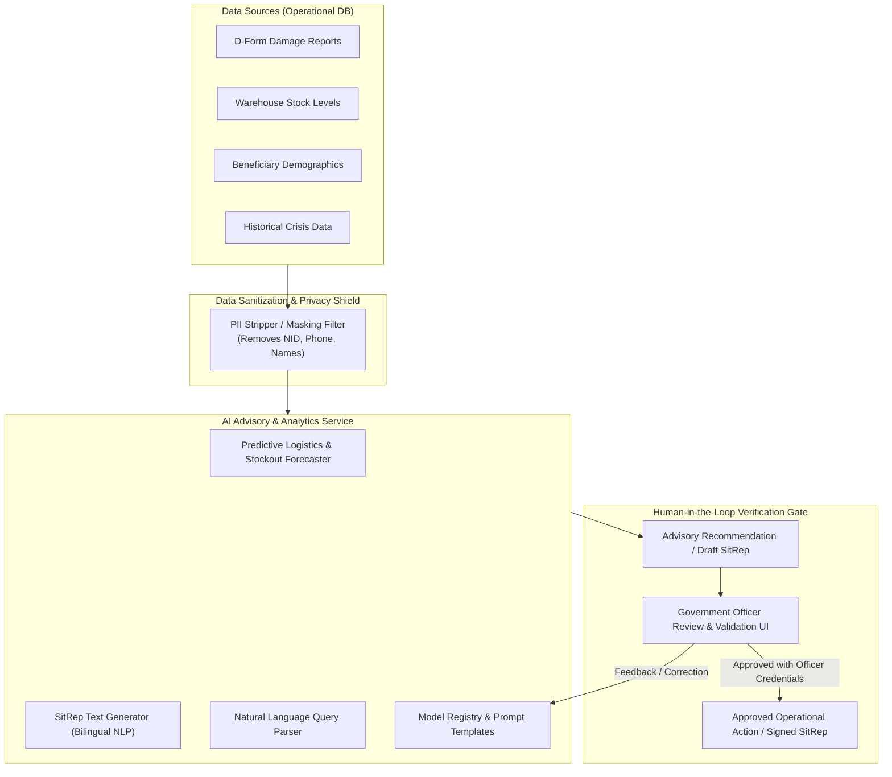

# Integrated Disaster Management System (IDMS)
## Enterprise AI Architecture & Human-in-the-Loop Decision Support

| Document Information | Details |
| :--- | :--- |
| **Document Version** | 1.0.0-PROPOSED |
| **Operational Role** | Non-Autonomous Decision Support & Analytics Copilot |
| **Human Governance** | Strict Human-in-the-Loop (HITL) - Zero Autonomous Binding Actions |
| **Compliance Standard**| Government of Bangladesh National AI Strategy / Ethical AI Principles |

---

## 1. Ethical Governance & Core Operational Principles

In strict alignment with Section 10 of `AGENTS.md`:
1. **Zero Autonomous Authority:** The AI engine **must never** autonomously approve beneficiary applications, sanction relief allocations, initiate financial disbursements, or close emergency incidents.
2. **Transparent Data Provenance:** Every AI output (such as a suggested relief allocation or an automated damage forecast) must explicitly cite the specific database tables, record IDs, time ranges, and statistical models used to generate the conclusion.
3. **Mandatory Human Signature:** AI outputs are marked as `DRAFT_ADVISORY`. A certified government officer must review, modify if necessary, and digitally sign/approve the action before it takes legal or operational effect.
4. **Audit Trail Logging:** All prompts, raw inputs, model versions, confidence scores, and user overrides (e.g. officer changing an AI recommendation) are permanently logged in `core.audit_logs`.

---

## 2. AI Architecture Topology & Pipeline

---

## 3. Core AI Feature Capabilities

### 3.1 Predictive Relief Logistics & Deficit Forecasting
- **Mechanism:** Time-series forecasting (ARIMA / Gradient Boosted Trees) trained on historical relief consumption rates during prior disaster events (e.g., Cyclone Sidr, Aila, Amphan, Remal).
- **Function:** Models projected population displacement in an affected upazila against current warehouse inventory to project commodity depletion dates (e.g., *"Upazila X will exhaust drinking water purification tablets within 72 hours under current influx rates"*).
- **Output Format:** Advisory alerts presented on the DDM logistics dashboard with visual confidence ribbons (&plusmn;15% margin).

### 3.2 Automated Bilingual Situation Report (SitRep) Drafting
- **Mechanism:** Retrieval-Augmented Generation (RAG) querying verified preliminary D-Form records, active shelter counts, and relief disbursements within the preceding 24-hour cycle.
- **Function:** Automatically generates a comprehensive, publication-ready SitRep draft in both Bangla and English, following the official MoDMR National SitRep template.
- **Review Gate:** The DDM Director of Emergency Response reviews the draft side-by-side with source records, edits discrepancies, and publishes with an official electronic signature.

### 3.3 Natural Language Search & Querying
- **Mechanism:** Translates conversational Bangla and English administrative queries into structured SQL / PostGIS queries:
  - *Query (Bangla):* "খুলনা জেলার কয়রা উপজেলার যে সকল সাইক্লোন শেল্টারে ধারণক্ষমতার বেশি লোক রয়েছে তাদের তালিকা দেখাও।"
  - *Query (English):* "List all cyclone shelters in Koyra Upazila, Khulna that exceed 100% capacity."
- **Execution:** Safely parsed into read-only SQL parameterized queries, constrained by the requesting user's administrative jurisdiction.

---

## 4. Privacy, PII Shielding & Model Isolation

1. **Strict De-Identification:** Citizen PII (NID numbers, full names, mobile numbers, bank/MFS account numbers) is stripped prior to feature engineering or model inference.
2. **On-Premise / Sovereign Deployment:** Analytical models and LLM inferences operate within the sovereign Bangladesh National Data Center (BCC) perimeter, preventing sensitive national disaster data from leaking to third-party public clouds.
