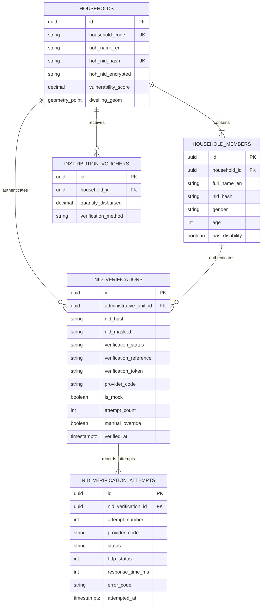
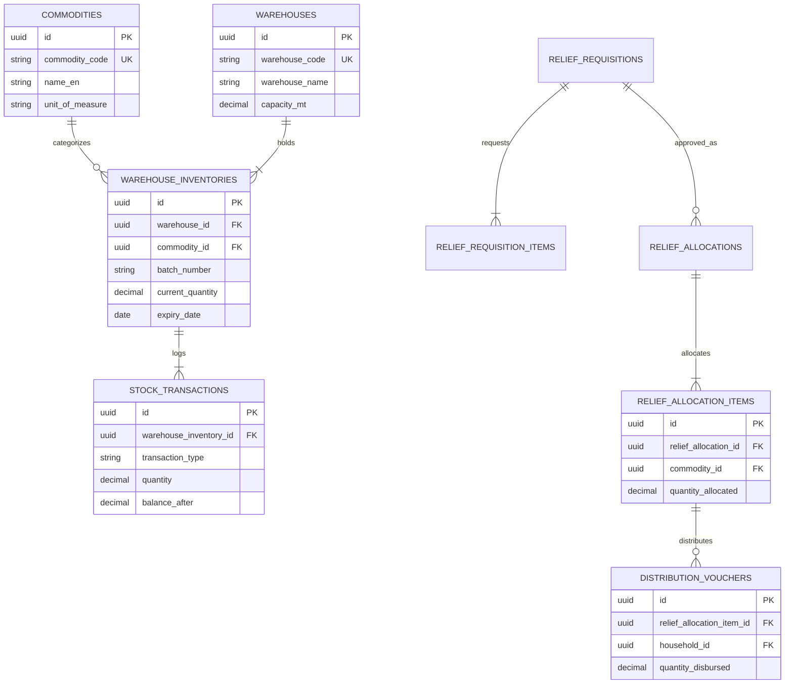
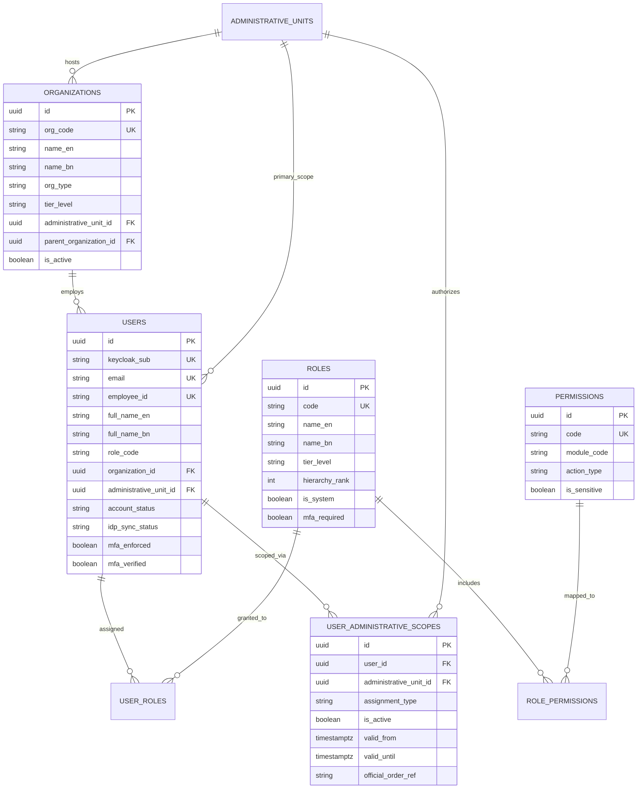

# Integrated Disaster Management System (IDMS)
## Enterprise Database Entity-Relationship Diagram (ERD) Specification

| Document Information | Details |
| :--- | :--- |
| **System** | Integrated Disaster Management System (IDMS) |
| **Document Purpose** | Complete Database Relational Schema & Entity-Relationship Modeling |
| **Target Engine** | PostgreSQL 16.x + PostGIS 3.4+ |
| **Document Version** | 1.0.0-PROPOSED |
| **Status** | Prepared for Review (No Migrations Generated) |

---

## 1. Master System Entity-Relationship Diagram (Mermaid)

The master diagram depicts all core operational entities and their foreign key constraints across IDMS:

```mermaid
erDiagram
    %% CORE ADMINISTRATIVE & SECURITY HIERARCHY
    ADMINISTRATIVE_UNITS ||--o{ ADMINISTRATIVE_UNITS : "parent_of"
    ADMINISTRATIVE_UNITS ||--o{ USERS : "assigned_jurisdiction"
    ADMINISTRATIVE_UNITS ||--o{ HOUSEHOLDS : "contains_households"
    ADMINISTRATIVE_UNITS ||--o{ SHELTERS : "located_within"
    ADMINISTRATIVE_UNITS ||--o{ WAREHOUSES : "located_within"

    %% BENEFICIARY & NID VERIFICATION
    HOUSEHOLDS ||--|{ HOUSEHOLD_MEMBERS : "has_members"
    HOUSEHOLDS ||--o{ NID_VERIFICATIONS : "verified_via"
    HOUSEHOLD_MEMBERS ||--o{ NID_VERIFICATIONS : "member_verified_via"
    ADMINISTRATIVE_UNITS ||--o{ NID_VERIFICATIONS : "scoped_to"
    NID_VERIFICATIONS ||--|{ NID_VERIFICATION_ATTEMPTS : "logs_attempts"
    HOUSEHOLDS ||--o{ DISTRIBUTION_VOUCHERS : "receives_relief"

    %% DISASTER & SHELTER MANAGEMENT
    DISASTER_CATEGORIES ||--o{ DISASTER_EVENTS : "classifies"
    DISASTER_EVENTS ||--|{ DISASTER_LOCATIONS : "affects_areas"
    ADMINISTRATIVE_UNITS ||--o{ DISASTER_LOCATIONS : "mapped_to_disaster"
    DISASTER_EVENTS ||--o| DISASTER_IMPACTS : "summarizes_impact"
    DISASTER_EVENTS ||--o{ DISASTER_WARNINGS : "issues_warnings"
    DISASTER_EVENTS ||--o{ DISASTER_TIMELINES : "tracks_history"
    DISASTER_EVENTS ||--o{ SHELTER_OCCUPANCIES : "causes_evacuation_to"
    SHELTERS ||--o{ SHELTER_OCCUPANCIES : "logs_occupancy"
    DISASTER_EVENTS ||--o{ SAR_INCIDENTS : "triggers_sar"
    DISASTER_EVENTS ||--o{ DAMAGE_ASSESSMENTS : "caused_damage"
    DISASTER_EVENTS ||--o{ RELIEF_REQUISITIONS : "triggers_requisitions"
    DISASTER_EVENTS ||--o{ PROJECTS : "rehabilitates_from"
    DISASTER_EVENTS ||--o{ RESPONSE_OPERATIONS : "triggers_operations"

    %% DISASTER RESPONSE MANAGEMENT (M05)
    ADMINISTRATIVE_UNITS ||--o{ RESPONSE_CENTERS : "hosts_eoc"
    ADMINISTRATIVE_UNITS ||--o{ RESOURCE_ASSETS : "stationed_at"
    ADMINISTRATIVE_UNITS ||--o{ RESPONSE_OPERATIONS : "scoped_operation"
    RESPONSE_CENTERS ||--o{ RESPONSE_OPERATIONS : "coordinated_from"
    RESPONSE_OPERATIONS ||--o{ RESPONSE_OPERATION_AGENCIES : "coordinates_with"
    RESPONSE_OPERATIONS ||--o{ RESPONSE_TEAMS : "deploys_teams"
    RESPONSE_OPERATIONS ||--o{ RESPONSE_TASKS : "tracks_tasks"
    RESPONSE_ACTIVITY_TYPES ||--o{ RESPONSE_TASKS : "classifies"
    RESPONSE_TEAMS ||--o{ RESPONSE_TASKS : "executes"
    RESPONSE_TASKS ||--o{ RESPONSE_TASK_ATTACHMENTS : "evidenced_by"
    RESPONSE_OPERATIONS ||--o{ RESPONSE_RESOURCE_ALLOCATIONS : "requests_or_links"
    RESOURCE_ASSETS ||--o{ RESPONSE_RESOURCE_ALLOCATIONS : "deployed_to_operation"
    RESPONSE_OPERATIONS ||--o{ RESPONSE_SITUATION_REPORTS : "receives_sitreps"

    %% RESOURCE MANAGEMENT (M07)
    RESOURCE_CATEGORIES ||--o{ RESOURCE_ASSETS : "classifies_resource"
    RESOURCE_ASSETS ||--o{ RESOURCE_ATTACHMENTS : "documented_by"
    RESOURCE_ASSETS ||--o{ RESOURCE_ALLOCATIONS : "allocated_via"
    DISASTER_EVENTS ||--o{ RESOURCE_ALLOCATIONS : "allocates_resources"
    RESPONSE_OPERATIONS ||--o{ RESOURCE_ALLOCATIONS : "deploys_resources"
    ADMINISTRATIVE_UNITS ||--o{ RESOURCE_ALLOCATIONS : "allocation_location"
    RESOURCE_ASSETS ||--o{ RESOURCE_MAINTENANCES : "serviced_via"
    RESOURCE_ASSETS ||--o{ HUMAN_RESOURCE_DEPLOYMENTS : "assigned_personnel"
    RESPONSE_TEAMS ||--o{ HUMAN_RESOURCE_DEPLOYMENTS : "assigned_team"
    RESPONSE_OPERATIONS ||--o{ HUMAN_RESOURCE_DEPLOYMENTS : "personnel_deployed_to"
    DISASTER_EVENTS ||--o{ HUMAN_RESOURCE_DEPLOYMENTS : "personnel_for_disaster"

    %% DAMAGE ASSESSMENT (D-FORM)
    DAMAGE_CATEGORIES ||--o{ DAMAGE_SECTOR_ITEMS : "categorizes"
    DAMAGE_ASSESSMENTS ||--|{ DAMAGE_SECTOR_ITEMS : "details_sector_loss"
    DAMAGE_ASSESSMENTS ||--o{ DAMAGE_LOCATIONS : "covers_areas"
    DAMAGE_ASSESSMENTS ||--o{ DAMAGE_ATTACHMENTS : "evidenced_by"
    DAMAGE_ASSESSMENTS ||--o{ DAMAGE_VERIFICATION_LOGS : "logs_verification"
    ADMINISTRATIVE_UNITS ||--o{ DAMAGE_ASSESSMENTS : "assessed_at"
    ADMINISTRATIVE_UNITS ||--o{ DAMAGE_LOCATIONS : "covered_unit"

    %% LOGISTICS, WAREHOUSING & RELIEF CHAIN
    RELIEF_CATEGORIES ||--o{ COMMODITIES : "categorizes"
    COMMODITIES ||--o{ WAREHOUSE_INVENTORIES : "stocked_as"
    WAREHOUSES ||--|{ WAREHOUSE_INVENTORIES : "stores_lots"
    WAREHOUSE_INVENTORIES ||--o{ STOCK_TRANSACTIONS : "ledger_records"
    WAREHOUSES ||--o{ STOCK_RECEIPTS : "receives_grn"
    STOCK_RECEIPTS ||--|{ STOCK_RECEIPT_ITEMS : "contains_received_items"
    COMMODITIES ||--o{ STOCK_RECEIPT_ITEMS : "received_as"
    WAREHOUSES ||--o{ WAREHOUSE_TRANSFERS : "dispatches_from"
    WAREHOUSES ||--o{ WAREHOUSE_TRANSFERS : "receives_to"
    WAREHOUSE_TRANSFERS ||--|{ WAREHOUSE_TRANSFER_ITEMS : "transfers_items"
    COMMODITIES ||--o{ WAREHOUSE_TRANSFER_ITEMS : "transferred_as"

    DISASTER_EVENTS ||--o{ RELIEF_ALLOCATIONS : "funds_allocations"
    ADMINISTRATIVE_UNITS ||--o{ RELIEF_ALLOCATIONS : "allocated_to_unit"
    DISTRIBUTION_POINTS ||--o{ RELIEF_ALLOCATIONS : "staged_at_center"
    WAREHOUSES ||--o{ RELIEF_ALLOCATIONS : "sourced_from_warehouse"

    RELIEF_REQUISITIONS ||--|{ RELIEF_REQUISITION_ITEMS : "contains_requests"
    RELIEF_REQUISITIONS ||--o{ RELIEF_ALLOCATIONS : "approved_into"
    RELIEF_ALLOCATIONS ||--|{ RELIEF_ALLOCATION_ITEMS : "contains_allocations"
    RELIEF_ALLOCATIONS ||--o{ RELIEF_ALLOCATION_BENEFICIARIES : "targets_beneficiaries"
    HOUSEHOLDS ||--o{ RELIEF_ALLOCATION_BENEFICIARIES : "eligible_for_allocation"

    COMMODITIES ||--o{ RELIEF_REQUISITION_ITEMS : "requested_commodity"
    COMMODITIES ||--o{ RELIEF_ALLOCATION_ITEMS : "allocated_commodity"
    
    RELIEF_ALLOCATION_ITEMS ||--o{ DISTRIBUTION_VOUCHERS : "disbursed_through"
    DISTRIBUTION_POINTS ||--o{ DISTRIBUTION_VOUCHERS : "handed_over_at"
    ADMINISTRATIVE_UNITS ||--o{ DISTRIBUTION_POINTS : "located_in"
    STOCK_TRANSACTIONS ||--o| DISTRIBUTION_VOUCHERS : "deducted_for_voucher"

    %% PROJECT MANAGEMENT (M06)
    PROJECT_CATEGORIES ||--o{ PROJECTS : "categorizes"
    PROJECTS ||--o{ PROJECT_LOCATIONS : "covers_sites"
    PROJECTS ||--|{ PROJECT_MILESTONES : "scheduled_in"
    PROJECTS ||--o{ PROJECT_DISBURSEMENTS : "tracks_financials"
    PROJECT_MILESTONES ||--o{ PROJECT_DISBURSEMENTS : "authorizes_payment"
    PROJECTS ||--o{ PROJECT_MONITORING_REPORTS : "inspected_by"
    PROJECTS ||--o{ PROJECT_RISKS : "logs_risks"
    ADMINISTRATIVE_UNITS ||--o{ PROJECTS : "implemented_within"

    %% VOLUNTEER & FIELD OPERATIONS
    VOLUNTEER_CATEGORIES ||--o{ SKILL_CATALOG : "groups"
    VOLUNTEER_CATEGORIES ||--o{ VOLUNTEERS : "primary_category"
    VOLUNTEER_ORGANIZATIONS ||--o{ VOLUNTEER_ORGANIZATION_COVERAGES : "covers"
    ADMINISTRATIVE_UNITS ||--o{ VOLUNTEER_ORGANIZATION_COVERAGES : "covered_by"
    VOLUNTEER_ORGANIZATIONS ||--o{ VOLUNTEERS : "affiliated_with"
    VOLUNTEERS ||--o{ VOLUNTEER_SKILL_ASSIGNMENTS : "possesses_skills"
    SKILL_CATALOG ||--o{ VOLUNTEER_SKILL_ASSIGNMENTS : "categorized_by"
    VOLUNTEERS ||--o{ VOLUNTEER_VERIFICATION_LOGS : "verification_audit"
    VOLUNTEERS ||--o{ VOLUNTEER_DEPLOYMENTS : "mobilized_into"
    DISASTER_EVENTS ||--o{ VOLUNTEER_DEPLOYMENTS : "mobilized_for"
    VOLUNTEER_DEPLOYMENTS ||--o{ VOLUNTEER_ATTENDANCES : "logs_attendance"
    VOLUNTEER_TRAINING_PROGRAMS ||--o{ VOLUNTEER_TRAINING_SESSIONS : "scheduled_as"
    VOLUNTEER_TRAINING_SESSIONS ||--o{ VOLUNTEER_TRAINING_ENROLLMENTS : "enrolls"
    VOLUNTEERS ||--o{ VOLUNTEER_TRAINING_ENROLLMENTS : "attends_and_certified"

    %% WORKFLOW ENGINE (MODULE 11)
    WORKFLOW_DEFINITIONS ||--|{ WORKFLOW_STAGES : "configures"
    WORKFLOW_STAGES ||--|{ WORKFLOW_STAGE_ASSIGNMENTS : "assigns"
    WORKFLOW_DEFINITIONS ||--o{ WORKFLOW_DELEGATIONS : "delegates"
    WORKFLOW_DEFINITIONS ||--o{ WORKFLOW_INSTANCES : "instantiates"
    WORKFLOW_INSTANCES ||--|{ WORKFLOW_STAGE_TASKS : "tracks_tasks"
    WORKFLOW_INSTANCES ||--|{ WORKFLOW_TRANSITIONS : "progresses_via"
    WORKFLOW_INSTANCES ||--o{ WORKFLOW_ATTACHMENTS : "attaches"
    WORKFLOW_INSTANCES ||--o{ WORKFLOW_NOTIFICATIONS : "notifies"
    RELIEF_REQUISITIONS ||--o{ WORKFLOW_INSTANCES : "governed_by"
    DAMAGE_ASSESSMENTS ||--o{ WORKFLOW_INSTANCES : "governed_by"
    PROJECT_DISBURSEMENTS ||--o{ WORKFLOW_INSTANCES : "governed_by"

    %% NOTIFICATIONS & ALERTS (MODULE 13), DOCUMENTS & AUDIT
    USERS ||--o{ NOTIFICATIONS : "creates_notice"
    ADMINISTRATIVE_UNITS ||--o{ NOTIFICATIONS : "targets_area"
    NOTIFICATION_TEMPLATES ||--o{ NOTIFICATIONS : "instantiates"
    NOTIFICATIONS ||--|{ NOTIFICATION_DISPATCHES : "delivers_via"
    USERS ||--o{ NOTIFICATION_DISPATCHES : "receives_notice"
    NOTIFICATION_TEMPLATES ||--o{ NOTIFICATION_DISPATCHES : "instantiated_from"
    ADMINISTRATIVE_UNITS ||--o{ ALERT_RULES : "scopes_rule"
    ALERT_RULES ||--o{ ALERTS : "triggers"
    ADMINISTRATIVE_UNITS ||--o{ ALERTS : "impacts_unit"
    USERS ||--o{ ALERTS : "acknowledges_resolves"
    USERS ||--o{ NOTIFICATION_PREFERENCES : "configures_channels"
    USERS ||--o{ NOTIFICATION_DEVICES : "registers_push_device"
    USERS ||--o{ DOCUMENTS : "uploaded_by"
    USERS ||--o{ AUDIT_LOGS : "performed_by"

    %% ENTITY ATTRIBUTE DEFINITIONS
    ADMINISTRATIVE_UNITS {
        uuid id PK
        uuid parent_id FK
        string code UK
        string name_en
        string name_bn
        string tier_level
        string ancestry_path
        geometry_multipolygon boundary_geom
    }

    USERS {
        uuid id PK
        string keycloak_sub UK
        string email UK
        string full_name_en
        string role_code
        uuid administrative_unit_id FK
        boolean is_active
    }

    HOUSEHOLDS {
        uuid id PK
        string household_code UK
        uuid administrative_unit_id FK
        string hoh_name_en
        string hoh_name_bn
        string hoh_nid_hash UK
        string hoh_nid_encrypted
        decimal vulnerability_score
        geometry_point dwelling_geom
    }

    HOUSEHOLD_MEMBERS {
        uuid id PK
        uuid household_id FK
        string full_name_en
        string full_name_bn
        string nid_hash
        string gender
        int age
        boolean has_disability
    }

    NID_VERIFICATIONS {
        uuid id PK
        uuid household_id FK
        uuid household_member_id FK
        uuid administrative_unit_id FK
        string nid_hash
        string nid_masked
        date date_of_birth
        string verification_status
        string verification_reference
        string verification_token
        string provider_code
        boolean is_mock
        int attempt_count
        boolean manual_override
        uuid requested_by_user_id FK
        uuid reviewed_by_user_id FK
        timestamptz verified_at
        timestamptz reviewed_at
    }

    NID_VERIFICATION_ATTEMPTS {
        uuid id PK
        uuid nid_verification_id FK
        int attempt_number
        string provider_code
        string status
        int http_status
        int response_time_ms
        string error_code
        timestamptz attempted_at
    }

    DISASTER_CATEGORIES {
        uuid id PK
        string code UK
        string name_en
        string name_bn
        json subtypes
        boolean is_active
    }

    DISASTER_EVENTS {
        uuid id PK
        uuid category_id FK
        string disaster_code UK
        string name_en
        string name_bn
        string disaster_type
        string subtype
        string severity_level
        string lifecycle_phase
        timestamptz declaration_date
        date start_date
        date end_date
        decimal epicenter_lat
        decimal epicenter_lng
        geometry_point location_geom
        geometry_multipolygon affected_zone_geom
        boolean is_national
        boolean is_emergency_declared
    }

    DISASTER_LOCATIONS {
        uuid id PK
        uuid disaster_event_id FK
        uuid administrative_unit_id FK
        decimal latitude
        decimal longitude
        string severity_override
    }

    DISASTER_IMPACTS {
        uuid id PK
        uuid disaster_event_id FK
        int affected_population
        int affected_households
        int deaths_count
        int injured_count
        int missing_count
        int damaged_houses_fully
        int damaged_houses_partially
        int damaged_infrastructure_count
        decimal agricultural_loss_bdt
        int livestock_loss_count
        decimal total_economic_loss_bdt
    }

    DISASTER_WARNINGS {
        uuid id PK
        uuid disaster_event_id FK
        string warning_level
        string title_en
        string title_bn
        string issuing_authority
        timestamptz issued_at
        timestamptz expires_at
        string status
    }

    DISASTER_TIMELINES {
        uuid id PK
        uuid disaster_event_id FK
        string event_type
        string from_phase
        string to_phase
        string title_en
        string attachment_path
        uuid recorded_by FK
        timestamptz occurred_at
    }

    SHELTERS {
        uuid id PK
        uuid administrative_unit_id FK
        string shelter_code UK
        string shelter_name_en
        int capacity_persons
        int capacity_livestock
        geometry_point location_geom
    }

    SHELTER_OCCUPANCIES {
        uuid id PK
        uuid shelter_id FK
        uuid disaster_event_id FK
        int current_men
        int current_women
        int current_children
        timestamptz recorded_at
    }

    RESPONSE_ACTIVITY_TYPES {
        uuid id PK
        string code UK
        string name_en
        string name_bn
        boolean is_system
        boolean is_active
    }

    RESPONSE_CENTERS {
        uuid id PK
        uuid administrative_unit_id FK
        string center_code UK
        string center_type
        string name_en
        string name_bn
        decimal latitude
        decimal longitude
        geometry_point location_geom
    }

    RESOURCE_CATEGORIES {
        uuid id PK
        string code UK
        string name_en
        string name_bn
        boolean is_human_resource
        boolean is_system
        boolean is_active
    }

    RESOURCE_ASSETS {
        uuid id PK
        uuid category_id FK
        uuid administrative_unit_id FK
        string asset_code UK
        string asset_type
        string resource_type
        string name_en
        string name_bn
        string owning_organization
        string current_location
        string responsible_officer_name
        uuid responsible_user_id FK
        date acquisition_date
        decimal acquisition_value_bdt
        date next_maintenance_due_at
        string status
        geometry_point location_geom
    }

    RESOURCE_ATTACHMENTS {
        uuid id PK
        uuid resource_asset_id FK
        string attachment_kind
        string original_name
        string storage_path
        string sha256_hash
    }

    RESOURCE_ALLOCATIONS {
        uuid id PK
        uuid resource_asset_id FK
        uuid disaster_event_id FK
        uuid response_operation_id FK
        uuid administrative_unit_id FK
        string allocation_no UK
        string allocation_location
        date assignment_date
        date expected_return_date
        date actual_return_date
        string responsible_officer_name
        string status
        geometry_point location_geom
    }

    RESOURCE_MAINTENANCES {
        uuid id PK
        uuid resource_asset_id FK
        uuid administrative_unit_id FK
        string maintenance_no UK
        string record_type
        string title
        date scheduled_date
        date performed_date
        date next_due_date
        string inspection_result
        decimal repair_cost_bdt
        string status
        string attachment_path
    }

    HUMAN_RESOURCE_DEPLOYMENTS {
        uuid id PK
        uuid resource_asset_id FK
        uuid user_id FK
        uuid response_team_id FK
        uuid response_operation_id FK
        uuid disaster_event_id FK
        uuid administrative_unit_id FK
        string deployment_no UK
        string personnel_name
        text assigned_duty
        date deployment_start_date
        date deployment_end_date
        date actual_return_date
        string availability_status
    }

    RESPONSE_OPERATIONS {
        uuid id PK
        uuid disaster_event_id FK
        uuid administrative_unit_id FK
        uuid response_center_id FK
        string operation_no UK
        string title_en
        string title_bn
        string priority
        string severity_level
        string status
        date start_date
        date expected_completion_date
    }

    RESPONSE_OPERATION_AGENCIES {
        uuid id PK
        uuid response_operation_id FK
        string agency_name
        string agency_type
        string role_summary
        string coordination_status
    }

    RESPONSE_TEAMS {
        uuid id PK
        uuid response_operation_id FK
        uuid administrative_unit_id FK
        string team_code UK
        string team_name
        string agency_name
        string team_type
        int member_count
        string status
        decimal latitude
        decimal longitude
        geometry_point location_geom
    }

    RESPONSE_TASKS {
        uuid id PK
        uuid response_operation_id FK
        uuid activity_type_id FK
        uuid response_team_id FK
        uuid assigned_user_id FK
        string task_code UK
        string title_en
        string title_bn
        string priority
        string status
        int progress_percentage
        timestamptz deadline_at
    }

    RESPONSE_TASK_ATTACHMENTS {
        uuid id PK
        uuid response_task_id FK
        string original_name
        string storage_path
        string sha256_hash
    }

    RESPONSE_RESOURCE_ALLOCATIONS {
        uuid id PK
        uuid response_operation_id FK
        uuid resource_asset_id FK
        string requirement_title
        decimal quantity_needed
        decimal quantity_assigned
        string status
    }

    RESPONSE_SITUATION_REPORTS {
        uuid id PK
        uuid response_operation_id FK
        uuid disaster_event_id FK
        uuid administrative_unit_id FK
        string report_no UK
        string report_type
        int casualties_injured
        int casualties_missing
        int casualties_fatalities
        int rescued_count
        string privacy_level
        decimal latitude
        decimal longitude
        geometry_point location_geom
        timestamptz reported_at
    }

    DAMAGE_CATEGORIES {
        uuid id PK
        string code UK
        string name_en
        string name_bn
        string default_unit
        boolean is_system
        boolean is_active
    }

    DAMAGE_ASSESSMENTS {
        uuid id PK
        uuid disaster_event_id FK
        uuid administrative_unit_id FK
        string d_form_code UK
        string assessment_type
        date assessment_date
        string assessing_organization
        string severity_level
        string verification_status
        int affected_households
        int affected_population
        decimal total_estimated_loss_bdt
        string client_uuid UK
        string idempotency_key UK
        string sync_status
        geometry_point location_geom
        geometry_multipolygon damage_area_geom
    }

    DAMAGE_LOCATIONS {
        uuid id PK
        uuid damage_assessment_id FK
        uuid administrative_unit_id FK
        string ward_no
        int affected_households
        string severity_level
        geometry_point location_geom
    }

    DAMAGE_SECTOR_ITEMS {
        uuid id PK
        uuid damage_assessment_id FK
        uuid category_id FK
        string sector_code
        int fully_damaged_count
        int partially_damaged_count
        int minor_damaged_count
        decimal estimated_loss_bdt
    }

    DAMAGE_ATTACHMENTS {
        uuid id PK
        uuid damage_assessment_id FK
        string attachment_kind
        string original_name
        string storage_path
        string sha256_hash
    }

    DAMAGE_VERIFICATION_LOGS {
        uuid id PK
        uuid damage_assessment_id FK
        string action
        string from_status
        string to_status
        uuid actor_id FK
    }

    RELIEF_CATEGORIES {
        uuid id PK
        string code UK
        string name_en
        string name_bn
        boolean is_system
        boolean is_active
    }

    COMMODITIES {
        uuid id PK
        uuid relief_category_id FK
        string commodity_code UK
        string name_en
        string name_bn
        string category
        string unit_of_measure
        text description
        decimal minimum_stock_level
        boolean is_perishable
        boolean is_active
        uuid created_by FK
        uuid updated_by FK
    }

    WAREHOUSES {
        uuid id PK
        uuid administrative_unit_id FK
        string warehouse_code UK
        string warehouse_name
        string warehouse_name_bn
        string tier
        string warehouse_type
        string owning_organization
        string responsible_officer_name
        string responsible_officer_contact
        uuid responsible_user_id FK
        text address
        string contact_phone
        string contact_email
        decimal capacity_mt
        decimal latitude
        decimal longitude
        geometry_point location_geom
        uuid created_by FK
        uuid updated_by FK
    }

    WAREHOUSE_INVENTORIES {
        uuid id PK
        uuid warehouse_id FK
        uuid commodity_id FK
        string batch_number
        decimal opening_quantity
        decimal current_quantity
        decimal reserved_quantity
        decimal damaged_quantity
        decimal expired_quantity
        decimal unit_cost_bdt
        date expiry_date
        string status
        text notes
    }

    STOCK_TRANSACTIONS {
        uuid id PK
        uuid warehouse_inventory_id FK
        uuid warehouse_id FK
        uuid commodity_id FK
        uuid warehouse_transfer_id FK
        uuid stock_receipt_id FK
        string transaction_type
        string reference_type
        string reason_code
        decimal quantity
        decimal balance_after
        string reference_voucher_no
        string idempotency_key UK
        uuid relief_allocation_item_id FK
        uuid distribution_voucher_id FK
        uuid approved_by FK
        uuid created_by FK
    }

    STOCK_RECEIPTS {
        uuid id PK
        string receipt_no UK
        uuid warehouse_id FK
        string supplier_name
        string supplier_contact
        string purchase_order_no
        date received_date
        string status
        string attachment_path
        string attachment_sha256
        string idempotency_key UK
        uuid received_by FK
        uuid verified_by FK
    }

    STOCK_RECEIPT_ITEMS {
        uuid id PK
        uuid stock_receipt_id FK
        uuid commodity_id FK
        string batch_number
        decimal quantity_received
        decimal unit_cost_bdt
        date expiry_date
        uuid warehouse_inventory_id FK
    }

    WAREHOUSE_TRANSFERS {
        uuid id PK
        string transfer_no UK
        uuid source_warehouse_id FK
        uuid destination_warehouse_id FK
        string status
        date requested_date
        string vehicle_info
        string idempotency_key UK
        uuid requested_by FK
        uuid approved_by FK
        uuid dispatched_by FK
        uuid received_by FK
    }

    WAREHOUSE_TRANSFER_ITEMS {
        uuid id PK
        uuid warehouse_transfer_id FK
        uuid commodity_id FK
        string batch_number
        decimal quantity_requested
        decimal quantity_dispatched
        decimal quantity_received
        decimal unit_cost_bdt
        date expiry_date
    }

    RELIEF_REQUISITIONS {
        uuid id PK
        uuid disaster_event_id FK
        uuid administrative_unit_id FK
        string requisition_no UK
        string requesting_organization
        int estimated_beneficiaries
        string priority
        date request_date
        string status
        string supporting_doc_path
        timestamptz submitted_at
    }

    RELIEF_REQUISITION_ITEMS {
        uuid id PK
        uuid relief_requisition_id FK
        uuid commodity_id FK
        decimal quantity_requested
        decimal quantity_approved
    }

    RELIEF_ALLOCATIONS {
        uuid id PK
        uuid relief_requisition_id FK
        uuid disaster_event_id FK
        uuid administrative_unit_id FK
        uuid distribution_point_id FK
        uuid warehouse_id FK
        string allocation_order_no UK
        string status
        timestamptz scheduled_start_at
        timestamptz scheduled_end_at
        timestamptz approved_at
    }

    RELIEF_ALLOCATION_ITEMS {
        uuid id PK
        uuid relief_allocation_id FK
        uuid commodity_id FK
        decimal quantity_allocated
        decimal quantity_distributed
        decimal quantity_cancelled
    }

    RELIEF_ALLOCATION_BENEFICIARIES {
        uuid id PK
        uuid relief_allocation_id FK
        uuid household_id FK
        string selection_status
    }

    DISTRIBUTION_POINTS {
        uuid id PK
        uuid administrative_unit_id FK
        string point_code UK
        string point_name
        string point_name_bn
        decimal latitude
        decimal longitude
        geometry_point location_geom
    }

    DISTRIBUTION_VOUCHERS {
        uuid id PK
        uuid relief_allocation_item_id FK
        uuid household_id FK
        uuid distribution_point_id FK
        string voucher_no UK
        string idempotency_key UK
        decimal quantity_disbursed
        string verification_method
        string acknowledgment_signature
        string photo_evidence_path
        decimal distribution_lat
        decimal distribution_lng
        boolean duplicate_override
        text duplicate_override_reason
        timestamptz distributed_at
        boolean is_voided
    }

    PROJECTS {
        uuid id PK
        uuid category_id FK
        uuid disaster_event_id FK
        uuid administrative_unit_id FK
        string project_code UK
        string reference_no UK
        string title_en
        string title_bn
        decimal approved_budget_bdt
        decimal revised_budget_bdt
        decimal released_funds_bdt
        decimal expenditure_bdt
        decimal physical_progress_pct
        decimal financial_progress_pct
        string status
        boolean is_delayed
    }

    PROJECT_MILESTONES {
        uuid id PK
        uuid project_id FK
        uuid parent_milestone_id FK
        string wbs_code
        string milestone_title
        string item_type
        decimal weight_percentage
        decimal target_percentage
        decimal completion_percentage
        string approval_status
    }

    PROJECT_DISBURSEMENTS {
        uuid id PK
        uuid project_id FK
        uuid project_milestone_id FK
        string record_type
        string voucher_no UK
        decimal amount_bdt
        string payment_status
        timestamptz disbursed_at
    }

    VOLUNTEER_CATEGORIES {
        uuid id PK
        string code UK
        string name_en
        string name_bn
        boolean is_active
    }

    VOLUNTEER_ORGANIZATIONS {
        uuid id PK
        string org_code UK
        string name_en
        string org_type
        uuid administrative_unit_id FK
        string verification_status
    }

    VOLUNTEER_ORGANIZATION_COVERAGES {
        uuid id PK
        uuid organization_id FK
        uuid administrative_unit_id FK
    }

    VOLUNTEERS {
        uuid id PK
        uuid administrative_unit_id FK
        uuid organization_id FK
        uuid primary_category_id FK
        string volunteer_code UK
        string nid_hash UK
        string full_name_en
        string full_name_bn
        string mobile_encrypted
        string overall_verification_status
        string availability_status
    }

    SKILL_CATALOG {
        uuid id PK
        uuid category_id FK
        string skill_code UK
        string name_en
        string name_bn
    }

    VOLUNTEER_SKILL_ASSIGNMENTS {
        uuid id PK
        uuid volunteer_id FK
        uuid skill_id FK
        string proficiency_level
        string certification_level
        string verification_status
    }

    VOLUNTEER_VERIFICATION_LOGS {
        uuid id PK
        uuid volunteer_id FK
        string pillar
        string action
        string to_status
        uuid actor_user_id FK
    }

    VOLUNTEER_DEPLOYMENTS {
        uuid id PK
        string deployment_no UK
        uuid volunteer_id FK
        uuid disaster_event_id FK
        uuid response_operation_id FK
        uuid administrative_unit_id FK
        string assigned_role
        string deployment_status
        date start_date
        date end_date
    }

    VOLUNTEER_ATTENDANCES {
        uuid id PK
        uuid deployment_id FK
        uuid volunteer_id FK
        date attendance_date
        timestamptz check_in_at
        timestamptz check_out_at
        integer duration_minutes
        boolean gps_consent_given
        string confirmation_status
    }

    VOLUNTEER_TRAINING_PROGRAMS {
        uuid id PK
        string program_code UK
        string title_en
        string provider_name
        integer duration_hours
    }

    VOLUNTEER_TRAINING_SESSIONS {
        uuid id PK
        string session_code UK
        uuid program_id FK
        uuid administrative_unit_id FK
        date start_date
        date end_date
        string status
    }

    VOLUNTEER_TRAINING_ENROLLMENTS {
        uuid id PK
        uuid session_id FK
        uuid volunteer_id FK
        string enrollment_status
        boolean passed
        string certificate_no UK
    }

    WORKFLOW_DEFINITIONS {
        uuid id PK
        string code UK
        string module_code
        string entity_type
        boolean is_active
        boolean allow_self_approval
        integer sla_hours
    }

    WORKFLOW_STAGES {
        uuid id PK
        uuid workflow_definition_id FK
        integer stage_order
        string stage_code
        string approval_level
        string execution_mode
        integer required_approvals
        integer sla_hours
    }

    WORKFLOW_STAGE_ASSIGNMENTS {
        uuid id PK
        uuid workflow_stage_id FK
        string assignee_type
        uuid user_id FK
        string role_code
        uuid administrative_unit_id FK
        string authority_type
    }

    WORKFLOW_DELEGATIONS {
        uuid id PK
        uuid workflow_definition_id FK
        uuid delegator_user_id FK
        uuid delegate_user_id FK
        timestamptz valid_from
        timestamptz valid_until
        boolean is_active
    }

    WORKFLOW_INSTANCES {
        uuid id PK
        string instance_no UK
        uuid workflow_definition_id FK
        string module_code
        string entity_type
        uuid entity_id
        uuid administrative_unit_id FK
        uuid current_stage_id FK
        string current_state
        timestamptz due_at
    }

    WORKFLOW_STAGE_TASKS {
        uuid id PK
        uuid workflow_instance_id FK
        uuid workflow_stage_id FK
        uuid assignee_user_id FK
        string assignee_role_code
        string status
    }

    WORKFLOW_TRANSITIONS {
        uuid id PK
        uuid workflow_instance_id FK
        string action
        string from_state
        string to_state
        uuid action_by_user_id FK
        uuid acted_on_behalf_of_user_id FK
        text remarks
        timestamptz transitioned_at
    }

    WORKFLOW_ATTACHMENTS {
        uuid id PK
        uuid workflow_instance_id FK
        string original_name
        string sha256_hash
    }

    WORKFLOW_NOTIFICATIONS {
        uuid id PK
        uuid workflow_instance_id FK
        string notification_type
        uuid recipient_user_id FK
        string delivery_status
    }

    NOTIFICATION_TEMPLATES {
        uuid id PK
        string template_code UK
        string category
        string channel
        string default_severity
        string title_bn
        string title_en
        text body_bn
        text body_en
        jsonb variables
        boolean is_system
        boolean is_active
    }

    NOTIFICATIONS {
        uuid id PK
        string notification_no UK
        uuid template_id FK
        string category
        string severity
        string priority
        jsonb channels
        string target_type
        jsonb target_criteria
        uuid administrative_unit_id FK
        string status
        string idempotency_key UK
        timestamptz scheduled_at
        timestamptz dispatched_at
        uuid created_by FK
    }

    NOTIFICATION_DISPATCHES {
        uuid id PK
        uuid notification_id FK
        uuid template_id FK
        uuid recipient_user_id FK
        string channel
        string destination_address
        string delivery_status
        string provider_name
        string provider_reference
        integer attempt_count
        timestamptz read_at
        timestamptz dispatched_at
        timestamptz delivered_at
    }

    ALERT_RULES {
        uuid id PK
        string rule_code UK
        string category
        string event_type
        string severity
        jsonb condition_config
        jsonb channels
        integer escalation_delay_minutes
        string escalation_role_code
        uuid administrative_unit_id FK
        boolean is_active
    }

    ALERTS {
        uuid id PK
        string alert_no UK
        uuid alert_rule_id FK
        string category
        string severity
        string status
        string source_module
        string source_entity_type
        uuid source_entity_id
        uuid administrative_unit_id FK
        timestamptz triggered_at
        uuid acknowledged_by FK
        timestamptz acknowledged_at
        timestamptz escalated_at
        uuid resolved_by FK
        timestamptz resolved_at
    }

    NOTIFICATION_PREFERENCES {
        uuid id PK
        uuid user_id FK
        string category
        boolean in_app_enabled
        boolean email_enabled
        boolean sms_enabled
        boolean push_enabled
        boolean policy_locked
    }

    NOTIFICATION_DEVICES {
        uuid id PK
        uuid user_id FK
        string device_uuid
        string platform
        string push_provider
        text push_token_encrypted
        string push_token_hash
        boolean is_active
        timestamptz last_seen_at
    }

    DOCUMENTS {
        uuid id PK
        string entity_type
        uuid entity_id
        string original_filename
        string file_hash_sha256
        string mime_type
        bigint file_size_bytes
        string storage_path
        string scan_status
    }

    AUDIT_LOGS {
        uuid id PK
        uuid user_id FK
        string action_name
        string auditable_type
        uuid auditable_id
        jsonb old_values
        jsonb new_values
        string ip_address
        timestamptz created_at
    }
```

---

## 2. Relational Cardinality & Cascade Integrity Rules

The table below defines relational integrity constraints, foreign key cascades, and operational behaviors:

| Parent Table | Child Table | Foreign Key Column | Delete Cascade Policy | Business Justification |
| :--- | :--- | :--- | :--- | :--- |
| `core.administrative_units` | `core.administrative_units` | `parent_id` | `RESTRICT` | Prevent orphaned administrative regions |
| `core.administrative_units` | `core.users` | `administrative_unit_id` | `RESTRICT` | Prohibit deleting jurisdictions with active officers |
| `core.administrative_units` | `beneficiary.households` | `administrative_unit_id` | `RESTRICT` | Citizen registry records must preserve historical jurisdiction |
| `beneficiary.households` | `beneficiary.household_members` | `household_id` | `CASCADE` | Deleting a household deletes its dependent members |
| `core.administrative_units` | `beneficiary.nid_verifications` | `administrative_unit_id` | `SET NULL` | Retains verification audit record while enforcing jurisdictional scoping |
| `beneficiary.nid_verifications` | `beneficiary.nid_verification_attempts` | `nid_verification_id` | `CASCADE` | Provider attempt logs belong to parent verification transaction |
| `disaster.disaster_events` | `disaster.shelter_occupancies` | `disaster_event_id` | `RESTRICT` | Historical disaster shelter usage cannot be dropped |
| `disaster.shelters` | `disaster.shelter_occupancies` | `shelter_id` | `RESTRICT` | Preserves shelter occupancy audit history |
| `disaster.disaster_events` | `damage.damage_assessments` | `disaster_event_id` | `RESTRICT` | D-Form damage assessments are legally binding government records |
| `damage.damage_assessments`| `damage.damage_sector_items` | `damage_assessment_id` | `CASCADE` | Sector breakdown items belong entirely to parent assessment |
| `logistics.warehouses` | `logistics.warehouse_inventories`| `warehouse_id` | `RESTRICT` | Warehouse cannot be deleted while inventory balances exist |
| `logistics.commodities` | `logistics.warehouse_inventories`| `commodity_id` | `RESTRICT` | Commodity definition locked if referenced in stock |
| `logistics.warehouse_inventories`| `logistics.stock_transactions`| `warehouse_inventory_id`| `RESTRICT` | Financial/commodity stock ledgers must be immutable |
| `logistics.relief_requisitions`| `logistics.relief_requisition_items`| `relief_requisition_id`| `CASCADE` | Deleting draft requisition removes line items |
| `logistics.relief_requisitions`| `logistics.relief_allocations` | `relief_requisition_id` | `RESTRICT` | Approved allocations cannot lose parent requisition reference |
| `logistics.relief_allocations` | `logistics.relief_allocation_items` | `relief_allocation_id` | `CASCADE` | Allocation line items belong to parent sanction order |
| `logistics.relief_allocation_items`| `distribution.distribution_vouchers`| `relief_allocation_item_id`| `RESTRICT` | Distribution vouchers are official receipts; must preserve link |
| `beneficiary.households` | `distribution.distribution_vouchers`| `household_id` | `RESTRICT` | Retains lifelong aid delivery records for citizen |
| `project.projects` | `project.project_milestones` | `project_id` | `CASCADE` | Milestones cascade with project definition |
| `project.project_milestones` | `project.project_disbursements` | `project_milestone_id`| `RESTRICT` | Prohibits deleting milestone once money has been disbursed |
| `volunteer.volunteers` | `volunteer.volunteer_skill_assignments`| `volunteer_id` | `CASCADE` | Volunteer skill associations cascade with volunteer |
| `workflow.workflow_instances`| `workflow.workflow_transitions`| `workflow_instance_id`| `RESTRICT` | Workflow historical transitions are permanent audit records |
| `core.users` | `audit.audit_logs` | `user_id` | `SET NULL` | Preserves audit record if user account is deactivated/purged |

---

## 3. Sub-Domain Architectural ERD Views

### 3.1 Citizen Identity & Beneficiary Verification Sub-Domain


### 3.2 Logistics, Warehouse & Relief Chain Sub-Domain


### 3.3 User Management, RBAC & Organizational Scoping Sub-Domain (`core.*`)

