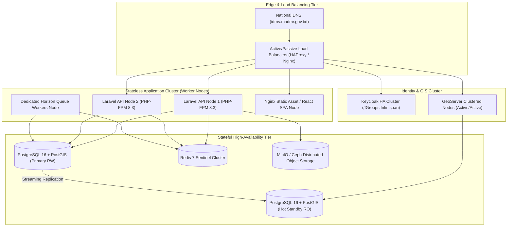

# Integrated Disaster Management System (IDMS)
## Enterprise Deployment Guide & Infrastructure Architecture

| Document Information | Details |
| :--- | :--- |
| **Document Version** | 1.0.0-PROPOSED |
| **Target Infrastructure** | On-Premise Government Cloud (BCC National Data Center) / OCI Containers |
| **Container Runtime** | Docker Engine 26+ / Kubernetes 1.29+ / Docker Compose v2 |
| **Operating System** | Rocky Linux 9 / Ubuntu Server 22.04 LTS / Windows Server 2022 |

---

## 1. High-Availability Production Topology

The production architecture separates stateless compute nodes from stateful data stores with full redundancy:



---

## 2. Local Development Environment Architecture (Docker Compose)

To ensure developer parity on Windows workstations (e.g. running under `C:\wamp64\www\IDMS`) while adhering strictly to PostgreSQL, PostGIS, Keycloak, and GeoServer standards:

### 2.1 Compose Service Manifest (`deployment/docker-compose.dev.yml`)
```yaml
version: '3.8'

services:
  postgres:
    image: postgis/postgis:16-3.4
    container_name: idms_postgres
    restart: always
    environment:
      POSTGRES_DB: idms_db
      POSTGRES_USER: idms_user
      POSTGRES_PASSWORD: idms_secret_password
    ports:
      - "5432:5432"
    volumes:
      - postgres_data:/var/lib/postgresql/data
      - ../database/init:/docker-entrypoint-initdb.d

  redis:
    image: redis:7.2-alpine
    container_name: idms_redis
    restart: always
    ports:
      - "6379:6379"
    volumes:
      - redis_data:/data

  keycloak:
    image: quay.io/keycloak/keycloak:24.0
    container_name: idms_keycloak
    command: start-dev
    environment:
      KEYCLOAK_ADMIN: admin
      KEYCLOAK_ADMIN_PASSWORD: admin_secret_password
      KC_DB: postgres
      KC_DB_URL: jdbc:postgresql://postgres:5432/idms_db
      KC_DB_USERNAME: idms_user
      KC_DB_PASSWORD: idms_secret_password
      KC_DB_SCHEMA: keycloak
    ports:
      - "8080:8080"
    depends_on:
      - postgres

  geoserver:
    image: kartoza/geoserver:2.25.0
    container_name: idms_geoserver
    restart: always
    environment:
      GEOSERVER_ADMIN_PASSWORD: geoserver_secret_password
      INITIAL_MEMORY: 1G
      MAXIMUM_MEMORY: 2G
    ports:
      - "8081:8080"
    volumes:
      - geoserver_data:/opt/geoserver/data_dir
    depends_on:
      - postgres

volumes:
  postgres_data:
  redis_data:
  geoserver_data:
```

---

## 3. Environment Variable Standards & Configuration

Strict configuration enforcement via `.env` files:
- `APP_ENV=production` / `APP_DEBUG=false`
- `DB_CONNECTION=pgsql`
- `DB_HOST=postgres`
- `DB_PORT=5432`
- `DB_DATABASE=idms_db`
- `DB_USERNAME=idms_app_user`
- `DB_PASSWORD=<STRONG_ROTATING_SECRET>`
- `KEYCLOAK_BASE_URL=https://auth.modmr.gov.bd`
- `KEYCLOAK_REALM=idms-gov-realm`
- `KEYCLOAK_CLIENT_ID=idms-backend-api`
- `GEOSERVER_URL=https://gis.modmr.gov.bd/geoserver`
- `NID_VERIFICATION_ADAPTER=mock` (in staging/dev) or `porichoy_live` (in production)
- `SMS_GATEWAY_ADAPTER=mock` (in dev) or `teletalk_live` (in production)

---

## 4. Database Initialization & Migration Sequence

When provisioning new environments:
1. Initialize PostgreSQL database and enable extensions:
   ```sql
   CREATE EXTENSION IF NOT EXISTS "uuid-ossp";
   CREATE EXTENSION IF NOT EXISTS "postgis";
   CREATE EXTENSION IF NOT EXISTS "pgcrypto";
   ```
2. Create dedicated schemas:
   ```sql
   CREATE SCHEMA IF NOT EXISTS core;
   CREATE SCHEMA IF NOT EXISTS beneficiary;
   CREATE SCHEMA IF NOT EXISTS disaster;
   CREATE SCHEMA IF NOT EXISTS logistics;
   CREATE SCHEMA IF NOT EXISTS volunteer;
   CREATE SCHEMA IF NOT EXISTS analytics;
   ```
3. Run Laravel migrations sequentially per approved module roadmap.
4. Execute base seeders for Bangladesh Administrative Boundaries (`Division`, `District`, `Upazila`, `Union`).
