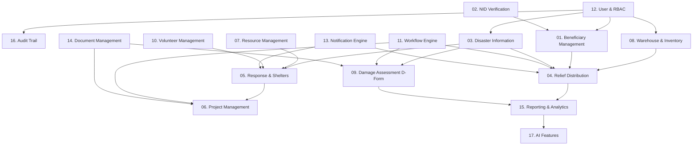

# Integrated Disaster Management System (IDMS)
## Enterprise Development Roadmap, Dependency Matrix & Sign-Off Checklist

| Document Information | Details |
| :--- | :--- |
| **Document Version** | 1.0.0-PROPOSED |
| **Methodology** | Agile / Phased Milestone Delivery with Strict Gate Sign-Offs |
| **Governance Baseline**| Rule 11 of `AGENTS.md` (Module-by-Module Delivery & Test-Driven Verification) |

---

## 1. Module Dependency Matrix

Understanding inter-module dependencies ensures that database tables, domain service contracts, and frontend components are sequenced without circular blockers:

---

## 2. Phased Implementation Roadmap

In accordance with Section 11 of `AGENTS.md` (*"Never generate the entire application in one step. Implement one module at a time"*), development proceeds in 8 structured phases:

### Phase 0: Architecture, Foundation & Scaffolding (COMPLETED)
- [x] Architecture approval and sign-off (System Architecture, Security Design, Database ERD, RBAC Matrix, Organizational Access Control).
- [x] Provision local and staging development configurations (Docker Compose for PostgreSQL 16 + PostGIS, Redis 7, Keycloak 24+).
- [x] Initialize Laravel 11 modular monolith scaffold under `backend/` with PostgreSQL/PostGIS, Redis (Predis), `/api/v1` versioning, centralized JSON error handling, and Keycloak JWT guard.
- [x] Initialize React 19 SPA under `frontend/` with Vite, React Router, TanStack Query, Axios, Bootstrap 5, and sovereign BNDA theme.
- [x] Establish base database migrations for extensions (`postgis`, `uuid-ossp`) and 12 sovereign schemas (`core`, `beneficiary`, `disaster`, `damage`, `logistics`, `distribution`, `project`, `volunteer`, `workflow`, `notification`, `document`, `audit`).
- [x] Establish passwordless sovereign user model (`App\Core\Models\User`) delegating all authentication to Keycloak IAM.
- [x] Verify automated unit/feature tests (6 passed) and frontend Vite build.

### Phase 1: Core System & Security Infrastructure (AUTHENTICATION & RBAC COMPLETED)
- [x] **Keycloak OIDC Centralized Authentication:**
  - Provisioned Keycloak 24.0.5 running on `http://localhost:8080` in Docker.
  - Configured realm `idms-gov-realm` with clients: `idms-spa-frontend` (Public, PKCE S256) and `idms-backend-api` (Bearer-Only).
  - Protocol mappers configured for `ancestry_path`, `tier_level`, `scope_id`, `roles`, and `designation`.
  - Configured MFA policy (TOTP) in Keycloak.
- [x] **React Frontend Authentication (RFC 7636 PKCE Flow):**
  - Implemented Authorization Code Flow with PKCE (`code_verifier`, SHA-256 `code_challenge`, cryptographic `state`).
  - Implemented `/auth/callback` handler (`CallbackPage.jsx`) exchanging code for access, refresh, and ID tokens.
  - Implemented transparent silent refresh in Axios interceptor with retry queuing.
  - Implemented OIDC end-session logout (`post_logout_redirect_uri`).
  - Zero client secrets exposed in frontend.
- [x] **Laravel Backend Authentication & Verification Guard:**
  - Implemented `KeycloakJwtService.php`: strictly validates RS256 algorithm (rejects `none` and symmetric algs), checks expiration (`exp`), not-before (`nbf`), issuer (`iss`), and audience (`aud`), verifies cryptographic RS256 signature using Keycloak JWKS public certs with rotation cache.
  - Implemented `UserSynchronizationService.php`: maps validated token claims into PostgreSQL `core.users` without storing passwords in Laravel.
  - Implemented `AdministrativeScopeService.php`: strictly enforces 7-tier hierarchical scoping (downward subtree access, lateral boundary isolation, upward access denial, national executive bypass).
  - Implemented `KeycloakAuthenticate` & `RequireRole` middleware on protected `/api/v1` routes.
- [x] **Automated & Live Verification:**
  - 18 automated tests passing in PHPUnit (`KeycloakAuthenticationTest`, `HealthCheckTest`), asserting 401 on missing/malformed/insecure/expired tokens, tampered signatures, 403 on role/scope mismatches, and 200 on authorized access.
  - Live end-to-end integration verified against live Docker Keycloak, PostgreSQL PostGIS (`core.users`), and Redis.
- [ ] **Module 16 (Audit Trail):** Global audit observers capturing JSON mutations, IP, and actor credentials into partitioned audit tables.
- [ ] **Module 14 (Document Management):** Secure file upload pipeline with MIME sniffing, ClamAV hook, UUID obfuscation, and pre-signed URL streamer.
- [ ] **Base Seeder:** Bangladesh Administrative Hierarchy dataset (8 Divisions, 64 Districts, 495 Upazilas, 4,500+ Unions).

### Phase 2: Citizen Identity & Beneficiary Registry (MODULE 01 & 02 COMPLETED)
- [x] **Module 02 (NID Verification Engine):** Dedicated `App\Modules\NidVerification` module with `NidVerificationServiceInterface`, `MockNidAdapter` (dev/test only with explicit `is_mock` isolation), fail-closed `AuthorizedGovernmentNidAdapter` awaiting official government credentials, bounded retries/timeouts, Redis rate limiting, optional async queue job (`ProcessNidVerificationJob`), `beneficiary.nid_verification_attempts` history, 4-eye SoD manual review overrides, React dashboard/workbench/history/detail UI, and 14 dedicated unit/feature tests.
- [x] **Module 01 (Beneficiary Management):** Master household enrollment, member roster, deterministic vulnerability scoring formula (0-100 scale), multi-factor duplicate suspect detection engine, 7-tier scoping, and PostGIS dwelling coordinates.
- [x] **Four-Eye Verification State Machine:** Draft &rarr; Field Survey &rarr; UDMC Vetted &rarr; PIO/DRRO Statutory Approval / Rejection with separation of duties enforced.
- [x] **Sensitive Personal Data (PII) Protection:** AES-256-GCM authenticated encryption for NID/Phone, keyed HMAC-SHA256 deduplication hashing, masked UI rendering, and audited gated decryption (`beneficiary.pii.decrypt`).
- [x] **Disaster Linkages & Assistance History:** Pivot relationships linking households to disaster events (Cyclone Remal, Floods) with assistance disbursement counters preventing unauthorized double dipping.
- [x] **Batch Processing:** CSV/Excel import with line-by-line validation error reporting, sample template generator, and muster roll CSV export.
- [x] **React Frontend:** Enterprise dashboard with KPI metrics, high-performance searchable/filterable master registry, 5-step registration wizard with GPS capture, profile details, family member roster, and side-by-side duplicate comparison dialog.
- [x] **Automated Testing:** 45 backend tests passing in PHPUnit (14 new Module 02 unit/feature tests + 31 existing tests, 240+ assertions) covering statutory rules, 4-eye SoD, scoping, rate limiting, retries, async queue safety, and failure scenarios.

### Phase 3: Disaster Lifecycle & GIS Spatial Operations (MODULE 03 COMPLETED)
- [x] **Module 03 (Disaster Information Management):** Configurable disaster categories/subtypes, multi-location 7-tier scoping, PostGIS epicenter & affected-area MultiPolygon/GeoJSON support, humanitarian & economic impact tracking, 7-stage lifecycle state machine (`REPORTED` &rarr; `CLOSED`), early warning bulletins with queued notification adapter (`DisasterNotificationInterface`), chronological timeline with SHA-256 hashed private attachments, Leaflet interactive map with Shapefile (`.zip`) / GeoJSON upload & polygon/point picker, and 5 feature tests (52 total tests passing, 300+ assertions).
- **GIS Core Engine:** Leaflet React integration (`leaflet` + `shpjs`) implemented with spatial filters (`bbox`, radius, administrative unit, category, severity, lifecycle, date range), Shapefile upload, optional GeoServer WMS toggle, and PostGIS spatial queries (`ST_Intersects`, `ST_DWithin`). GeoServer container publishing remains ready for deployment configuration.
- [x] **Module 05 (Disaster Response Management):** Configurable response activity types (`SEARCH_RESCUE`, `EMERGENCY_EVACUATION`, `MEDICAL_ASSISTANCE`, `EMERGENCY_SHELTER`, `FOOD_WATER_SUPPLY`, `ROAD_COMM_RESTORATION`, `EMERGENCY_TRANSPORT`), `response.*` & core `resource.resource_assets` tables, 6-state operation lifecycle (`PLANNED` &rarr; `CLOSED`) with District/UNO/NEOC+ gating & Super Admin operational blackout, coordinating agencies & participating teams, task assignment with progress & SHA-256 private evidence attachments, vehicle/resource linking, emergency situation reporting, Leaflet response GIS map with location privacy coordinate masking, and automated tests.

### Phase 4: Logistics, Warehousing & Relief Chain (MODULE 04 COMPLETED)
- [x] **Module 04 (Relief Distribution Management):** Configurable relief categories (`FOOD`, `DRINKING_WATER`, `CASH_ASSISTANCE`, `CLOTHING`, `SHELTER_MATERIALS`, `MEDICINE_SUPPLIES`), core `logistics.*` warehouse & FEFO/FIFO batch ledger tables (`InventoryLedgerService`), 7-state relief requisition workflow (`DRAFT` &rarr; `COMPLETED`) with private document attachments, relief allocation orders with stock reservation & eligible beneficiary roster, physical distribution vouchers with `idempotency_key` replay protection, duplicate-assistance cooldown guard with authorized documented override, GPS/signature/photo evidence, 4-eye SoD witness verification & void stock reversal, Super Admin operational blackout, bilingual React dashboard/requisition/allocation/handover pages, and unit/feature automated tests.
- [x] **Module 08 (Warehouse & Inventory Management):** Multi-echelon godown registry (`CENTRAL_CSD`, `REGIONAL_LSD`, `DISTRICT_GODOWN`, `UPAZILA_STORE`) with PostGIS spatial support & Leaflet GIS map, bilingual commodity catalog with minimum stock thresholds, strict immutable FEFO/FIFO stock ledger (`StockTransaction` immutability guards + `idempotency_key` deduplication), 4-eye GRN procurement & receiving workflow with SHA-256 private attachments, 4-stage inter-warehouse transfer workflow (`REQUESTED` &rarr; `APPROVED` &rarr; `DISPATCHED` &rarr; `RECEIVED`), Module 04 relief allocation stock issuance integration preventing double-deduction, dual-auth (`[D]`) write-offs & adjustments, real-time low-stock/expiry/anomaly alerts, 6 operational reports + UTF-8 CSV ledger export, `ROLE_SUPER_ADMIN` operational blackout & external partner redaction, bilingual React UI, and automated unit/feature tests.
- [x] **Module 07 (Resource Management):** Centralized register of disaster management resources (`VEHICLES`, `BOATS`, `RESCUE_EQUIPMENT`, `MEDICAL_EQUIPMENT`, `COMMUNICATION_EQUIPMENT`, `HEAVY_MACHINERY`, `EMERGENCY_RESPONSE_EQUIPMENT`, `HUMAN_RESOURCES`, and custom categories) extending `resource.resource_assets`, availability lifecycle (`AVAILABLE`, `ASSIGNED`, `IN_USE`, `UNDER_MAINTENANCE`, `DAMAGED`, `RETIRED`), SHA-256 private documents/photographs, transaction-safe allocation & release (`lockForUpdate()` preventing unavailable assignment), maintenance schedules/records/inspections/repair costs & reminders, human resource deployments, Redis-cached dashboard analytics, Leaflet GIS distribution map, UTF-8 CSV export, and unit/feature automated tests.

### Phase 5: Field Damage Assessment & Mobilization
- [x] **Module 09 (Damage Assessment - D-Form):** Configurable damage categories (`HOUSING`, `ROADS_BRIDGES`, `EDUCATION`, `HEALTHCARE`, `AGRICULTURE`, `LIVESTOCK_FISHERIES`, `WATER_SANITATION`, `ELECTRICITY_COMM`, `PUBLIC_INFRASTRUCTURE`, plus custom categories), `damage.*` schema with PostGIS `location_geom` & `damage_area_geom`, multi-location coverage, sectoral damage counts (fully/partially/minor damaged & estimated repair/replacement loss BDT), geo-tagged SHA-256 private photographs/documents, Flutter-compatible offline batch sync (`client_uuid`, `idempotency_key`, `sync_version` conflict detection), 7-state verification workflow (`DRAFT` &rarr; `SUBMITTED` &rarr; `UNDER_VERIFICATION` &rarr; `CORRECTION_REQUESTED` / `VERIFIED` / `REJECTED` &rarr; `APPROVED`) with 4-eye SoD, `ROLE_SUPER_ADMIN` blackout & external partner redaction, Redis-cached dashboard, Leaflet GIS infrastructure + heatmap + area severity layers, 4 operational reports + UTF-8 CSV export, and unit/feature automated tests.
- [x] **Module 10 (Volunteer Management):** Configurable volunteer categories (`SEARCH_AND_RESCUE`, `FIRST_AID`, `MEDICAL_SUPPORT`, `EVACUATION_SUPPORT`, `RELIEF_DISTRIBUTION`, `COMMUNICATION`, `COMMUNITY_AWARENESS`, and custom categories), configurable skill catalog, `volunteer.*` 12-table schema with PostGIS `location_geom`, volunteer organizations with multi-unit geographic coverage & verification, bilingual volunteer registration with encrypted/masked PII, audited `reveal-pii`, SHA-256 private photo upload, hybrid Module 02 NID verification adapter + 3-pillar (Identity/Organization/Training) 4-eye SoD verification workflow, transaction-safe deployments (`lockForUpdate()`) linked to disasters & response operations, check-in/check-out & activity reports with explicit GPS consent & supervisor confirmation, training programs/schedules/enrollments/certificates, Redis-cached dashboard & Leaflet GIS map, 4 operational reports + UTF-8 CSV export, `ROLE_SUPER_ADMIN` operational blackout & external partner redaction, bilingual React UI, and unit/feature automated tests.

### Phase 6: Governance, Workflows & Communications
- [x] **Module 11 (Workflow Management):** Configurable multi-tier workflow engine (`workflow.*` 9-table schema) with dynamic definitions, sequential & parallel (`PARALLEL_ALL` / `PARALLEL_ANY`) approval stages across 7 administrative levels (`SUBMITTED` &rarr; `INITIAL_REVIEW` &rarr; `SUPERVISOR_APPROVAL` &rarr; `DISTRICT_APPROVAL` &rarr; `DIRECTORATE_APPROVAL` &rarr; `MINISTRY_APPROVAL` &rarr; `FINAL_APPROVAL`), user/role/unit assignments, authorized time-bound delegations, full action workbench (`APPROVE`, `REJECT`, `RETURN_FOR_CORRECTION`, `REQUEST_INFO`, `PROVIDE_INFO`, `RESUBMIT`, `FORWARD`, `CANCEL`) with 4-eye SoD & `ROLE_SUPER_ADMIN` operational blackout, immutable `WorkflowTransition` audit ledger, SHA-256 private attachments, SLA overdue reminder & escalation engine (`ProcessWorkflowEscalationsJob` + `workflow:escalate-overdue`), Redis-cached performance dashboard, cross-module integration adapter (`Beneficiary`, `Relief`, `DamageAssessment`, `Project`, `Resource`, `Warehouse`, `Volunteer`), bilingual React UI, and unit/feature automated tests.
- [x] **Module 06 (Project Management):** Configurable project categories (`DEVELOPMENT`, `DRR`, `REHABILITATION`, `RECOVERY`, `TR_KABITA`, `SHELTER_INFRA`, `EMBANKMENT`), `project.*` schema with PostGIS `site_geom` & `boundary_geom`, multi-location geographic coverage, 7-stage lifecycle (`PROPOSED` &rarr; `UNDER_REVIEW` &rarr; `APPROVED` &rarr; `ONGOING` &rarr; `SUSPENDED` &rarr; `COMPLETED` &rarr; `CLOSED`) with 4-eye SoD & `ROLE_SUPER_ADMIN` blackout, WBS activities & weighted milestones with Engineer/PIO 4-eye certification, financial tracking ledger (budget revisions, fund releases, expenditures, ceiling checks, SHA-256 private supporting documents without unrestricted payment execution), monitoring visit reports & risk register, 5 report views + UTF-8 CSV export, bilingual React dashboard/registry/form/detail/reports/GIS map UI, and unit/feature automated tests.
- [x] **Module 12 (User Management):** Passwordless Keycloak-federated officer registry extending `core.users` (`employee_id`, bilingual names/designations, organization/department, private SHA-256 photo, lifecycle states `PENDING`/`ACTIVE`/`SUSPENDED`/`DEACTIVATED`/`LOCKED`, MFA enforcement/verification tracking), `core.organizations`, dynamic RBAC tables (`core.roles`, `core.permissions`, `core.role_permissions`, `core.user_roles`) with Redis permission caching & privilege-escalation prevention, `core.user_administrative_scopes` supporting time-bound temporary assignments (`ADDITIONAL_CHARGE`, `EMERGENCY_DEPUTATION`, `INSPECTION_TAG`) integrated into `AdministrativeScopeService` & `HasJurisdictionScope`, `KeycloakAdminServiceInterface` (`KeycloakAdminHttpAdapter` + `MockKeycloakAdminAdapter`) with safe IdP failure handling, `KeycloakAuthenticate` restriction enforcement, Redis-cached User Management dashboard, bilingual React admin UI (Dashboard, Directory, Form, Profile/Scopes/Lifecycle/Activity Detail, Role-Permission Matrix, Organizations), and unit/feature automated tests.
- [x] **Module 13 (Notification & Alert Management):** Multi-channel notification & alerting engine (`notification.*` 7-table schema: `notification_templates`, `notifications`, `notification_dispatches`, `alert_rules`, `alerts`, `notification_preferences`, `notification_devices`), bilingual Bangla/English templates across all 8 IDMS categories, `SmsGatewayInterface` (`MockSmsGatewayAdapter` + fail-closed `TeletalkSmsGatewayAdapter` with UCS-2 Bangla support), `PushNotificationInterface` (`MockPushNotificationAdapter` + fail-closed `FcmPushNotificationAdapter` for Flutter Android/iOS), Laravel `NotificationMail` email channel, priority Redis queues (`notifications-urgent` / `notifications-default`) with exponential backoff retries, `idempotency_key` + `dedup_hash` deduplication, privacy-masked delivery logs, alert rules & thresholds with cooldowns, acknowledge/resolve/SLA escalation (`ProcessScheduledNotificationsJob`, `ProcessAlertEscalationsJob`), policy-locked emergency preferences, encrypted Flutter push device registration, Redis-cached dashboard KPIs, React UI + header unread bell, and unit/feature automated tests.

### Phase 7: Analytics, Assistive AI & System Hardening
- **Module 15 (Reporting & Analytics):** Automated National Situation Report (SitRep) generator, export engines (PDF with Bangla UTF-8, Excel, GeoJSON).
- **Module 17 (Artificial Intelligence Features):** Predictive logistics stockout forecaster, automated SitRep drafting copilot, and natural language query parser with strict human-in-the-loop authorization gates.
- **End-to-End Hardening:** k6 stress testing (5,000 concurrent VUs), security penetration testing, accessibility review, and final acceptance testing.

---

## 3. Architecture Review & Sign-Off Checklist

Before coding begins, the following architectural decisions and baseline requirements must be formally approved:

| Item # | Architectural Domain | Checkpoint Description | Status |
| :---: | :--- | :--- | :---: |
| **01** | **System Architecture** | Modular Monolithic Laravel backend + Decoupled React SPA (Vite) selected over distributed microservices. | **PROPOSED** |
| **02** | **Administrative Scope** | 7-tier Hierarchical Scope-Based Access Control (HSBAC) approved; no SaaS tenant isolation; downward data inheritance enforced. | **PROPOSED** |
| **03** | **Identity & IAM** | Keycloak approved as sole sovereign IdP; OIDC / PKCE auth flow; JWT token with embedded administrative claims; MFA mandatory for Upazila level and above. | **PROPOSED** |
| **04** | **Database & Keys** | PostgreSQL 16+ with PostGIS approved; dedicated schemas (`core`, `beneficiary`, `disaster`, `logistics`, `volunteer`, `analytics`); UUIDv7 for all primary keys. | **PROPOSED** |
| **05** | **GIS Integration** | GeoServer OGC services (WMS/WFS/MVT) + OpenLayers 9.x in React approved; dual projection support (EPSG:4326 storage, EPSG:3857 display, EPSG:3106 BTM area calculations). | **PROPOSED** |
| **06** | **NID Verification** | Decoupled `NidVerificationServiceInterface` with enterprise `MockNidAdapter` approved until certified Election Commission / Porichoy API credentials are provided. | **PROPOSED** |
| **07** | **Logistics & Inventory** | Strict FIFO/FEFO accounting, batch tracking, expiry monitoring, and dual-authorization stock write-offs approved. | **PROPOSED** |
| **08** | **AI Governance** | Assistive-only AI co-pilot approved; strictly zero autonomous binding approvals; mandatory human officer digital signature; clear data provenance citing. | **PROPOSED** |
| **09** | **Localization (i18n)** | Bilingual interface approved with Bangla as default and English toggle; full Unicode UTF-8 Bangla rendering across all PDFs, reports, and SMS. | **PROPOSED** |
| **10** | **Execution Discipline**| Phased module-by-module delivery sequence (Phases 0 through 7) adhering strictly to `AGENTS.md` rules. | **PROPOSED** |

---

> [!IMPORTANT]
> **Action Required:** Please review the architecture artifacts saved in the `documentation/` directory and confirm your approval of the Architecture Review Checklist above before we proceed to Phase 0 environment setup and base database schema migrations.
