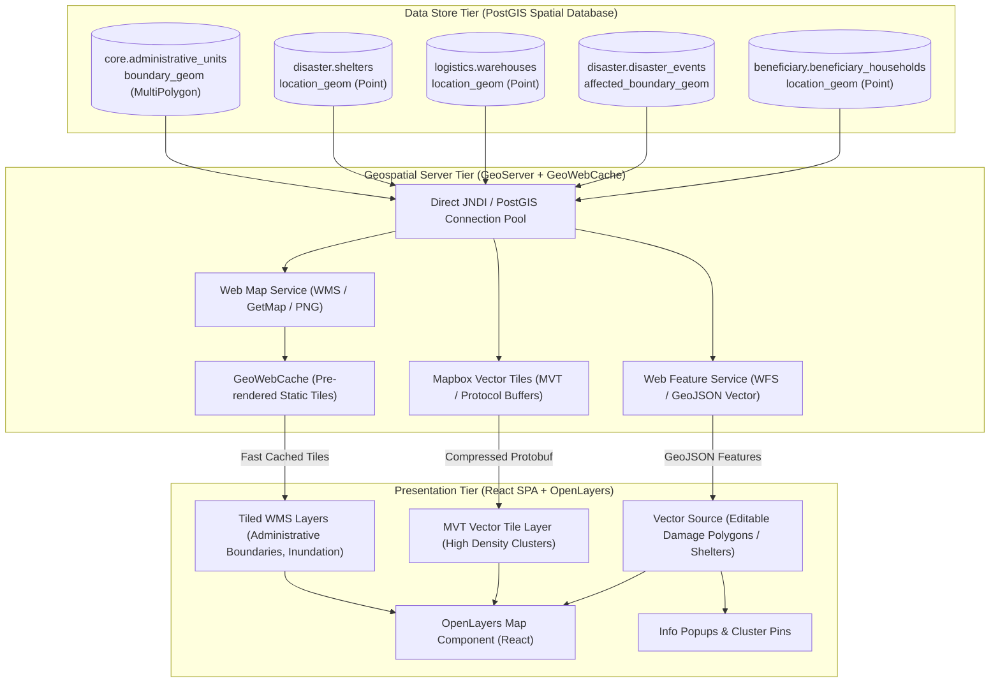

# Integrated Disaster Management System (IDMS)
## Enterprise GIS Architecture Specification

| Document Information | Details |
| :--- | :--- |
| **Document Version** | 1.0.0-PROPOSED |
| **Spatial Engine** | PostGIS 3.4+ on PostgreSQL 16+ |
| **Map Server** | GeoServer 2.25+ (Open Source Geospatial Foundation - OSGeo) |
| **Web Mapping Engine**| OpenLayers 9.x (Integrated into React 18 SPA) |
| **Spatial Projections**| EPSG:4326 (WGS 84), EPSG:3857 (Web Mercator), EPSG:3106 (Bangladesh Transverse Mercator - BTM) |

---

## 1. High-Level GIS Integration Architecture

The spatial tier bridges low-level PostGIS database tables with the React frontend through GeoServer OGC web services:



---

## 2. Component Collaboration: PostGIS + GeoServer + OpenLayers

### 2.1 PostGIS (Spatial Database Layer)
- Serves as the authoritative source for all geospatial features.
- All spatial coordinates are stored in **EPSG:4326** (WGS 84 Longitude/Latitude) as standard OGC geometries.
- PostGIS functions calculate spatial intersections, buffers, and distances on-the-fly:
  - `ST_Intersects(boundary_geom, point_geom)`: Determine whether a shelter or household falls within a flooded polygon.
  - `ST_DWithin(geography(location_geom), geography(center_point), 5000)`: Query all functional cyclone shelters within a 5-kilometer radius of a threatened village.
  - `ST_Union(array_agg(boundary_geom))`: Merge affected upazila boundaries into a composite disaster declaration zone.
- Every spatial column has an associated **Generalized Search Tree (GIST)** index.

### 2.2 GeoServer (OGC Map Server Layer)
- Connects directly to the PostgreSQL database using an optimized connection pool.
- Exposes standardized Open Geospatial Consortium (OGC) endpoints:
  - **WMS (Web Map Service):** Renders high-resolution map tiles on the server and streams compressed WebP/PNG tiles to the client. Ideal for large polygon boundaries (all 4,500+ unions of Bangladesh) to keep the client browser lightweight.
  - **WFS (Web Feature Service):** Exposes raw vector geometries in GeoJSON format. Allows clients to query feature attributes, filter dynamically by attribute (`CQL_FILTER`), and query spatial properties.
  - **MVT (Mapbox Vector Tiles):** Pre-sliced vector protocol buffers that enable the client browser to style layers dynamically without re-fetching geometry data.
  - **GeoWebCache (GWC):** Pre-caches repetitive boundary layers (National, Division, District grids) in disk memory, cutting tile rendering latency from 180ms down to &le; 15ms.

### 2.3 OpenLayers 9.x (React Client Presentation Layer)
- Embedded in the React SPA via custom React hooks (`useMap`, `useMapLayer`).
- **Layer Stacking Order:**
  1. *Base Layer:* OpenStreetMap or CartoDB Positron (lightweight background).
  2. *Administrative Tile Layer:* WMS tiled layer showing national boundaries and union outlines.
  3. *Thematic Heatmap / Hazard Layer:* WMS layer showing satellite-derived flood inundation or cyclone wind cones.
  4. *Shelter & Warehouse Cluster Layer:* OpenLayers `ol/source/Cluster` displaying point icons with real-time occupancy badges.
  5. *Vector Draw Layer:* Client-side drawing tools allowing field monitors to draw damage polygons or route diversions directly on the map.

---

## 3. Spatial Reference Systems & Projections

| Projection Code | Standard Name | Usage in IDMS |
| :--- | :--- | :--- |
| **EPSG:4326** | WGS 84 (Lat/Long) | Database internal storage, GPS sensor readings, mobile field sync. |
| **EPSG:3857** | Web Mercator (Spherical) | OpenLayers map display, satellite tile overlays, web rendering. |
| **EPSG:3106** | Bangladesh Transverse Mercator (BTM) | High-precision national distance & surface area calculations (embankment length, flooded agricultural acreages). |

PostGIS automatically transforms projections during spatial queries when necessary:
```sql
-- Calculate exact flooded agricultural land in Square Kilometers using BTM (EPSG:3106)
SELECT ST_Area(ST_Transform(damage_boundary_geom, 3106)) / 1000000.0 AS flooded_area_sq_km
FROM disaster.damage_assessments
WHERE id = :assessment_id;
```

---

## 4. Master GIS Layer Catalog

| Layer Name | GeoServer Workspace | Geometry Type | Update Frequency | Styling Standard (SLD) |
| :--- | :--- | :--- | :--- | :--- |
| `idms:admin_divisions` | `idms` | MultiPolygon | Static / Annually | Crisp dark gray outlines |
| `idms:admin_districts` | `idms` | MultiPolygon | Static / Annually | Subtle gray outlines with label |
| `idms:admin_unions` | `idms` | MultiPolygon | Static / Annually | Thin borders, zoom-restricted |
| `idms:active_disaster_zones`| `idms` | MultiPolygon | Real-Time / Hourly | Red semi-transparent fill with pulsating stroke |
| `idms:cyclone_shelters` | `idms` | Point (Cluster) | Real-Time / 15-min | Green (available) / Orange (full) / Red (damaged) |
| `idms:warehouses` | `idms` | Point | Daily | Blue warehouse icon with capacity tooltips |
| `idms:damage_footprints` | `idms` | MultiPolygon | Real-Time Field Sync| Orange hatch-fill |

---

## 5. Security & Scope Enforcement in GeoServer

GeoServer endpoints are guarded to maintain the system's administrative data scoping:
1. **Reverse Proxy Token Validation:** GeoServer is not exposed directly to the public internet. All `/geoserver/*` requests route through Nginx/Envoy, which verifies the user's Keycloak JWT.
2. **Dynamic CQL Filtering:** The React OpenLayers client automatically appends the officer's administrative boundary code to GeoServer WMS/WFS requests via `CQL_FILTER`:
   ```
   CQL_FILTER=district_code='1020' AND status='ACTIVE'
   ```
3. **Internal Proxy for Sensitive Beneficiary Points:** Individual beneficiary household locations are **never** published as an open WFS layer. Household density is served either as aggregated choropleth heatmaps at the union level or proxied through Laravel API endpoints that verify fine-grained role permissions.
