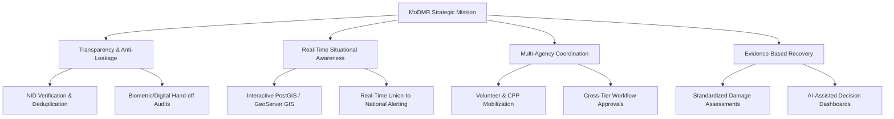

# Integrated Disaster Management System (IDMS)
## Enterprise Project Overview & Architecture Charter

| Document Information | Details |
| :--- | :--- |
| **Project Title** | Integrated Disaster Management System (IDMS) |
| **Client Agency** | Ministry of Disaster Management and Relief (MoDMR), Government of Bangladesh |
| **Executing Body** | Department of Disaster Management (DDM) |
| **Document Version** | 1.0.0-PROPOSED |
| **Classification** | Official / Enterprise Architecture |
| **Author** | Enterprise Software Architecture & Solution Engineering Team |
| **Target Runtime** | Modular Monolith (Laravel 11.x, React 18.x, PostgreSQL 16+ with PostGIS, Keycloak 24+) |

---

## 1. Executive Summary

Bangladesh is geographically situated in the low-lying Ganges-Brahmaputra-Meghna delta, making it one of the most disaster-prone nations globally. It regularly faces cyclones, monsoon flash floods, riverbank erosion, storm surges, drought, earthquakes, and landslides. The **Ministry of Disaster Management and Relief (MoDMR)**, alongside the **Department of Disaster Management (DDM)**, spearheads disaster risk reduction, immediate emergency response, transparent relief distribution, and rehabilitation.

Currently, disaster incident reporting, damage assessment, warehouse logistics, volunteer dispatching, and relief distribution are fragmented across legacy spreadsheets, standalone siloed portals, and paper-based communications. This leads to:
1. Double-counting and leakages in beneficiary aid distribution.
2. Delayed situation reports (SitReps) from union and upazila levels to the National Emergency Operation Centre (NEOC).
3. Inability to visualize spatial damage footprints (WMS/WFS) against vulnerable demographic clusters.
4. Absence of auditable tracking from national fund allocation down to the beneficiary hand-off.

The **Integrated Disaster Management System (IDMS)** is conceived as the sovereign, unified enterprise platform providing end-to-end digital governance across all phases of disaster management: **Preparedness, Mitigation, Early Warning, Response, Relief Distribution, Recovery, and Post-Disaster Reconstruction**.

---

## 2. Strategic Objectives & Outcomes



### Specific Operational Objectives:
1. **Single Source of Truth for Beneficiaries:** Centralize vulnerable and disaster-affected citizens, deduplicated through National Identity (NID) verification, household-level profiling, and socioeconomic indexing.
2. **End-to-End Relief Traceability:** Trace aid transfers from central budget allocation to central/regional warehouses (CSD/LSD), down to distribution points and directly into beneficiary hands.
3. **Multi-Tier Hierarchical Operations:** Enforce strict administrative governance across all 7 tiers of Bangladesh governance:
   - National (Ministry/NEOC)
   - Directorate (DDM)
   - Division (Divisional Commissioner)
   - District (Deputy Commissioner / DRRO)
   - Upazila (Upazila Nirbahi Officer / PIO)
   - Union (Union Parishad Chairman / Members)
   - Field Officer (Disaster Field Monitors, CPP, Volunteers)
4. **Spatial Analytics & Early Warning:** Render GIS layers including flood inundation models, cyclone track forecasts, designated shelter capacities, warehouse stockpiles, and road accessibility.
5. **Human-in-the-Loop AI Decision Support:** Deliver automated situation synthesis, predictive logistics forecasting, and automated draft reports while guaranteeing that all binding decisions are strictly authorized by certified government officers.

---

## 3. High-Level System Scope & 17 Functional Modules

The IDMS architecture consolidates 17 tightly integrated modules into a modular monolithic engine:

```
+----------------------------------------------------------------------------------------------------+
|                                    IDMS CORE MODULE MATRIX                                         |
+----------------------------------+----------------------------------+------------------------------+
| 01. Beneficiary Management       | 02. NID Verification Engine      | 03. Disaster Information     |
| 04. Relief Distribution          | 05. Disaster Response Management | 06. Project Management       |
| 07. Resource Management          | 08. Warehouse & Inventory        | 09. Damage Assessment (D-Form)|
| 10. Volunteer Management (CPP)   | 11. Multi-Tier Workflow Engine   | 12. User & RBAC Management   |
| 13. Notification & Alert Engine  | 14. Document Management (e-Docs) | 15. Reporting & Analytics    |
| 16. Immutable Audit Trail        | 17. AI Analytics & Decision Supp.|                              |
+----------------------------------+----------------------------------+------------------------------+
```

---

## 4. Stakeholder Ecosystem & Beneficiaries

| Stakeholder Group | Primary Operational Needs |
| :--- | :--- |
| **MoDMR Leadership & Policy Makers** | High-level KPI dashboards, national disaster declarations, strategic budget allocations, donor reporting. |
| **Department of Disaster Management (DDM)** | Central warehouse oversight, national logistics coordination, D-Form assessment aggregations, emergency response monitoring. |
| **Divisional Commissioners & DRROs** | Division/District level monitoring, inter-district resource reallocations, verification of upazila relief requests. |
| **UNOs & Project Implementation Officers (PIOs)** | Approval of union beneficiary lists, warehouse issue orders, local damage validation, relief delivery monitoring. |
| **Union Parishads (Chairman & Ward Members)** | Preliminary beneficiary enrollment, local damage survey submission, relief distribution point management. |
| **Cyclone Preparedness Programme (CPP) & Volunteers**| Field-level alert dissemination, evacuation logging, shelter management, crowd monitoring, local survey data entry. |
| **Affected Citizens (Beneficiaries)** | SMS relief allocation alerts, entitlement transparency, grievance redressal, emergency SOS helpline integration. |
| **Audit & Oversight Bodies (C&AG, Anti-Corruption)** | Unalterable event logs, digital handover signatures, inventory reconciliation records. |

---

## 5. Architectural Guiding Principles

1. **Modular Monolithic Simplicity:** Avoid premature microservice overhead. Isolate domains via clean Laravel namespaces, bounded service contracts, and modular interfaces with shared PostgreSQL transactions.
2. **Organizational Scope-First Security:** No cross-jurisdiction leakage. Data queries must be scoped to the authenticated officer's administrative boundary unless higher-tier permissions are explicitly inherited.
3. **Decoupled Identity via Keycloak:** Application code must not handle user passwords or identity storage. Keycloak acts as the OIDC OpenID Connect authority with MFA and JWT token generation.
4. **Spatial First-Class Citizenship:** All geographic locations (shelters, warehouses, distribution points, damage zones) must be stored in PostGIS geometry columns and served via standardized OGC protocols (WMS/WFS) through GeoServer.
5. **Resilient Field Operation:** Architect backend APIs to support idempotency and batch transactions anticipating unstable network connectivity in field environments.
6. **Assistive, Non-Autonomous AI:** Artificial intelligence serves as an advisory co-pilot. Algorithms suggest, predict, and summarize; human officers validate, approve, and execute.
