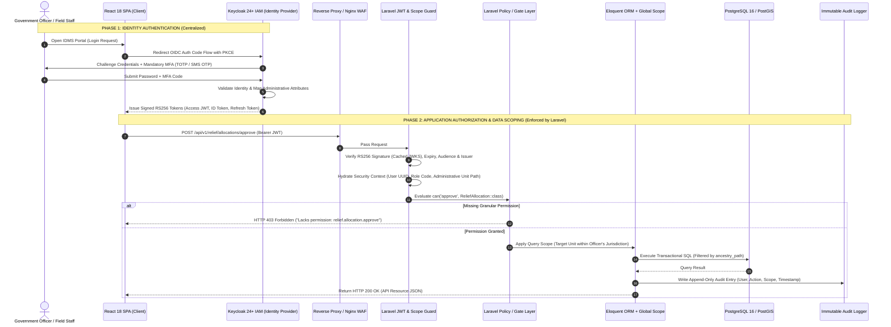
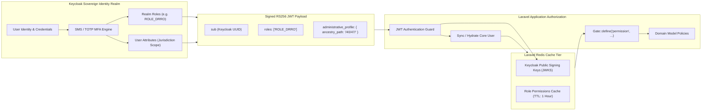

# Integrated Disaster Management System (IDMS)
## Role-Based Access Control (RBAC) & Permission Matrix Specification

| Document Information | Details |
| :--- | :--- |
| **System** | Integrated Disaster Management System (IDMS) |
| **Client Agency** | Ministry of Disaster Management and Relief (MoDMR), Government of Bangladesh |
| **Document Purpose** | Exhaustive System Roles, Granular Permissions, Role-Permission Matrix & Keycloak IAM Integration |
| **Document Version** | 1.0.0-PROPOSED |
| **Security Standards** | BNDA e-Governance Interoperability Framework, ISO/IEC 27001:2022, RFC 7519 (JWT), NIST SP 800-162 (ABAC/RBAC) |
| **Status** | Prepared for Architecture Review (No Migrations / Code Generated) |

---

## 1. Executive Summary & Design Principles

The Integrated Disaster Management System (IDMS) serves as the sovereign national platform for disaster risk management, emergency humanitarian response, relief distribution, and rehabilitation monitoring across the People's Republic of Bangladesh.

Given the mission-critical nature of emergency response and the constitutional mandate to safeguard citizen identity data and public resources, the access control model is governed by four core principles:

1. **Strict Separation of Authentication and Application Authorization:**
   - **Centralized Identity & Authentication (Keycloak IdP):** Sovereign identity provisioning, OpenID Connect (OIDC) protocols, multi-factor authentication (MFA), password policies, and coarse realm role assignments.
   - **Enforced Application Authorization (Laravel Resource Server):** Context-aware evaluation of granular business permissions (CRUD + Approve + Export + Decrypt PII) combined dynamically with organizational administrative scope boundaries on every single API request.
2. **Principle of Least Privilege (PoLP):**
   - Every system actor operates strictly with the minimal permissions necessary to fulfill their statutory duties under the Disaster Management Act, 2012 and Standing Orders on Disaster (SOD).
3. **Separation of Duties (SoD) & Dual Authorization:**
   - Requisition of relief goods, assessment of damages, and approval of financial/commodity allocations cannot be performed by the same individual.
   - Destructive operations, emergency bulk allocations, and citizen Personally Identifiable Information (PII) unmasking enforce dual verification and immutable audit trail logging.
4. **Defense in Depth for Citizen Data Privacy:**
   - Beneficiary National ID (NID) numbers, biometric hashes, and mobile banking accounts are encrypted at rest with AES-256-GCM. Unmasked access requires the specialized `beneficiary.pii.decrypt` permission, restricted to authorized statutory officers and logged per record access.

---

## 2. Authentication (Keycloak) vs. Application Authorization (Laravel)



### 2.1 Responsibilities Matrix

| Functionality Area | Keycloak 24+ (Identity Provider) | Laravel 11.x (Application / Resource Server) |
| :--- | :--- | :--- |
| **User Identity Verification** | Primary password, LDAP/Active Directory federation, Gov SSO | None (Trusts verified JWT token) |
| **Multi-Factor Authentication** | Enforces TOTP, Government SMS Gateway OTP, WebAuthn | None |
| **Token Minting & Lifecycle** | Issues RS256 signed JWTs, handles refresh & token revocation | Validates cryptographic signatures via JWKS public keys |
| **Role Cataloging** | Holds sovereign Realm Roles & Client Roles | Maps Keycloak role codes to fine-grained permission sets |
| **Granular Business Actions** | Agnostic of business logic (does not know `relief.approve`) | Evaluates granular permissions (`view`, `create`, `update`, `delete`, `approve`, `export`, `decrypt_pii`) |
| **Hierarchical Data Scoping** | Injects administrative profile claims into token payload | Strictly filters database queries by geographic path (`ancestry_path`) |
| **Citizen PII Masking/Decryption** | Agnostic of database column encryption | Enforces AES-256-GCM column decryption gated by policy |
| **Immutable Operational Audit** | Logs authentication events (Login, Logout, MFA fail) | Logs all business resource mutations, state transitions, and exports |

### 2.2 Keycloak Custom Protocol Mappers & JWT Token Claims
Keycloak user attributes are enriched via custom OIDC protocol mappers to inject the officer's administrative jurisdiction and role profile into the standard JWT payload:

```json
{
  "iss": "https://auth.modmr.gov.bd/realms/idms-gov-realm",
  "sub": "3a1c9e42-7f28-48b2-9011-8c4391e92d05",
  "aud": "idms-backend-api",
  "exp": 1732435200,
  "nbf": 1732431600,
  "iat": 1732431600,
  "jti": "b0a68d83-4a0b-47e3-92f5-d52b9dfc44ae",
  "preferred_username": "drro_khulna",
  "email": "drro.khulna@modmr.gov.bd",
  "email_verified": true,
  "name": "Md. Rafiqul Islam",
  "roles": [
    "ROLE_DRRO"
  ],
  "administrative_profile": {
    "tier_level": "DISTRICT",
    "scope_id": "8f3e2b10-6c91-4d3a-8742-1a4e8d3b5c90",
    "division_code": "40",
    "district_code": "47",
    "upazila_code": null,
    "union_code": null,
    "ancestry_path": "/40/47/",
    "name_en": "Khulna District",
    "name_bn": "খুলনা জেলা",
    "designation": "District Relief and Rehabilitation Officer (DRRO)"
  }
}
```

---

## 3. Comprehensive System Role Taxonomy

System roles reflect the official statutory hierarchy of disaster management administration in Bangladesh across seven governance tiers:

```
[Tier 1] National / Ministry
   ├── ROLE_SUPER_ADMIN (MoDMR ICT Administrator)
   ├── ROLE_MINISTRY_EXECUTIVE (Minister / Secretary / Additional Secretary)
   ├── ROLE_NEOC_DIRECTOR (National Emergency Operations Centre Director)
   └── ROLE_NATIONAL_AUDITOR (Auditor General / MoDMR Audit Cell)
[Tier 2] Directorate (DDM)
   ├── ROLE_DDM_DIRECTOR_GENERAL (Director General, Department of Disaster Management)
   ├── ROLE_DDM_RELIEF_DIRECTOR (Director - Relief, Logistics & Warehousing)
   └── ROLE_DDM_PLANNING_DIRECTOR (Director - Planning, M&E & Reconstruction)
[Tier 3] Division
   └── ROLE_DIVISIONAL_COMMISSIONER (Divisional Commissioner / Addl. Divisional Commissioner)
[Tier 4] District
   ├── ROLE_DEPUTY_COMMISSIONER (Deputy Commissioner - DC / District Magistrate)
   └── ROLE_DRRO (District Relief and Rehabilitation Officer)
[Tier 5] Upazila
   ├── ROLE_UNO (Upazila Nirbahi Officer)
   └── ROLE_PIO (Project Implementation Officer)
[Tier 6] Union / Pouroshava
   ├── ROLE_UP_CHAIRMAN (Union Parishad Chairman / Pouroshava Mayor)
   └── ROLE_UP_SECRETARY (Union Parishad Secretary / Administrative Officer)
[Tier 7] Field Operation & Specialized Units
   ├── ROLE_FIELD_ENUMERATOR (Ward Surveyor / Field Data Collector)
   ├── ROLE_TAG_OFFICER (Assigned Verification & Inspection Officer)
   ├── ROLE_WAREHOUSE_OFFICER (Godown Officer / Central & Local Storekeeper)
   ├── ROLE_SHELTER_MANAGER (Designated Cyclone/Flood Shelter In-Charge)
   ├── ROLE_CPP_LEADER (Cyclone Preparedness Programme Unit Leader)
   ├── ROLE_VOLUNTEER_RESPONDER (Registered First Responder / Red Crescent Volunteer)
   └── ROLE_EXTERNAL_PARTNER (UN Agencies / Humanitarian NGO Observers - WFP, UNICEF)
```

### 3.1 Role Profiles and Functional Mandates

| Role Identifier | Administrative Tier | Official Government Designations | Operational Scope & Statutory Mandate |
| :--- | :--- | :--- | :--- |
| `ROLE_SUPER_ADMIN` | National (MoDMR) | Chief ICT Officer, Lead System Administrator | Full technical administration, user provisioning, role assignments, system health, and security configuration. **Excluded from approving relief or financial disbursements.** |
| `ROLE_MINISTRY_EXECUTIVE` | National (MoDMR) | Minister, Senior Secretary, Additional Secretary | National strategic overview, disaster state of emergency declaration, policy approvals, national budget allocations, executive SitRep dashboard. |
| `ROLE_NEOC_DIRECTOR` | National (MoDMR) | Director, National Emergency Operations Centre | 24/7 disaster incident management, emergency warning broadcasts, national SAR mobilization, multi-district relief coordination. |
| `ROLE_NATIONAL_AUDITOR` | National (Audit) | Comptroller and Auditor General (CAG) Officer, MoDMR Audit Cell | Read-only national visibility across all muster rolls, vouchers, stock ledgers, financial disbursements, and immutable system audit logs. |
| `ROLE_DDM_DIRECTOR_GENERAL`| Directorate (DDM) | Director General, Department of Disaster Management | Operational head of national relief and disaster response. Approves multi-district allocations, major project milestones, and national stock movements. |
| `ROLE_DDM_RELIEF_DIRECTOR` | Directorate (DDM) | Director (Relief), Deputy Director (Relief) | Directs Central Supply Depots (CSD), manages national relief reserves, reviews bottom-up requisitions, approves inter-district transfers. |
| `ROLE_DDM_PLANNING_DIRECTOR`| Directorate (DDM) | Director (Planning), Director (M&E) | Oversees post-disaster reconstruction schemes, TR/KABITA projects, damage assessment consolidation, infrastructure rehabilitation. |
| `ROLE_DIVISIONAL_COMMISSIONER`| Division | Divisional Commissioner, Additional Div. Commissioner | Regional oversight over constituent districts. Resolves inter-district relief imbalances, monitors division-wide shelter occupancy and D-Form validation. |
| `ROLE_DEPUTY_COMMISSIONER`| District | Deputy Commissioner (DC), District Magistrate | Chair of District Disaster Management Committee (DDMC). Approves district emergency allocations, endorses D-Form assessments, mobilizes district resources. |
| `ROLE_DRRO` | District | District Relief and Rehabilitation Officer | Operational custodian of district disaster response. Reviews Upazila requisitions, manages Local Supply Depots (LSD), verifies muster rolls, validates D-Forms. |
| `ROLE_UNO` | Upazila | Upazila Nirbahi Officer | Chair of Upazila Disaster Management Committee (UzDMC). Approves Upazila relief requisitions, certifies project milestone completions, coordinates local SAR. |
| `ROLE_PIO` | Upazila | Project Implementation Officer (MoDMR Upazila Head) | Primary operational officer for relief, damage surveys, warehouse stock, and rehabilitation works across unions in the upazila. Vets union requisitions. |
| `ROLE_UP_CHAIRMAN` | Union / Pouroshava | Union Parishad Chairman, Municipal Mayor | Chair of Union Disaster Management Committee (UDMC). Submits grassroots relief requisitions, endorses beneficiary lists, coordinates local shelter evacuations. |
| `ROLE_UP_SECRETARY` | Union / Pouroshava | Union Parishad Secretary | Administrative officer of Union Parishad. Enrolls vulnerable households, prepares draft muster rolls, records union-level distribution vouchers. |
| `ROLE_FIELD_ENUMERATOR` | Field Level | Sub-Assistant Engineer, Ward Member, Field Surveyor | On-ground damage assessment data entry (D-Form), household vulnerability surveys, GPS tagging of damaged dwellings and public infrastructure. |
| `ROLE_TAG_OFFICER` | Field Level | Designated Gazetted / Field Tag Officer | Independent government witness verifying physical distribution of relief and certifying physical milestone execution of reconstruction projects. |
| `ROLE_WAREHOUSE_OFFICER` | Field / Logistics | Central/District/Upazila Godown Keeper | Physical receipt of goods (GRN), inventory stock accounting, batch/expiry monitoring, distribution dispatch against verified allocation issue orders. |
| `ROLE_SHELTER_MANAGER` | Field / Shelter | Designated Shelter In-Charge, School Headmaster | Real-time shelter occupancy tracking (men, women, children, livestock), medical supply requests, emergency food distribution within shelter premises. |
| `ROLE_CPP_LEADER` | Field / CPP | Cyclone Preparedness Programme Unit Leader | Volunteer mobilization, siren/flag early warning dissemination, coastal evacuation guiding, initial search and rescue reports. |
| `ROLE_VOLUNTEER_RESPONDER`| Field / Community | Registered Red Crescent / Community Volunteer | Field-level first aid, assistance at distribution centers, logistics loading/unloading, crowd management during emergencies. |
| `ROLE_EXTERNAL_PARTNER` | External Agency | WFP, UNICEF, UNHCR, INGO Humanitarian Observers | Read-only access to anonymized SitReps, open GIS hazard layers, and macro relief distribution figures. **Strictly blocked from citizen PII.** |

---

## 4. Granular Permission Taxonomy

Permissions adhere to a strict standardized dot-notation syntax: `<module>.<subsystem>.<action>`

### 4.1 Permitted Action Verbs
- `view`: Read-only access to datasets (filtered automatically by administrative jurisdiction).
- `create`: Initiate, draft, or record new entities.
- `update`: Modify existing records within allowed workflow states (e.g. `DRAFT`, `REVISION_REQUIRED`).
- `delete`: Soft-delete uncommitted drafts (hard deletes are restricted or entirely disabled).
- `approve`: Formally authorize workflow transitions (endorse, sanction, dispatch, or release public funds).
- `export`: Generate and download Excel, CSV, Unicode Bangla PDF, or GeoJSON datasets.
- `decrypt_pii`: View raw, unmasked citizen NID numbers, phone numbers, and bank account details (subject to individual access audit logging).

### 4.2 Comprehensive Permission Catalog by Module

```
Module 01: Beneficiary Management (beneficiary.*)
  ├── beneficiary.household.view
  ├── beneficiary.household.create
  ├── beneficiary.household.update
  ├── beneficiary.household.delete
  ├── beneficiary.household.export
  ├── beneficiary.pii.decrypt              # Gated access to unmasked NID/Phone/Bank details
  └── beneficiary.dedup.override           # Override AI biometric/demographic duplicate flag

Module 02: National ID Verification (nid.*)
  ├── nid.verification.initiate            # Submit NID & DoB for verification against authorized gateway
  ├── nid.verification.view_status         # View verification status, dashboard & attempt history
  ├── nid.verification.manual_review       # Perform manual review & override (with 4-eye SoD)
  └── nid.adapter.configure                # Technical configuration of NID gateway adapter

Module 03: Disaster Information Management (disaster.*)
  ├── disaster.event.view                  # View scoped disaster events, impacts, timelines & GIS map
  ├── disaster.event.create                # Report/register new disaster incident within jurisdiction
  ├── disaster.event.update                # Update details, impact metrics, locations & timeline updates
  ├── disaster.event.verify                # Transition lifecycle to VERIFIED / ACTIVE / CLOSED
  ├── disaster.category.manage             # Manage configurable disaster categories & subtypes
  ├── disaster.warning.broadcast           # Issue & dispatch early warning bulletins
  ├── disaster.hazard_map.manage           # Update GIS epicenter & affected area boundaries
  └── disaster.emergency.declare           # Declare National/District State of Emergency

Module 04: Relief Distribution Management (relief.*)
  ├── relief.category.manage               # Manage configurable relief categories
  ├── relief.requisition.view
  ├── relief.requisition.create            # Submit relief request (with org, disaster, docs)
  ├── relief.requisition.update
  ├── relief.requisition.delete
  ├── relief.requisition.approve           # Review / approve / partially approve / reject (4-eye SoD)
  ├── relief.allocation.view
  ├── relief.allocation.create             # Issue allocation order & target beneficiaries
  ├── relief.allocation.approve            # Authorize allocation & reserve/release stock (4-eye SoD)
  ├── relief.allocation.export
  ├── relief.distribution.record           # Record physical handover with acknowledgment, photo & GPS
  ├── relief.distribution.override_duplicate # Authorize documented exception to duplicate rule
  ├── relief.distribution.verify           # Tag Officer witness sign-off (4-eye SoD)
  └── relief.distribution.export_muster    # Download official muster roll with signatures

Module 05: Disaster Response Management (response.*)
  ├── response.incident.view
  ├── response.incident.create             # Submit SOS emergency incident report
  ├── response.incident.update
  ├── response.shelter.view
  ├── response.shelter.manage              # Add or update shelter capacity & amenities
  ├── response.shelter.log_occupancy       # Record live headcount of evacuees & livestock
  ├── response.sar.view
  ├── response.sar.dispatch                # Dispatch Fire Service, Armed Forces, Coast Guard
  └── response.sar.update_status

Module 06: Project Management (project.*)
  ├── project.scheme.view
  ├── project.scheme.create                # Propose rehabilitation project (TR/KABITA, etc.)
  ├── project.scheme.update
  ├── project.scheme.approve               # Sanction project budget and engineering plan
  ├── project.milestone.update             # Update physical progress percentage with photos
  ├── project.milestone.certify            # Tag Officer / PIO physical inspection certification
  ├── project.disbursement.create          # Prepare contractor payment voucher
  ├── project.disbursement.approve         # Authorize public treasury payment disbursement
  └── project.scheme.export

Module 07: Resource Management (resource.*)
  ├── resource.asset.view
  ├── resource.asset.create                # Register rescue boats, water purification units, vehicles
  ├── resource.asset.update                # Update operational status & maintenance log
  ├── resource.asset.deploy                # Assign asset to emergency operational zone
  └── resource.asset.export

Module 08: Warehouse & Inventory Management (warehouse.*)
  ├── warehouse.facility.view
  ├── warehouse.facility.manage            # Create or update warehouse location & storage capacity
  ├── warehouse.stock.view
  ├── warehouse.stock.receive              # Issue Goods Received Note (GRN) for stock entry
  ├── warehouse.stock.transfer             # Inter-warehouse stock requisition & transfer
  ├── warehouse.stock.issue                # Issue stock against verified relief allocation
  ├── warehouse.stock.writeoff             # Authorize write-off of damaged/expired commodities (Dual Auth)
  └── warehouse.stock.export_ledger

Module 09: Damage Assessment - D-Form (damage.*)
  ├── damage.assessment.view
  ├── damage.assessment.create             # Initiate preliminary / detailed D-Form
  ├── damage.assessment.update             # Update sectoral loss figures (Housing, Crops, etc.)
  ├── damage.assessment.delete
  ├── damage.assessment.submit             # Formal submission to next administrative tier
  ├── damage.assessment.verify             # Upazila PIO / District DRRO endorsement
  ├── damage.assessment.approve            # Final consolidation approval by DDM/Ministry
  └── damage.assessment.export

Module 10: Volunteer Management (volunteer.*)
  ├── volunteer.roster.view
  ├── volunteer.roster.register            # Enroll CPP or Red Crescent volunteer
  ├── volunteer.roster.update
  ├── volunteer.skill.manage               # Catalog specialized certifications (First Aid, Diving)
  ├── volunteer.deployment.dispatch        # Assign volunteers to shelters or relief centers
  └── volunteer.roster.export

Module 11: Workflow Management (workflow.*)
  ├── workflow.instance.view
  ├── workflow.transition.execute          # Trigger state advance / revert in state machine
  └── workflow.configuration.manage        # Configure approval gates and timeout fallbacks

Module 12: User & Access Management (user.*, role.*)
  ├── user.account.view
  ├── user.account.create                  # Provision user profile linked to Keycloak UUID
  ├── user.account.update
  ├── user.account.deactivate              # Suspend account access
  ├── user.scope.assign                    # Bind user to administrative jurisdiction node
  ├── role.assignment.manage               # Assign roles to internal profiles
  └── role.permission.view

Module 13: Notification & Alert Management (notification.*)
  ├── notification.template.manage         # Configure SMS/Email alert templates in Bangla & English
  ├── notification.broadcast.send          # Trigger emergency bulk SMS / WebPush blast
  └── notification.log.view

Module 14: Document Management (document.*)
  ├── document.file.view                   # View document metadata & request signed streaming URL
  ├── document.file.upload                 # Upload muster rolls, photos, engineering blueprints
  ├── document.file.delete                 # Soft-delete uploaded document
  └── document.file.verify_integrity       # Inspect SHA-256 hash & antivirus scan status

Module 15: Reporting & Analytics (report.*)
  ├── report.sitrep.view                   # View daily National / District Situation Reports
  ├── report.sitrep.generate               # Trigger daily SitRep compilation
  ├── report.analytics.view                # Access dynamic multi-dimensional pivot dashboards
  └── report.analytics.export              # Export high-resolution analytical datasets

Module 16: Audit Trail (audit.*)
  ├── audit.log.view                       # Search immutable activity logs
  ├── audit.pii_access.view                # View dedicated log of who unmasked citizen PII
  └── audit.log.export                     # Export cryptographically sealed audit reports

Module 17: AI Decision Support (ai.*)
  ├── ai.insight.view                      # View AI vulnerability heatmaps & forecasting charts
  ├── ai.report.generate                   # Generate draft situation summary narratives
  └── ai.model.configure                   # Configure model parameters, prompt templates, boundaries
```

---

## 5. Comprehensive Role-Permission Matrix

The following matrix maps every system role across all 17 functional modules.

### Legend:
- `✔` : Unrestricted permission within administrative scope.
- `[S]` : Strictly scoped to user's assigned administrative jurisdiction (`ancestry_path`).
- `[D]` : Dual-authorization required (cannot approve own submission).
- `[A]` : Read access to anonymized / aggregated data only (no citizen PII).
- `--` : Explicitly denied.

| Functional Permission | SUPER ADMIN | MINISTRY EXEC | NEOC DIR | NATL AUDITOR | DDM DG | DDM RELIEF | DDM PLAN | DIV COMM | DC | DRRO | UNO | PIO | UP CHAIR | UP SEC | FIELD ENUM | TAG OFF | WAREHOUSE | SHELTER MGR | CPP LDR | VOLUNTEER | EXT PARTNER |
| :--- | :---: | :---: | :---: | :---: | :---: | :---: | :---: | :---: | :---: | :---: | :---: | :---: | :---: | :---: | :---: | :---: | :---: | :---: | :---: | :---: | :---: |
| **M01: BENEFICIARY** | | | | | | | | | | | | | | | | | | | | | |
| `beneficiary.household.view` | ✔ | ✔ | ✔ | ✔ | ✔ | ✔ | ✔ | [S] | [S] | [S] | [S] | [S] | [S] | [S] | [S] | [S] | [S] | [S] | [S] | -- | [A] |
| `beneficiary.household.create` | -- | -- | -- | -- | -- | -- | -- | -- | -- | -- | -- | [S] | -- | [S] | [S] | -- | -- | [S] | -- | -- | -- |
| `beneficiary.household.update` | -- | -- | -- | -- | -- | -- | -- | -- | -- | -- | -- | [S] | -- | [S] | [S] | -- | -- | [S] | -- | -- | -- |
| `beneficiary.household.delete` | -- | -- | -- | -- | -- | -- | -- | -- | -- | -- | [S] | [S] | -- | -- | -- | -- | -- | -- | -- | -- | -- |
| `beneficiary.household.export` | ✔ | ✔ | ✔ | ✔ | ✔ | ✔ | ✔ | [S] | [S] | [S] | [S] | [S] | [S] | [S] | -- | -- | -- | -- | -- | -- | [A] |
| `beneficiary.pii.decrypt` | -- | -- | -- | ✔ | -- | -- | -- | -- | [S] | [S] | [S] | [S] | -- | [S] | -- | [S] | -- | -- | -- | -- | -- |
| `beneficiary.dedup.override` | -- | -- | -- | -- | -- | -- | -- | -- | -- | [S] | [S] | [S] | -- | -- | -- | -- | -- | -- | -- | -- | -- |
| **M02: NID VERIFICATION** | | | | | | | | | | | | | | | | | | | | | |
| `nid.verification.initiate` | -- | -- | -- | -- | -- | -- | -- | -- | -- | [S] | -- | [S] | -- | [S] | [S] | -- | -- | -- | -- | -- | -- |
| `nid.verification.view_status` | ✔ | ✔ | ✔ | ✔ | ✔ | ✔ | ✔ | [S] | [S] | [S] | [S] | [S] | [S] | [S] | [S] | [S] | -- | -- | -- | -- | -- |
| `nid.verification.manual_review` | ✔ | -- | -- | -- | -- | -- | -- | -- | [S][D] | [S][D] | [S][D] | [S][D] | -- | -- | -- | -- | -- | -- | -- | -- | -- |
| `nid.adapter.configure` | ✔ | -- | -- | -- | -- | -- | -- | -- | -- | -- | -- | -- | -- | -- | -- | -- | -- | -- | -- | -- | -- |
| **M03: DISASTER INFO** | | | | | | | | | | | | | | | | | | | | | |
| `disaster.event.view` | ✔ | ✔ | ✔ | ✔ | ✔ | ✔ | ✔ | [S] | [S] | [S] | [S] | [S] | [S] | [S] | [S] | [S] | [S] | [S] | [S] | [S] | [A] |
| `disaster.event.create` | ✔ | ✔ | ✔ | -- | ✔ | -- | -- | -- | [S] | [S] | [S] | [S] | -- | -- | -- | -- | -- | -- | -- | -- | -- |
| `disaster.event.update` | ✔ | ✔ | ✔ | -- | ✔ | ✔ | -- | -- | [S] | [S] | [S] | [S] | -- | -- | -- | -- | -- | -- | -- | -- | -- |
| `disaster.event.verify` | ✔ | ✔ | ✔ | -- | ✔ | -- | -- | [S] | [S] | [S] | -- | -- | -- | -- | -- | -- | -- | -- | -- | -- | -- |
| `disaster.category.manage` | ✔ | ✔ | ✔ | -- | ✔ | -- | -- | -- | -- | -- | -- | -- | -- | -- | -- | -- | -- | -- | -- | -- | -- |
| `disaster.warning.broadcast` | ✔ | ✔ | ✔ | -- | ✔ | -- | -- | [S] | [S] | [S] | -- | -- | -- | -- | -- | -- | -- | -- | -- | -- | -- |
| `disaster.hazard_map.manage` | ✔ | ✔ | ✔ | -- | ✔ | -- | -- | -- | [S] | [S] | [S] | [S] | -- | -- | -- | -- | -- | -- | -- | -- | -- |
| `disaster.emergency.declare` | -- | ✔ | -- | -- | -- | -- | -- | -- | [S] | -- | -- | -- | -- | -- | -- | -- | -- | -- | -- | -- | -- |
| **M04: RELIEF DISTRIBUTION** | | | | | | | | | | | | | | | | | | | | | |
| `relief.category.manage` | ✔ | ✔ | -- | -- | ✔ | ✔ | -- | -- | -- | -- | -- | -- | -- | -- | -- | -- | -- | -- | -- | -- | -- |
| `relief.requisition.view` | ✔ | ✔ | ✔ | ✔ | ✔ | ✔ | ✔ | [S] | [S] | [S] | [S] | [S] | [S] | [S] | [S] | [S] | [S] | [S] | [S] | [S] | [A] |
| `relief.requisition.create` | -- | -- | -- | -- | -- | -- | -- | -- | -- | [S] | -- | [S] | [S] | [S] | -- | -- | -- | [S] | -- | -- | -- |
| `relief.requisition.update` | -- | -- | -- | -- | -- | -- | -- | -- | -- | [S] | -- | [S] | [S] | [S] | -- | -- | -- | [S] | -- | -- | -- |
| `relief.requisition.delete` | -- | -- | -- | -- | -- | -- | -- | -- | -- | -- | -- | [S] | [S] | -- | -- | -- | -- | -- | -- | -- | -- |
| `relief.requisition.approve` | -- | ✔[D] | ✔[D] | -- | ✔[D] | ✔[D] | -- | [S][D] | [S][D] | [S][D] | [S][D] | [S][D] | -- | -- | -- | -- | -- | -- | -- | -- | -- |
| `relief.allocation.view` | ✔ | ✔ | ✔ | ✔ | ✔ | ✔ | ✔ | [S] | [S] | [S] | [S] | [S] | [S] | [S] | [S] | [S] | [S] | [S] | [S] | [S] | [A] |
| `relief.allocation.create` | -- | ✔ | -- | -- | ✔ | ✔ | -- | -- | [S] | [S] | [S] | [S] | -- | -- | -- | -- | -- | -- | -- | -- | -- |
| `relief.allocation.approve` | -- | ✔[D] | -- | -- | ✔[D]| ✔[D]| -- | -- | [S][D]| [S][D]| [S][D]| -- | -- | -- | -- | -- | -- | -- | -- | -- | -- |
| `relief.allocation.export` | ✔ | ✔ | ✔ | ✔ | ✔ | ✔ | ✔ | [S] | [S] | [S] | [S] | [S] | [S] | [S] | -- | [S] | [S] | -- | -- | -- | [A] |
| `relief.distribution.record` | -- | -- | -- | -- | -- | -- | -- | -- | -- | [S] | -- | [S] | [S] | [S] | [S] | -- | -- | [S] | -- | [S] | -- |
| `relief.distribution.override_duplicate` | -- | -- | -- | -- | -- | -- | -- | -- | [S] | [S] | [S] | [S] | -- | -- | -- | -- | -- | -- | -- | -- | -- |
| `relief.distribution.verify` | -- | -- | -- | -- | -- | -- | -- | -- | -- | [S][D] | [S][D] | [S][D] | -- | -- | -- | [S][D] | -- | -- | -- | -- | -- |
| `relief.distribution.export_muster` | ✔ | ✔ | ✔ | ✔ | ✔ | ✔ | ✔ | [S] | [S] | [S] | [S] | [S] | [S] | [S] | -- | [S] | [S] | [S] | -- | -- | -- |
| **M05: DISASTER RESPONSE** | | | | | | | | | | | | | | | | | | | | | |
| `response.incident.view` | ✔ | ✔ | ✔ | ✔ | ✔ | ✔ | ✔ | ✔ | ✔ | ✔ | ✔ | ✔ | ✔ | ✔ | ✔ | ✔ | ✔ | ✔ | ✔ | ✔ | ✔ |
| `response.incident.create` | ✔ | ✔ | ✔ | -- | ✔ | ✔ | ✔ | [S] | [S] | [S] | [S] | [S] | [S] | [S] | [S] | [S] | [S] | [S] | [S] | [S] | -- |
| `response.incident.update` | ✔ | -- | ✔ | -- | ✔ | ✔ | -- | [S] | [S] | [S] | [S] | [S] | [S] | [S] | [S] | -- | -- | [S] | [S] | -- | -- |
| `response.shelter.view` | ✔ | ✔ | ✔ | ✔ | ✔ | ✔ | ✔ | ✔ | ✔ | ✔ | ✔ | ✔ | ✔ | ✔ | ✔ | ✔ | ✔ | ✔ | ✔ | ✔ | ✔ |
| `response.shelter.manage` | ✔ | -- | ✔ | -- | ✔ | -- | -- | -- | [S] | [S] | [S] | [S] | -- | -- | -- | -- | -- | [S] | -- | -- | -- |
| `response.shelter.log_occupancy` | -- | -- | -- | -- | -- | -- | -- | -- | -- | -- | -- | [S] | [S] | [S] | [S] | [S] | -- | [S] | [S] | [S] | -- |
| `response.sar.view` | ✔ | ✔ | ✔ | ✔ | ✔ | ✔ | ✔ | [S] | [S] | [S] | [S] | [S] | [S] | [S] | [S] | [S] | -- | [S] | [S] | [S] | [A] |
| `response.sar.dispatch` | -- | ✔ | ✔ | -- | ✔ | -- | -- | [S] | [S] | [S] | [S] | [S] | -- | -- | -- | -- | -- | -- | -- | -- | -- |
| `response.sar.update_status` | -- | -- | ✔ | -- | ✔ | -- | -- | [S] | [S] | [S] | [S] | [S] | -- | -- | -- | -- | -- | -- | [S] | [S] | -- |
| **M06: PROJECT MANAGEMENT** | | | | | | | | | | | | | | | | | | | | | |
| `project.scheme.view` | ✔ | ✔ | ✔ | ✔ | ✔ | ✔ | ✔ | [S] | [S] | [S] | [S] | [S] | [S] | [S] | [S] | [S] | -- | -- | -- | -- | [A] |
| `project.scheme.create` | -- | -- | -- | -- | -- | -- | ✔ | -- | -- | [S] | -- | [S] | [S] | [S] | -- | -- | -- | -- | -- | -- | -- |
| `project.scheme.update` | -- | -- | -- | -- | -- | -- | ✔ | -- | -- | [S] | -- | [S] | [S] | [S] | -- | -- | -- | -- | -- | -- | -- |
| `project.scheme.approve` | -- | ✔ | -- | -- | ✔ | -- | ✔ | [S] | [S] | -- | [S] | -- | -- | -- | -- | -- | -- | -- | -- | -- | -- |
| `project.milestone.update` | -- | -- | -- | -- | -- | -- | -- | -- | -- | -- | -- | [S] | -- | -- | [S] | [S] | -- | -- | -- | -- | -- |
| `project.milestone.certify` | -- | -- | -- | -- | -- | -- | -- | -- | -- | [S] | [S] | [S] | -- | -- | -- | [S] | -- | -- | -- | -- | -- |
| `project.disbursement.create` | -- | -- | -- | -- | -- | -- | -- | -- | -- | [S] | -- | [S] | -- | -- | -- | -- | -- | -- | -- | -- | -- |
| `project.disbursement.approve` | -- | ✔ | -- | -- | ✔[D]| -- | ✔[D]| -- | [S][D]| [S][D]| [S][D]| -- | -- | -- | -- | -- | -- | -- | -- | -- | -- |
| `project.scheme.export` | ✔ | ✔ | ✔ | ✔ | ✔ | ✔ | ✔ | [S] | [S] | [S] | [S] | [S] | [S] | [S] | -- | [S] | -- | -- | -- | -- | [A] |
| **M07: RESOURCE MANAGEMENT**| | | | | | | | | | | | | | | | | | | | | |
| `resource.asset.view` | ✔ | ✔ | ✔ | ✔ | ✔ | ✔ | ✔ | ✔ | ✔ | ✔ | ✔ | ✔ | [S] | [S] | [S] | [S] | [S] | [S] | [S] | [S] | [A] |
| `resource.asset.create` | ✔ | -- | ✔ | -- | ✔ | ✔ | -- | -- | [S] | [S] | [S] | [S] | -- | -- | -- | -- | [S] | -- | -- | -- | -- |
| `resource.asset.update` | ✔ | -- | ✔ | -- | ✔ | ✔ | -- | -- | [S] | [S] | [S] | [S] | -- | -- | -- | -- | [S] | -- | -- | -- | -- |
| `resource.asset.deploy` | -- | ✔ | ✔ | -- | ✔ | ✔ | -- | [S] | [S] | [S] | [S] | [S] | -- | -- | -- | -- | -- | -- | -- | -- | -- |
| `resource.asset.export` | ✔ | ✔ | ✔ | ✔ | ✔ | ✔ | ✔ | [S] | [S] | [S] | [S] | [S] | [S] | [S] | -- | -- | [S] | -- | -- | -- | [A] |
| **M08: WAREHOUSE / STOCK** | | | | | | | | | | | | | | | | | | | | | |
| `warehouse.facility.view` | ✔ | ✔ | ✔ | ✔ | ✔ | ✔ | ✔ | ✔ | ✔ | ✔ | ✔ | ✔ | [S] | [S] | -- | [S] | [S] | -- | -- | -- | [A] |
| `warehouse.facility.manage` | ✔ | -- | -- | -- | ✔ | ✔ | -- | -- | [S] | [S] | [S] | [S] | -- | -- | -- | -- | -- | -- | -- | -- | -- |
| `warehouse.stock.view` | ✔ | ✔ | ✔ | ✔ | ✔ | ✔ | ✔ | [S] | [S] | [S] | [S] | [S] | [S] | [S] | -- | [S] | [S] | [S] | -- | -- | [A] |
| `warehouse.stock.receive` | -- | -- | -- | -- | -- | -- | -- | -- | -- | [S] | -- | [S] | -- | -- | -- | -- | [S] | -- | -- | -- | -- |
| `warehouse.stock.transfer` | -- | -- | -- | -- | ✔ | ✔ | -- | [S] | [S] | [S] | [S] | [S] | -- | -- | -- | -- | [S] | -- | -- | -- | -- |
| `warehouse.stock.issue` | -- | -- | -- | -- | -- | -- | -- | -- | -- | [S] | -- | [S] | -- | -- | -- | -- | [S] | -- | -- | -- | -- |
| `warehouse.stock.writeoff` | -- | -- | -- | -- | ✔[D]| ✔[D]| -- | -- | [S][D]| [S][D]| -- | -- | -- | -- | -- | -- | -- | -- | -- | -- | -- |
| `warehouse.stock.export_ledger`| ✔ | ✔ | ✔ | ✔ | ✔ | ✔ | ✔ | [S] | [S] | [S] | [S] | [S] | [S] | [S] | -- | [S] | [S] | -- | -- | -- | -- |
| **M09: DAMAGE (D-FORM)** | | | | | | | | | | | | | | | | | | | | | |
| `damage.assessment.view` | ✔ | ✔ | ✔ | ✔ | ✔ | ✔ | ✔ | ✔ | ✔ | ✔ | ✔ | ✔ | [S] | [S] | [S] | [S] | -- | [S] | [S] | -- | [A] |
| `damage.assessment.create` | -- | -- | -- | -- | -- | -- | -- | -- | -- | -- | -- | [S] | [S] | [S] | [S] | -- | -- | [S] | -- | -- | -- |
| `damage.assessment.update` | -- | -- | -- | -- | -- | -- | -- | -- | -- | -- | -- | [S] | [S] | [S] | [S] | -- | -- | [S] | -- | -- | -- |
| `damage.assessment.delete` | -- | -- | -- | -- | -- | -- | -- | -- | -- | -- | -- | [S] | [S] | -- | -- | -- | -- | -- | -- | -- | -- |
| `damage.assessment.submit` | -- | -- | -- | -- | -- | -- | -- | -- | -- | [S] | [S] | [S] | [S] | [S] | [S] | -- | -- | [S] | -- | -- | -- |
| `damage.assessment.verify` | -- | -- | -- | -- | -- | -- | -- | [S] | [S] | [S] | [S] | [S] | -- | -- | -- | [S] | -- | -- | -- | -- | -- |
| `damage.assessment.approve` | -- | ✔ | ✔ | -- | ✔ | -- | ✔ | [S] | [S] | -- | -- | -- | -- | -- | -- | -- | -- | -- | -- | -- | -- |
| `damage.assessment.export` | ✔ | ✔ | ✔ | ✔ | ✔ | ✔ | ✔ | [S] | [S] | [S] | [S] | [S] | [S] | [S] | [S] | [S] | -- | -- | -- | -- | [A] |
| **M10: VOLUNTEER (CPP)** | | | | | | | | | | | | | | | | | | | | | |
| `volunteer.roster.view` | ✔ | ✔ | ✔ | ✔ | ✔ | ✔ | ✔ | [S] | [S] | [S] | [S] | [S] | [S] | [S] | [S] | [S] | -- | [S] | [S] | [S] | [A] |
| `volunteer.roster.register` | ✔ | -- | ✔ | -- | ✔ | -- | -- | -- | -- | [S] | -- | [S] | [S] | [S] | -- | -- | -- | -- | [S] | -- | -- |
| `volunteer.roster.update` | ✔ | -- | ✔ | -- | ✔ | -- | -- | -- | -- | [S] | -- | [S] | [S] | [S] | -- | -- | -- | -- | [S] | [S] | -- |
| `volunteer.skill.manage` | ✔ | -- | ✔ | -- | ✔ | -- | -- | -- | -- | [S] | -- | [S] | -- | -- | -- | -- | -- | -- | [S] | -- | -- |
| `volunteer.deployment.dispatch`| -- | -- | ✔ | -- | ✔ | -- | -- | [S] | [S] | [S] | [S] | [S] | [S] | -- | -- | -- | -- | [S] | [S] | -- | -- |
| `volunteer.roster.export` | ✔ | ✔ | ✔ | ✔ | ✔ | ✔ | ✔ | [S] | [S] | [S] | [S] | [S] | [S] | [S] | -- | -- | -- | -- | [S] | -- | [A] |
| **M11: WORKFLOW ENGINE** | | | | | | | | | | | | | | | | | | | | | |
| `workflow.instance.view` | ✔ | ✔ | ✔ | ✔ | ✔ | ✔ | ✔ | [S] | [S] | [S] | [S] | [S] | [S] | [S] | [S] | [S] | [S] | [S] | -- | -- | -- |
| `workflow.transition.execute`| -- | ✔ | ✔ | -- | ✔ | ✔ | ✔ | [S] | [S] | [S] | [S] | [S] | [S] | [S] | [S] | [S] | [S] | [S] | -- | -- | -- |
| `workflow.configuration.manage`| ✔| -- | -- | -- | -- | -- | -- | -- | -- | -- | -- | -- | -- | -- | -- | -- | -- | -- | -- | -- | -- |
| **M12: USER & ACCESS** | | | | | | | | | | | | | | | | | | | | | |
| `user.account.view` | ✔ | ✔ | ✔ | ✔ | ✔ | ✔ | ✔ | [S] | [S] | [S] | [S] | [S] | -- | -- | -- | -- | -- | -- | -- | -- | -- |
| `user.account.create` | ✔ | -- | -- | -- | -- | -- | -- | -- | -- | -- | -- | -- | -- | -- | -- | -- | -- | -- | -- | -- | -- |
| `user.account.update` | ✔ | -- | -- | -- | -- | -- | -- | -- | -- | -- | -- | -- | -- | -- | -- | -- | -- | -- | -- | -- | -- |
| `user.account.deactivate` | ✔ | -- | -- | -- | -- | -- | -- | -- | -- | -- | -- | -- | -- | -- | -- | -- | -- | -- | -- | -- | -- |
| `user.scope.assign` | ✔ | -- | -- | -- | -- | -- | -- | -- | -- | -- | -- | -- | -- | -- | -- | -- | -- | -- | -- | -- | -- |
| `role.assignment.manage` | ✔ | -- | -- | -- | -- | -- | -- | -- | -- | -- | -- | -- | -- | -- | -- | -- | -- | -- | -- | -- | -- |
| `role.permission.view` | ✔ | ✔ | ✔ | ✔ | ✔ | ✔ | ✔ | ✔ | ✔ | ✔ | ✔ | ✔ | ✔ | ✔ | ✔ | ✔ | ✔ | ✔ | ✔ | ✔ | ✔ |
| **M13: NOTIFICATIONS** | | | | | | | | | | | | | | | | | | | | | |
| `notification.template.manage` | ✔ | -- | ✔ | -- | ✔ | -- | -- | -- | -- | -- | -- | -- | -- | -- | -- | -- | -- | -- | -- | -- | -- |
| `notification.broadcast.send` | -- | ✔ | ✔ | -- | ✔ | -- | -- | [S] | [S] | -- | [S] | -- | -- | -- | -- | -- | -- | -- | -- | -- | -- |
| `notification.log.view` | ✔ | ✔ | ✔ | ✔ | ✔ | ✔ | ✔ | [S] | [S] | [S] | [S] | [S] | [S] | [S] | -- | -- | -- | -- | -- | -- | -- |
| **M14: DOCUMENTS** | | | | | | | | | | | | | | | | | | | | | |
| `document.file.view` | ✔ | ✔ | ✔ | ✔ | ✔ | ✔ | ✔ | [S] | [S] | [S] | [S] | [S] | [S] | [S] | [S] | [S] | [S] | [S] | [S] | -- | [A] |
| `document.file.upload` | ✔ | ✔ | ✔ | -- | ✔ | ✔ | ✔ | [S] | [S] | [S] | [S] | [S] | [S] | [S] | [S] | [S] | [S] | [S] | [S] | [S] | -- |
| `document.file.delete` | ✔ | -- | -- | -- | -- | -- | -- | -- | -- | [S] | -- | [S] | -- | -- | -- | -- | -- | -- | -- | -- | -- |
| `document.file.verify_integrity`| ✔ | ✔ | ✔ | ✔ | ✔ | ✔ | ✔ | [S] | [S] | [S] | [S] | [S] | [S] | [S] | -- | [S] | [S] | -- | -- | -- | -- |
| **M15: REPORTING & ANALYTICS**| | | | | | | | | | | | | | | | | | | | | |
| `report.sitrep.view` | ✔ | ✔ | ✔ | ✔ | ✔ | ✔ | ✔ | ✔ | ✔ | ✔ | ✔ | ✔ | ✔ | ✔ | ✔ | ✔ | ✔ | ✔ | ✔ | ✔ | ✔ |
| `report.sitrep.generate` | ✔ | ✔ | ✔ | -- | ✔ | ✔ | ✔ | [S] | [S] | [S] | [S] | [S] | -- | -- | -- | -- | -- | -- | -- | -- | -- |
| `report.analytics.view` | ✔ | ✔ | ✔ | ✔ | ✔ | ✔ | ✔ | [S] | [S] | [S] | [S] | [S] | [S] | [S] | [S] | [S] | [S] | [S] | [S] | [S] | [A] |
| `report.analytics.export` | ✔ | ✔ | ✔ | ✔ | ✔ | ✔ | ✔ | [S] | [S] | [S] | [S] | [S] | [S] | [S] | -- | [S] | [S] | -- | -- | -- | [A] |
| **M16: AUDIT TRAIL** | | | | | | | | | | | | | | | | | | | | | |
| `audit.log.view` | ✔ | ✔ | -- | ✔ | ✔ | -- | -- | -- | [S] | [S] | [S] | [S] | -- | -- | -- | -- | -- | -- | -- | -- | -- |
| `audit.pii_access.view` | ✔ | ✔ | -- | ✔ | ✔ | -- | -- | -- | [S] | [S] | [S] | [S] | -- | -- | -- | -- | -- | -- | -- | -- | -- |
| `audit.log.export` | ✔ | ✔ | -- | ✔ | ✔ | -- | -- | -- | [S] | [S] | -- | -- | -- | -- | -- | -- | -- | -- | -- | -- | -- |
| **M17: AI DECISION SUPPORT** | | | | | | | | | | | | | | | | | | | | | |
| `ai.insight.view` | ✔ | ✔ | ✔ | ✔ | ✔ | ✔ | ✔ | [S] | [S] | [S] | [S] | [S] | [S] | [S] | [S] | [S] | [S] | [S] | [S] | [S] | [A] |
| `ai.report.generate` | ✔ | ✔ | ✔ | -- | ✔ | ✔ | ✔ | [S] | [S] | [S] | [S] | [S] | -- | -- | -- | -- | -- | -- | -- | -- | -- |
| `ai.model.configure` | ✔ | -- | -- | -- | -- | -- | -- | -- | -- | -- | -- | -- | -- | -- | -- | -- | -- | -- | -- | -- | -- |

---

## 6. Separation of Duties (SoD) & Anti-Fraud Safeguards

To prevent corruption, phantom beneficiaries, unauthorized inventory diversion, and administrative overreach, IDMS enforces hardcoded transactional state invariants in the Laravel domain service layer:

### 6.1 Strict Invariant Rules

1. **Requisition vs. Allocation Isolation (No Self-Allocation):**
   - A Project Implementation Officer (PIO) or Union Parishad Chairman who creates or submits a relief requisition cannot approve the corresponding allocation order.
   - Enforced by: `ReliefAllocationService::assertCreatorNotApprover()`.
2. **Dual-Authorization for Public Treasury & Buffer Releases:**
   - Relief allocations exceeding 50 Metric Tons (MT) of food grain or BDT 1,000,000 in emergency cash require **Dual Sign-Off**: endorsed by the District Relief and Rehabilitation Officer (DRRO) and signed by the Deputy Commissioner (DC).
   - Emergency write-offs of spoiled warehouse stock require approval by both the Warehouse Officer and the Upazila PIO/DRRO.
3. **Distribution Hand-Off Separation (Tag Officer Witness Rule):**
   - The officer distributing the physical relief voucher cannot be the verifying Tag Officer.
   - Distribution vouchers are finalized only when the assigned Tag Officer submits independent verification (biometric confirmation, OTP token, or geo-stamped muster photo).
4. **Beneficiary Enrollment vs. Verification:**
   - Field Enumerators who survey and register vulnerable households cannot mark the household as "Relief Entitled". Entitlement scoring is computed automatically via deterministic vulnerability algorithms, vetted by the Union Committee, and approved by the Upazila PIO.
5. **System Administrator Operational Blackout:**
   - `ROLE_SUPER_ADMIN` possesses complete platform administration rights (user creation, server monitoring, database backup triggers), but is **strictly prohibited from creating or approving relief requisitions, modifying damage estimates, or disbursing contractor funds.**

---

## 7. Sensitive Citizen PII Protection & Decryption Protocol

Citizens' National Identity (NID) numbers, phone numbers, and financial/mobile bank account details are classified as **Confidential Citizen Data (Class D)**.

### 7.1 Multi-Layered Protection Model

1. **Deterministic One-Way Hashes for Deduplication:**
   - Stored in `hoh_nid_hash` using keyed HMAC-SHA256 (`HMAC_SHA256(nid_normalized, APP_KEY_HMAC)`).
   - Allows unique constraint enforcement and duplicate detection queries without decrypting the underlying database columns.
2. **Symmetric Column Encryption:**
   - Stored in `hoh_nid_encrypted` and `hoh_mobile_encrypted` using AES-256-GCM authenticated encryption with authenticated additional data (AAD) bound to the `household_id`.
3. **Dynamic Default Masking:**
   - By default, all API responses return masked strings:
     - NID: `XXXXXXXXXXXX1234` (Only last 4 digits visible)
     - Mobile: `+88017XXXX5678` (Prefix and last 4 digits visible)
     - Bank Account / MFS: `XXXX-XXXX-9012`
4. **Gated Decryption Access & Immutable Logging:**
   - An API client requesting cleartext PII must pass `?decrypt_pii=true` and possess the `beneficiary.pii.decrypt` permission.
   - Laravel Policy checks `User::can('decryptPii', Household::class)`.
   - Upon granting decryption, the event is immediately recorded in `audit.audit_logs`:
     ```json
     {
       "event_type": "PII_DECRYPTION_ACCESSED",
       "user_id": "3a1c9e42-7f28-48b2-9011-8c4391e92d05",
       "role_code": "ROLE_DRRO",
       "household_id": "9b1deb4d-3b7d-4bad-9bdd-2b0d7b3dcb6d",
       "decrypted_fields": ["hoh_nid", "hoh_mobile"],
       "client_ip": "103.145.120.45",
       "user_agent": "Mozilla/5.0 ...",
       "timestamp": "2026-11-24T09:45:00Z"
     }
     ```

---

## 8. Keycloak IAM Integration & Permission Mapping in Laravel

### 8.1 Architectural Mapping Strategy



### 8.2 Database RBAC Entity Schema in PostgreSQL (`core` schema)

To maintain PSR-12 standard decoupled Laravel architecture while supporting dynamic permission updates without modifying Keycloak, the granular permissions reside in the `core` schema:

```sql
-- Role Catalog
CREATE TABLE core.roles (
    id UUID PRIMARY KEY DEFAULT gen_random_uuid(),
    code VARCHAR(50) NOT NULL UNIQUE,       -- e.g. 'ROLE_DRRO' (Matches Keycloak)
    name_en VARCHAR(100) NOT NULL,
    name_bn VARCHAR(150) NOT NULL,
    tier_level VARCHAR(30) NOT NULL,
    description TEXT,
    created_at TIMESTAMPTZ NOT NULL DEFAULT CURRENT_TIMESTAMP,
    updated_at TIMESTAMPTZ NOT NULL DEFAULT CURRENT_TIMESTAMP
);

-- Granular Permission Catalog
CREATE TABLE core.permissions (
    id UUID PRIMARY KEY DEFAULT gen_random_uuid(),
    code VARCHAR(100) NOT NULL UNIQUE,      -- e.g. 'relief.allocation.approve'
    module_code VARCHAR(50) NOT NULL,       -- e.g. 'relief'
    name_en VARCHAR(150) NOT NULL,
    name_bn VARCHAR(200) NOT NULL,
    action_type VARCHAR(30) NOT NULL,       -- VIEW, CREATE, UPDATE, DELETE, APPROVE, EXPORT, DECRYPT_PII
    created_at TIMESTAMPTZ NOT NULL DEFAULT CURRENT_TIMESTAMP
);

-- Role-Permission Pivot
CREATE TABLE core.role_permissions (
    role_id UUID NOT NULL REFERENCES core.roles(id) ON DELETE CASCADE,
    permission_id UUID NOT NULL REFERENCES core.permissions(id) ON DELETE CASCADE,
    created_at TIMESTAMPTZ NOT NULL DEFAULT CURRENT_TIMESTAMP,
    PRIMARY KEY (role_id, permission_id)
);

CREATE INDEX idx_role_permissions_role ON core.role_permissions(role_id);
CREATE INDEX idx_permissions_code ON core.permissions(code);
```

### 8.3 Redis Permission Caching & Policy Resolution
1. **Zero-Latency In-Memory Evaluation:** When an API request is validated by the JWT guard, the user's role is extracted from `$jwt->roles[0]`.
2. The role's permitted actions are resolved from Redis (`user:permissions:{role_code}`) in $< 1\text{ ms}$:
   ```php
   // Conceptual Policy Evaluation in Laravel Gate
   Gate::before(function ($user, $ability) {
       return $user->hasPermission($ability);
   });
   ```
3. When security administrators update permissions via the Admin portal, an event `RolePermissionsUpdated` broadcasts an invalidation to the Redis key tag, preserving immediate consistency across all worker processes.
