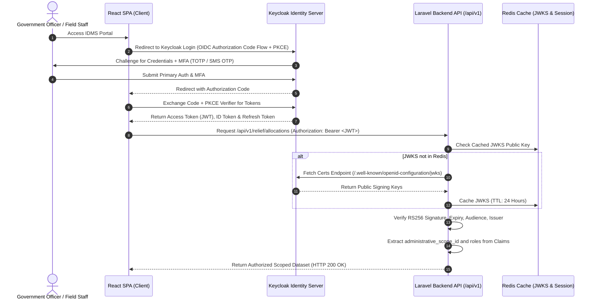
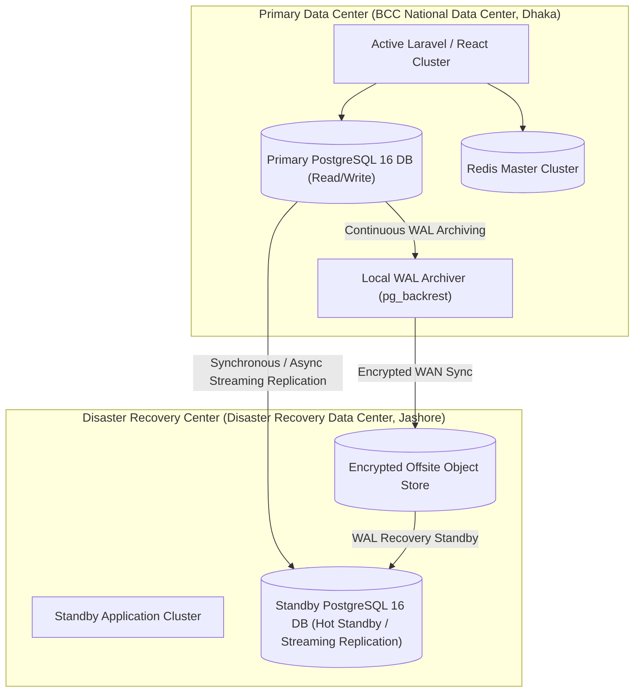

# Integrated Disaster Management System (IDMS)
## Enterprise Security, Keycloak IAM & BCDR Architecture

| Document Information | Details |
| :--- | :--- |
| **Document Version** | 1.0.0-PROPOSED |
| **Identity Provider** | Keycloak 24+ (OpenID Connect / OAuth 2.0 / SAML 2.0) |
| **Token Standard** | RFC 7519 (JSON Web Tokens - RS256 Asymmetric Encryption) |
| **Compliance Baseline**| Bangladesh National Digital Architecture (BNDA) / Bangladesh Cyber Security Guidelines / ISO 27001 |

---

## 1. Identity & Access Management (IAM) Architecture with Keycloak

Authentication is decoupled from the core application. Keycloak acts as the centralized Sovereign Identity Provider:



### 1.1 Keycloak Realm & Client Configurations
- **Realm:** `idms-gov-realm`
- **Clients:**
  1. `idms-spa-frontend`:
     - *Client Type:* Public Client
     - *Auth Flow:* Standard Authorization Code Flow with **Proof Key for Code Exchange (PKCE)**
     - *Redirect URIs:* `https://idms.modmr.gov.bd/*`
     - *Web Origins:* `https://idms.modmr.gov.bd`
  2. `idms-backend-api`:
     - *Client Type:* Bearer-Only Resource Server
     - Validates tokens using public certificates exposed by Keycloak JWKS.
  3. `idms-mobile-client` (Future):
     - *Client Type:* Public Client with PKCE and custom deep-link redirect URIs.

### 1.2 Custom JWT Claims Mapping
Keycloak user attributes are enriched via custom protocol mappers to embed administrative jurisdiction directly into the access token payload:
```json
{
  "iss": "https://auth.modmr.gov.bd/realms/idms-gov-realm",
  "sub": "4a7f29b0-8c21-41e9-b541-6e3e57f20108",
  "aud": "idms-backend-api",
  "exp": 1732356000,
  "nbf": 1732355100,
  "iat": 1732355100,
  "preferred_username": "uno_dacope",
  "email": "uno.dacope@modmr.gov.bd",
  "roles": [
    "UNO_PIO"
  ],
  "administrative_profile": {
    "tier_level": "UPAZILA",
    "scope_id": "9b1deb4d-3b7d-4bad-9bdd-2b0d7b3dcb6d",
    "division_code": "40",
    "district_code": "47",
    "upazila_code": "12",
    "name_en": "Dacope",
    "name_bn": "দাকোপ"
  }
}
```

### 1.3 Multi-Factor Authentication (MFA)
- Mandatory for all users at or above Upazila level (`UNO_PIO`, `DC_DRRO`, `DDM_DIRECTOR`, `MINISTRY_OFFICER`, `SUPER_ADMIN`).
- Supports Time-based One-Time Password (TOTP via Google Authenticator, FreeOTP) and automated SMS-OTP via the Government SMS Gateway.

---

## 2. Comprehensive Security Architecture

### 2.1 API & Perimeter Security Controls
1. **Zero-Trust Network Perimeter:** Reverse proxy (Nginx) enforces TLS 1.3 with high-grade ciphers, HTTP Strict Transport Security (HSTS - 2 years max-age with includeSubDomains), and strict Content-Security-Policy (CSP) headers.
2. **API Rate Limiting (Redis-Backed):**
   - Public / Auth Endpoints: 10 requests / minute per IP.
   - Standard Authenticated Endpoints: 300 requests / minute per user token.
   - Disaster Emergency Burst Mode: Elevates to 1,200 requests / minute for certified field monitors during active disaster declarations.
3. **CORS Hardening:** Whitelisted strictly to official government subdomains (`*.modmr.gov.bd`). Wildcard `*` origins are rejected at the Nginx layer.
4. **Input Sanitization & Injection Defense:**
   - 100% of incoming payloads pass through Laravel Form Request validation classes with strict typed rules.
   - Database operations use parameterized PDO statements via Eloquent ORM. Raw queries (`DB::raw`) are prohibited unless verified by senior database architects.
   - Output responses automatically escape HTML entities to prevent Cross-Site Scripting (XSS).

### 2.2 Data Protection & Encryption
- **Encryption at Rest:** 
  - Database volumes encrypted using LUKS (Linux Unified Key Setup) with AES-256-XTS.
  - Column-level encryption for sensitive citizen PII (NID numbers, mobile numbers, beneficiary bank account details) using Laravel's native AES-256-GCM encryption with managed rotation keys.
- **Encryption in Transit:** All inter-service communications (Laravel &harr; PostgreSQL, Laravel &harr; Redis, Laravel &harr; Keycloak, Laravel &harr; GeoServer) enforce mutual TLS (mTLS) or encrypted internal VPC channels.

---

## 3. Backup and Disaster Recovery (BCDR) Architecture

Because IDMS operates during natural disasters, its underlying infrastructure must withstand datacenter disruptions.



### 3.1 Recovery Objectives (RPO & RTO)
- **Recovery Point Objective (RPO):** &le; 15 minutes during standard operations; &le; 0 minutes (zero data loss) for committed relief transactions via synchronous streaming replication.
- **Recovery Time Objective (RTO):** &le; 60 minutes for complete DNS switchover to the Jashore DR facility during a catastrophic outage of the primary Dhaka datacenter.

### 3.2 Backup Execution Schedule
1. **Continuous WAL Streaming:** PostgreSQL Write-Ahead Logs (WAL) are streamed continuously offsite every 5 minutes.
2. **Daily Incremental Backups:** Automated nightly incremental database snapshots stored in an encrypted offsite bucket.
3. **Weekly Full Backups:** Full database image dump with checksum verification every Friday at 02:00 AM UTC.
4. **Automated Recovery Drills:** Monthly automated restore drills on isolated test environments verifying database integrity and zero corruption.
