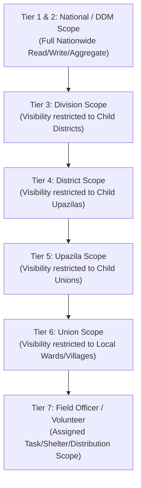

# Integrated Disaster Management System (IDMS)
## Software Requirements Specification (SRS)

| Document Information | Details |
| :--- | :--- |
| **Document Version** | 1.0.0-PROPOSED |
| **Target Agency** | Ministry of Disaster Management and Relief (MoDMR) |
| **System Classification**| Critical National Infrastructure / Government Enterprise Software |
| **Document Purpose** | Comprehensive Functional and Non-Functional Requirements Specification |

---

## 1. Introduction & Administrative Scope

### 1.1 Purpose
This document specifies the software requirements for the web-based **Integrated Disaster Management System (IDMS)**. It details functional capabilities, performance criteria, security baselines, organizational hierarchy rules, and data access policies governing operations from the central Ministry down to field operations in Bangladesh.

### 1.2 Administrative Governance Structure
The system models the seven-tier administrative hierarchy of Bangladesh:

```
[Tier 1] Ministry Level (MoDMR / National Emergency Operation Centre - NEOC)
   └── [Tier 2] Directorate / Department Level (Department of Disaster Management - DDM)
         └── [Tier 3] Division Level (Divisional Commissioner Office)
               └── [Tier 4] District Level (Deputy Commissioner - DC / District Relief & Rehab Officer - DRRO)
                     └── [Tier 5] Upazila Level (Upazila Nirbahi Officer - UNO / Project Implementation Officer - PIO)
                           └── [Tier 6] Union Level (Union Parishad Chairman / Secretary / Ward Members)
                                 └── [Tier 7] Field Operations (Disaster Field Monitors, Cyclone Preparedness Programme - CPP, Volunteers)
```

---

## 2. Organizational Data Access Strategy

Rather than adopting a commercial multi-tenant SaaS architecture (which fragments government cross-reporting), IDMS implements a **Hierarchical Scope-Based Access Control (HSBAC)** mechanism coupled with standard RBAC:



### 2.1 Scoping Rules & Principles
1. **Downward Inheritance:** An officer stationed at a District (Tier 4) automatically inherits read (and governed write) access to all entities created within that District's Upazilas, Unions, and Field assignments.
2. **Lateral Isolation:** An Upazila officer in Upazila 'A' cannot view or modify relief requests, beneficiary lists, or inventory allocations belonging to Upazila 'B', even within the same District, unless an inter-upazila disaster emergency transfer is initiated and approved by the DRRO.
3. **Escalation & Joint Operations:** During multi-district disasters (e.g., severe coastal cyclones affecting Khulna and Barishal divisions), the Ministry or DDM can establish temporary "Regional Taskforces" linking multiple jurisdictions under a defined operational scope with an automated expiration date.
4. **Data Isolation Enforcement:** The backend Laravel query builder enforces these rules universally via Global Eloquent Scopes tied to the JWT's `administrative_scope` claims. Developers cannot bypass this scoping unless executing an audited system-level scheduled aggregation.

---

## 3. Detailed Functional Requirements (17 Core Modules)

### Module 01: Beneficiary Management
- **FR-BEN-001 (Enrollment):** The system shall capture household and individual beneficiary profiles, including Head of Household (HoH), family size, gender breakdown, age groups, disability status, pregnant/lactating women, socioeconomic vulnerability score, and geo-coordinates of primary residence.
- **FR-BEN-002 (Categorization):** Support dynamic vulnerability scoring based on MoDMR criteria (e.g., Extreme Poor, Vulnerable Group Feeding eligible, Fisherfolk affected by seasonal ban, Cyclone-displaced).
- **FR-BEN-003 (Deduplication):** Prevent duplicate registration across schemes using NID, Smart Card, Birth Registration Number (BRN), and mobile phone number cross-checks.
- **FR-BEN-004 (History Tracking):** Maintain an unalterable history of all aid, cash, and in-kind relief packages received by the household over time across all disasters.

### Module 02: National ID (NID) Verification Engine
- **FR-NID-001 (Contract-Driven Adapter):** Provide a decoupled NID verification interface (`NidVerificationServiceInterface`).
- **FR-NID-002 (Mock Simulation):** In the absence of live production credentials to the Election Commission / Porichoy API, provide an enterprise mock adapter validating:
  - 10-digit Smart NID format
  - 13-digit and 17-digit legacy NID formats
  - Name (English & Bangla), Date of Birth, Father's Name, Mother's Name matching
  - Simulated latency (150ms-600ms), simulated network timeouts, and error code handling (Invalid NID, Deceased, Mismatch).
- **FR-NID-003 (Tokenized Caching):** Cache validated NID hashes and demographic fingerprints in Redis with encryption to prevent repetitive remote lookups while strictly protecting citizen PII.

### Module 03: Disaster Information Management
- **FR-DIS-001 (Disaster Event Profiling):** Record disaster events classified by type (Cyclone, Flood, Flash Flood, Riverbank Erosion, Earthquake, Landslide, Fire, Cold Wave), severity level (Alert, Warning, Severe, Catastrophic), affected boundaries (multi-polygon PostGIS geometries), and lifecycle phase (Impending, Active, Recovery, Closed).
- **FR-DIS-002 (Early Warning Bulletins):** Ingest and broadcast warnings from the Bangladesh Meteorological Department (BMD) and Flood Forecasting & Warning Centre (FFWC).
- **FR-DIS-003 (Hazard Mapping):** Associate spatial hazard zones with historical frequency, return periods, and vulnerability indices.

### Module 04: Relief Distribution Management
- **FR-REL-001 (Relief Requisitions):** Enable Union Parishads and PIOs to submit bottom-up relief requisitions based on assessed damage and population displacement.
- **FR-REL-002 (Allocation Matrix):** Enable Ministry/DDM/DRRO officers to approve allocations of food grains (Rice, Wheat), emergency cash (GR Cash), non-food items (CI Sheets, Blankets, Water Purification Tablets), and ready-to-eat dry food packs.
- **FR-REL-003 (Distribution Point Operations):** Schedule distributions at designated centers (shelters, school grounds, union offices) with designated time windows to prevent stampedes.
- **FR-REL-004 (Hand-Off Verification):** Record distribution hand-off with QR code scan, OTP via SMS, or offline photographic proof of handover. Flag and alert upon attempted double-claims.

### Module 05: Disaster Response Management
- **FR-RES-001 (SOS & Incident Logging):** Ingest incident reports from citizens, field monitors, and local administrations.
- **FR-RES-002 (Shelter Operations):** Monitor designated cyclone and flood shelters across coastal and riverine belts, tracking capacity, current occupancy, water/sanitation availability, and medical supplies.
- **FR-RES-003 (Search and Rescue - SAR Coordination):** Dispatch and track SAR teams (Fire Service & Civil Defence - FSCD, Armed Forces Division - AFD, Coast Guard, Red Crescent).
- **FR-RES-004 (Evacuation Monitoring):** Real-time aggregation of evacuated citizens, livestock, and vulnerable persons into assigned shelters.

### Module 06: Project Management
- **FR-PRJ-001 (Post-Disaster Rehabilitation Schemes):** Track post-disaster infrastructure rehabilitation projects (e.g., embankment repair, TR/KABITA, rural road reconstruction, disaster shelter maintenance).
- **FR-PRJ-002 (Milestone & Financial Progress):** Monitor project physical completion percentage alongside financial disbursements, procurement stages, and site inspection reports.
- **FR-PRJ-003 (Geo-Tagged Field Audits):** Mandate geo-tagged, timestamped photographic evidence for milestone approvals and contractor payments.

### Module 07: Resource Management
- **FR-RSM-001 (Heavy Equipment & Fleet):** Catalog rescue boats, speedboats, 4WD vehicles, water purification units, mobile water treatment plants, generators, and heavy earthmovers.
- **FR-RSM-002 (Deployment & Maintenance):** Track real-time status (Available, Deployed, In Maintenance, Decommissioned), location, fuel consumption, and operator assignments.

### Module 08: Warehouse & Inventory Management
- **FR-WAR-001 (Multi-Echelon Warehouses):** Support Central Supply Depots (CSD), Local Supply Depots (LSD), District Godowns, Upazila disaster storerooms, and temporary field staging hubs.
- **FR-WAR-002 (Batch & Expiry Tracking):** Track batch numbers, manufacturing dates, and expiration dates for perishable relief items (dry food packs, biscuits, medicines, baby food).
- **FR-WAR-003 (Stock Ledger & Transactions):** Maintain strict FIFO/FEFO accounting. Record Stock In (Goods Received Notes - GRN), Inter-Warehouse Stock Transfer, Stock Out (Distribution Issue Orders), and Stock Write-offs (Damage/Spoilage) with dual-authorization.

### Module 09: Damage Assessment (D-Form Workflow)
- **FR-DAM-001 (Standardized D-Form):** Digitize the official Bangladesh Government Disaster Damage and Needs Assessment Form (D-Form).
- **FR-DAM-002 (Sectoral Damage Breakdown):** Capture damages across Housing (Fully/Partially), Agriculture & Crops, Livestock & Poultry, Fisheries, Water & Sanitation (Tube-wells, Latrines), Infrastructure (Embankments, Roads, Bridges), and Human Casualties (Injured, Deceased, Missing).
- **FR-DAM-003 (Hierarchical Validation):** Enable Field/Union submission &rarr; Upazila PIO verification &rarr; District DRRO endorsement &rarr; DDM/Ministry final consolidation.

### Module 10: Volunteer Management (CPP & Red Crescent)
- **FR-VOL-001 (Roster Management):** Maintain verified profiles of Cyclone Preparedness Programme (CPP) volunteers, Bangladesh Red Crescent Society (BDRCS) volunteers, and community responders.
- **FR-VOL-002 (Skill & Equipment Mapping):** Catalog specialized skills (First Aid, Swimming/Diving, Search & Rescue, Ham Radio Operation) and assigned emergency gear.
- **FR-VOL-003 (Mobilization & Rostering):** Dispatch volunteers to specific shelters, unions, or relief points via automated SMS alerts and track attendance.

### Module 11: Workflow Management
- **FR-WFL-001 (Configurable State Machine):** Provide state machine workflows for Requisitions, Allocations, Damage Reports, and Project Approvals.
- **FR-WFL-002 (Multi-Tier Approval Gates):** Support sequential and parallel approval gates across administrative tiers with fallback routing upon non-action timeouts.
- **FR-WFL-003 (Audit & Reversion):** Retain complete historical audit of every state transition, comments, revision requests, approvals, and rejections.

### Module 12: User & RBAC Management
- **FR-USR-001 (Identity Synchronization):** Sync authenticated Keycloak identity with internal user profile attributes and organizational assignment.
- **FR-USR-002 (Fine-Grained Permissions):** Granular permission assignments (e.g., `relief.allocate`, `damage.verify`, `warehouse.issue`).
- **FR-USR-003 (Jurisdiction Binding):** Assign each user strictly to an administrative node (e.g., User ID 405 = PIO, Upazila: Dacope, District: Khulna).

### Module 13: Notification & Alert Management
- **FR-NOT-001 (Multi-Channel Dispatch):** Dispatch urgent alerts via SMS (Teletalk/Govt SMS Gateway adapter), Web Push, Email, and in-app notifications.
- **FR-NOT-002 (Emergency Broadcasts):** Support localized geofenced broadcasts to all registered volunteers and officers in cyclone-path upazilas.
- **FR-NOT-003 (Queued Retry Engine):** Resilient Redis queue dispatch with exponential backoff for telecom gateway failures.

### Module 14: Document Management (e-Docs)
- **FR-DOC-001 (Secure Uploads):** Handle situation reports, circulars, allocation orders, scanned muster rolls, and field damage photographs.
- **FR-DOC-002 (Antivirus & MIME Validation):** Strictly enforce file MIME validation, randomized storage paths, and virus scanning hooks before persisting.
- **FR-DOC-003 (Authorization-Gated Streaming):** Private storage access; documents are served exclusively via authorized, short-lived signed URLs.

### Module 15: Reporting & Analytics
- **FR-REP-001 (Situation Reports - SitRep):** Generate automated Daily SitReps aggregating national damage figures, active shelters, and relief distributed in standard MoDMR format.
- **FR-REP-002 (Export Formats):** Export all analytical grids into PDF (Unicode Bangla support via mPDF/Browsershot), Excel/CSV, and GIS GeoJSON.
- **FR-REP-003 (Dynamic Pivot Analytics):** Multi-dimensional slicing of relief distribution by disaster, year, district, demographic group, and commodity type.

### Module 16: Audit Trail
- **FR-AUD-001 (Immutable Activity Log):** Automatically capture every create, update, delete, login, export, and status change.
- **FR-AUD-002 (Metadata Capture):** Log User UUID, IP Address, User-Agent, Administrative Scope at time of action, old values vs. new values (JSON diff).
- **FR-AUD-003 (Tamper-Resistant Storage):** Audit logs are append-only. No user, including Super Admin, can update or delete audit records.

### Module 17: Artificial Intelligence Features
- **FR-AI-001 (Controlled Assistance):** AI serves exclusively as a decision-support copilot; autonomous execution of approvals or allocations is strictly prohibited.
- **FR-AI-002 (Predictive Relief Forecasting):** Model historical relief consumption against affected population figures to predict commodity deficits before shortages occur.
- **FR-AI-003 (Automated SitRep Drafting):** Synthesize thousands of union D-Form submissions into a coherent national SitRep executive summary.
- **FR-AI-004 (Explainability & Data Provenance):** Every AI-generated forecast or summary must explicitly cite its underlying database records and statistical confidence interval.

---

## 4. User Roles and Permissions Matrix

| Role Identifier | Administrative Tier | Scope Boundary | Key Permissions |
| :--- | :--- | :--- | :--- |
| `SUPER_ADMIN` | National (MoDMR) | Global | System configurations, Keycloak sync, global audits, emergency overrides. |
| `MINISTRY_OFFICER` | National (MoDMR) | Global | National budget allocation, disaster declarations, macro policy reporting. |
| `DDM_DIRECTOR` | Directorate (DDM) | Global | Central warehouse oversight, inter-division logistics, national SitRep validation. |
| `DIV_COMMISSIONER`| Division | Division Scope | Division-wide monitoring, inter-district resource approvals. |
| `DC_DRRO` | District | District Scope | District allocation, D-form endorsement, district warehouse issue orders. |
| `UNO_PIO` | Upazila | Upazila Scope | Union requisition approval, local D-form verification, local warehouse dispatch. |
| `UP_CHAIRMAN_SEC` | Union | Union Scope | Beneficiary master enrollment, initial damage survey, relief distribution execution. |
| `FIELD_OFFICER_CPP`| Field Operations | Assigned Ward/Point| Field damage data collection, shelter management, distribution verification. |
| `AUDITOR_VIEWER` | External / Ministry | Global / Filtered | Read-only audit log inspection, reconciliation reports, zero edit permissions. |

---

## 5. Non-Functional Requirements (NFRs)

### 5.1 Performance & Latency
- **NFR-PERF-001 (API Response Times):** Standard read/write endpoints shall respond within &le; 300 ms at the 95th percentile under normal loads.
- **NFR-PERF-002 (GIS Tile Throughput):** GeoServer WMS map tiles shall be served within &le; 200 ms via server-side tile caching (GeoWebCache).
- **NFR-PERF-003 (Peak Load Resiliency):** The system shall sustain 5,000 concurrent active users during peak disaster declaration periods without service degradation.

### 5.2 Security & Compliance
- **NFR-SEC-001 (Authentication):** Decoupled authentication handled exclusively by Keycloak via OpenID Connect (OIDC) with RS256 JWT tokens.
- **NFR-SEC-002 (Data at Rest):** Database storage volumes and sensitive citizen columns (NID, mobile, bank/MFS accounts) must be encrypted using AES-256.
- **NFR-SEC-003 (Data in Transit):** TLS 1.3 enforced across all external and internal communications with HSTS enabled.
- **NFR-SEC-004 (OWASP Top 10):** Universal protection against SQLi, XSS, CSRF, broken access control, and insecure direct object references (IDOR).

### 5.3 Reliability, Availability & Disaster Recovery
- **NFR-REL-001 (Uptime SLA):** 99.9% uptime during non-disaster periods; 99.99% high availability during active national disaster emergencies.
- **NFR-REL-002 (RPO & RTO):** Recovery Point Objective (RPO) &le; 15 minutes; Recovery Time Objective (RTO) &le; 1 hour via automated failover.

### 5.4 Localization & Accessibility
- **NFR-LOC-001 (Bangla First):** Full bilingual interface (Bangla as default, English as secondary option). All notifications and SMS must render clean Unicode Bangla (UTF-8).
- **NFR-ACC-002 (Accessibility):** Adhere to WCAG 2.1 Level AA for government web accessibility.
