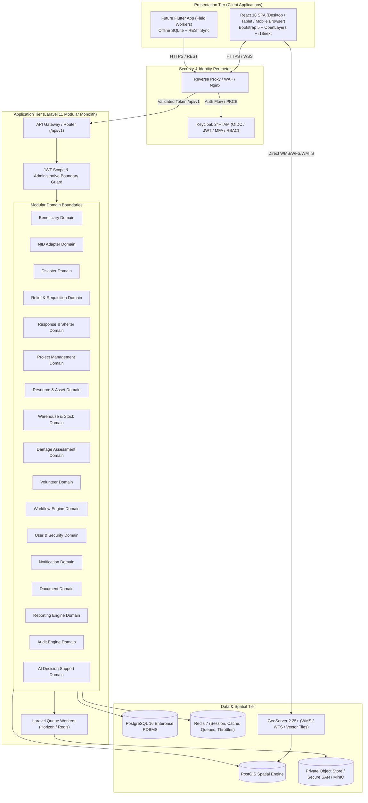
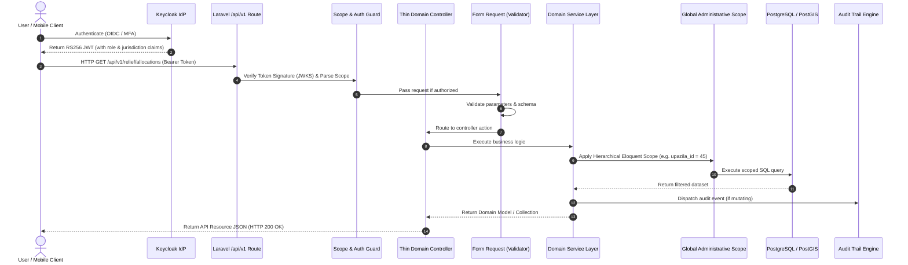
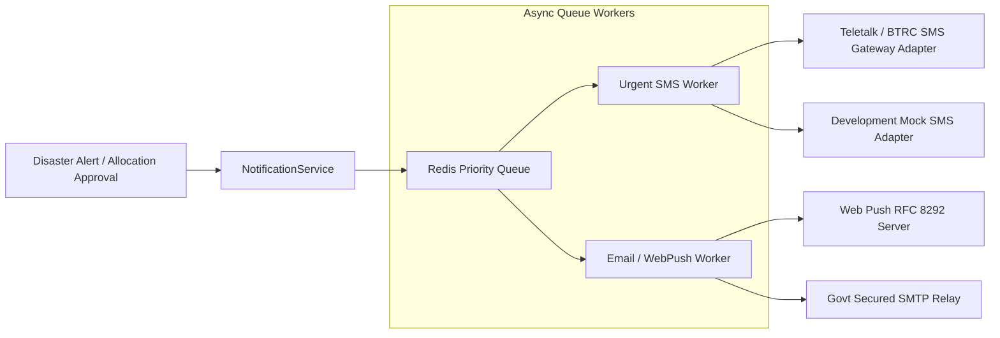

# Integrated Disaster Management System (IDMS)
## Enterprise System Architecture Specification

| Document Information | Details |
| :--- | :--- |
| **Document Version** | 1.0.0-PROPOSED |
| **System Pattern** | Modular Monolithic Architecture with Decoupled React SPA & Specialized Satellite Services |
| **Backend Framework** | Laravel 11.x (PHP 8.3+) |
| **Frontend Framework**| React 18.x (SPA via Vite) |
| **Target Runtime** | Linux / Windows Server / Containerized OCI Engines |

---

## 1. High-Level Enterprise System Topology

The IDMS is structured as an enterprise modular monolith. While microservices introduce distributed transaction friction and high DevOps operational overhead in emergency field scenarios, a disciplined modular monolith provides compile-time transaction safety, unified migrations, and zero network serialization penalties between domains, while maintaining clean domain boundaries:



---

## 2. Frontend Architecture (React 18 SPA)

### 2.1 Technology Stack & Core Libraries
- **Runtime & Build Engine:** React 18 with Vite for optimized HMR and production bundle chunking.
- **UI Framework & Styling:** Bootstrap 5.3 with custom MoDMR Government theme overrides, accessible contrast tokens, and responsive grid layouts.
- **State Management & Server Cache:** 
  - `@tanstack/react-query` (TanStack Query v5) for server-state caching, automatic background invalidation, and query deduplication.
  - React Context API for localized client UI state (theme toggle, sidebar state, active active filter presets).
- **Client Routing:** `react-router-dom` v6 with hierarchical route guards (Authentication Guard, Administrative Scope Guard, Permission Guard).
- **API Client:** Axios with centralized interceptors handling Bearer token injection, automatic token refresh via Keycloak silent renewal, and universal HTTP error toast handling.
- **GIS Component:** `ol` (OpenLayers v9) integrated via custom React wrapper hooks with projection support for WGS84 (EPSG:4326), Web Mercator (EPSG:3857), and Bangladesh Transverse Mercator (EPSG:3106 / BTM).
- **Internationalization (i18n):** `i18next` and `react-i18next` with complete English and Bangla translation dictionaries. Bangla is set as the default fallback language across all components.

### 2.2 Directory Structure
```
frontend/
├── public/
│   ├── assets/images/
│   └── locales/
│       ├── bn/translation.json
│       └── en/translation.json
├── src/
│   ├── api/
│   │   ├── axiosClient.js
│   │   ├── endpoints.js
│   │   └── keycloakService.js
│   ├── components/
│   │   ├── common/         # Buttons, Badges, Loaders, Empty States, ConfirmDialog
│   │   ├── forms/          # Form inputs with Bangla/English validation feedback
│   │   ├── layout/         # Header, Sidebar, Breadcrumb, Footer, ScopeSelector
│   │   ├── maps/           # OpenLayers MapView, LayerSwitcher, DrawTool, Legend
│   │   └── tables/         # DataGrid with sorting, filtering, and pagination
│   ├── contexts/           # AuthContext, ScopeContext, ThemeContext
│   ├── hooks/              # useAuth, useScope, useGeoLocation, useDebounce
│   ├── modules/            # Domain views matching the 17 core modules
│   │   ├── beneficiary/
│   │   ├── disaster/
│   │   ├── relief/
│   │   ├── response/
│   │   ├── warehouse/
│   │   └── ...
│   ├── routes/             # AppRoutes, ProtectedRoute, ScopeRoute
│   ├── styles/             # custom SCSS variables, gov-theme.scss
│   ├── App.jsx
│   └── main.jsx
```

---

## 3. Backend Architecture (Laravel 11 Modular Monolith)

### 3.1 Structural Philosophy & Clean Architecture
The backend strictly adheres to domain boundaries within a single deployable repository. Cross-domain communication occurs via explicit domain Service interfaces or transactional domain events, avoiding direct model-coupling across module walls.

```
backend/
├── app/
│   ├── Core/                           # Shared Cross-Cutting Infrastructure
│   │   ├── Exceptions/                 # Centralized Handler & Domain Exceptions
│   │   ├── Http/Middleware/            # KeycloakAuth, AdministrativeScope, RateLimit
│   │   ├── Models/                     # BaseUuidModel, AdministrativeUnit
│   │   ├── Scopes/                     # HierarchicalScopeExtension (Global Eloquent Scope)
│   │   ├── Services/                   # AuditService, NotificationService
│   │   └── Traits/                     # HasUuid, Auditable, HasAdministrativeScope
│   │
│   └── Modules/                        # 17 Encapsulated Functional Modules
│       ├── Beneficiary/
│       │   ├── Controllers/Api/V1/
│       │   ├── Models/
│       │   ├── Requests/               # Form Requests (Validation)
│       │   ├── Resources/              # API Resources (JSON Transformation)
│       │   ├── Services/               # Core Business Logic & Deduplication
│       │   └── Policies/               # Granular Model Policies
│       ├── NidVerification/
│       │   ├── Adapters/               # MockNidAdapter, PorichoyLiveAdapter
│       │   ├── Contracts/              # NidVerificationServiceInterface
│       │   └── DTOs/
│       ├── Disaster/
│       ├── Relief/
│       ├── Warehouse/
│       ├── DamageAssessment/
│       ├── Workflow/
│       └── ...
```

### 3.2 Request Lifecycle & Architectural Flow


---

## 4. Notification Architecture

The Notification Engine handles mission-critical alerting during disaster events:


- **SMS Resilience:** Integrated with an abstract adapter interface (`SmsGatewayInterface`). During live emergency warnings, high-priority queues bypass bulk messaging queues.
- **Bangla Text Encoding:** Universal UCS-2 encoding for Bangla SMS dispatches ensuring zero character corruption on legacy mobile handsets.
- **Delivery Confirmation:** Callbacks from telecom providers update the message delivery receipt in the database.

---

## 5. Document Management Architecture (e-Docs)

Disaster governance requires legal archiving of relief muster rolls, distribution vouchers, damage survey photos, and engineering certificates.

1. **Storage Tiering:**
   - Files are stored in an encrypted private Object Store (MinIO or S3-compatible storage) or private secure filesystem directories.
   - Public direct web server directory browsing is strictly forbidden.
2. **Upload Pipeline & Security Hardening:**
   ```
   Upload Request (Multipart)
       └── Step 1: In-Memory Magic Byte MIME Type Verification (Reject spoofed extensions)
             └── Step 2: Virus Scanning Hook (ClamAV daemon daemonized socket)
                   └── Step 3: SHA-256 Hash Computation & Deduplication
                         └── Step 4: UUID-based Filename Obfuscation
                               └── Step 5: Persistent Storage & DB Record Creation
   ```
3. **Authorized Document Access:**
   - Documents are retrieved exclusively through **pre-signed temporary URLs** generated by the Document Module with a 15-minute maximum TTL, verifying that the requesting user's administrative jurisdiction encompasses the document's owner node.
