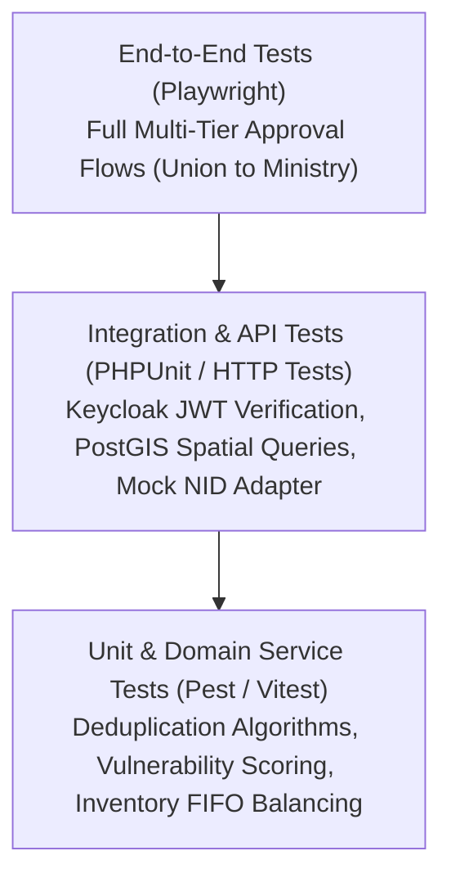

# Integrated Disaster Management System (IDMS)
## Enterprise Quality Assurance & Automated Testing Strategy

| Document Information | Details |
| :--- | :--- |
| **Document Version** | 1.0.0-PROPOSED |
| **Backend Testing Framework**| PHPUnit / Pest PHP / Laravel HTTP Tests |
| **Frontend Testing Framework**| Vitest / React Testing Library / Playwright E2E |
| **Load Testing Engine** | k6 / Locust |
| **Target Code Coverage** | &ge; 85% on Domain Services, Requests, and Security Scopes |

---

## 1. Testing Pyramid & Architectural Strategy

Testing follows the standard pyramid model, prioritizing high-velocity unit and feature tests while ensuring comprehensive coverage across multi-tier administrative workflows:

---

## 2. Test Execution Tiers

### 2.1 Backend Unit & Domain Tests (PHPUnit / Pest)
- **Domain Business Logic:** Validate edge cases in relief requisition allocation matrices, warehouse lot FIFO balancing, and D-Form damage financial total computations.
- **Hierarchical Scope Enforcement Tests:** 
  - Ensure Upazila officer cannot retrieve sibling Upazila records.
  - Verify that a District officer automatically inherits read access to all child Upazila records.
  - Confirm that an unauthorized role calling `/api/v1/relief/allocations` yields `HTTP 403 Forbidden`.
- **NID Mock Adapter Tests:** Verify format checks (10, 13, 17 digits), deceased flags, and network error handling.

### 2.2 Spatial & GIS Testing (PostGIS Test Harness)
- **Spatial Topology Tests:** Validate that all union boundary MultiPolygons are topologically valid (`ST_IsValid(geom) = true`).
- **Geo-Radius & Containment Queries:** Test shelter discovery algorithms (`ST_DWithin`) against known GPS coordinates across coastal upazilas.

### 2.3 Frontend Component & Integration Tests (Vitest + RTL)
- **Form Validation:** Verify both English and Bangla error messages render correctly on invalid input.
- **Auth State & Route Guards:** Verify that expired Keycloak tokens trigger background silent refresh, and revoked permissions redirect to access-denied screens.
- **Language Switching:** Validate dynamic i18n switching without UI degradation or un-translated string leaks.

### 2.4 End-to-End (E2E) Integration Workflows (Playwright)
Simulate end-to-end multi-tier operations across distinct user roles:
1. *Step 1 (Union Officer):* Enrolls a beneficiary household with NID verification.
2. *Step 2 (Union Officer):* Submits an emergency relief requisition for 500 households.
3. *Step 3 (UNO / PIO):* Logs in, reviews requisition, verifies against local warehouse inventory, and forwards to District.
4. *Step 4 (DC / DRRO):* Approves requisition, generating an official allocation order.
5. *Step 5 (Field Officer):* Executes hand-off to beneficiary, logging verification proof.

---

## 3. Performance, Concurrency & Stress Testing (k6)

Disasters cause acute spikes in concurrent traffic. k6 load scripts simulate:
- **Baseline Load:** 500 concurrent users performing typical dashboard browsing and reporting.
- **Crisis Peak Load:** 5,000 concurrent virtual users simulating:
  - 40% Field Officers submitting D-Forms and relief distributions.
  - 30% Public / Volunteers querying open cyclone shelters.
  - 20% Administrative officers processing approvals.
  - 10% Heavy GIS map tile requests via GeoServer.
- **Pass Criteria:**
  - HTTP 95th percentile response time &le; 300ms.
  - Zero database deadlocks on inventory tables.
  - Error rate < 0.1%.
