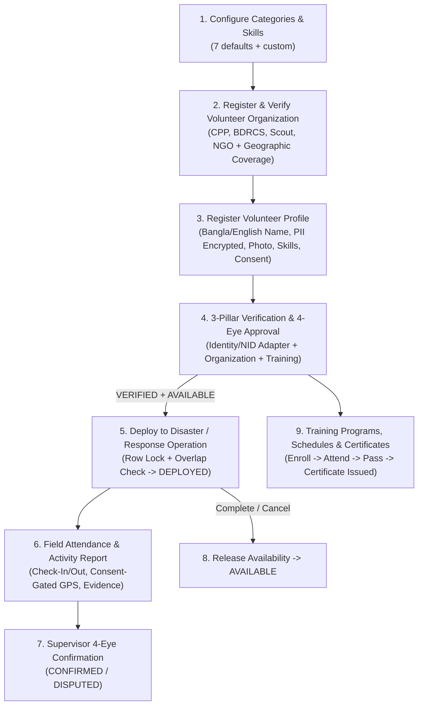

# Integrated Disaster Management System (IDMS)
## Module 10: Volunteer Management — Role-Wise Permissions & Operational Guide

| Document Information | Details |
| :--- | :--- |
| **Module** | Module 10 — Volunteer Management (`volunteer.*`) |
| **Policy Authority** | `backend/app/Modules/Volunteer/Policies/VolunteerPolicy.php` |
| **Frontend Gate Helpers** | `frontend/src/modules/volunteer/utils/volunteerPermissions.js` |
| **API Base Prefix** | `/api/v1/volunteer/*` |
| **Reference Matrix** | `documentation/ROLE_PERMISSION_MATRIX.md` |

---

## 1. Security & Governance Principles

1. **7-Tier Hierarchical Administrative Scoping (`[S]`):**
   - National roles (`ROLE_SUPER_ADMIN`, `ROLE_MINISTRY_EXECUTIVE`, `ROLE_NEOC_DIRECTOR`, `ROLE_NATIONAL_AUDITOR`, `ROLE_DDM_DIRECTOR_GENERAL`) have nationwide visibility.
   - Regional/local roles (Division, District, Upazila, Union, Field) can only view or act on volunteers, organizations, deployments, attendances, and training sessions inside their `ancestry_path` subtree (enforced via `AdministrativeScopeService` and `HasJurisdictionScope`).
   - Exception: Linked volunteer users (`volunteers.user_id === auth()->id()`) can always view their own profile, deployments, and submit check-in/out on deployments assigned to them.
2. **4-Eye Separation of Duties (`[D]`):**
   - **Volunteer Verification/Approval:** The officer who registers/submits a volunteer (`submitted_by` or `created_by`) cannot verify pillars or grant final approval (`verifyOrApproveVolunteer` returns HTTP `403`).
   - **Attendance Confirmation:** A volunteer or officer who records a check-in (`recorded_by`) cannot confirm that attendance (`confirmAttendance` returns HTTP `403`).
3. **`ROLE_SUPER_ADMIN` Operational Blackout:**
   - `ROLE_SUPER_ADMIN` can view dashboards/reports, export CSVs, and configure **Categories**, **Skills Catalog**, **Organization Registrations**, and **Training Program definitions**.
   - `ROLE_SUPER_ADMIN` is **strictly blocked (`403`)** from registering/updating/deleting volunteers, verifying organizations, verifying/approving volunteers, dispatching/completing deployments, recording/confirming attendance, and managing operational training sessions/certificates.
4. **PII & Location Privacy:**
   - Volunteer NID, mobile number, email, and emergency contact phone are encrypted at rest (`Crypt::encryptString`), deduplicated via keyed HMAC-SHA256 (`nid_hash`, `mobile_hash`), and masked by default in all API responses.
   - Cleartext PII requires `POST /api/v1/volunteer/volunteers/{id}/reveal-pii` (`decryptPii`) and writes an immutable `VOLUNTEER_PII_DECRYPTED` record in `audit.audit_logs`.
   - GPS coordinates are **never tracked continuously**. Coordinates are stored only on explicit `location_consent_given = true` (registration) or `gps_consent_given = true` (check-in/out).
   - `ROLE_EXTERNAL_PARTNER` (`[A]`) receives only `VERIFIED` roster aggregates (`full_name_*` replaced with `"Verified Volunteer"`, zero PII/photos/contact details, and rounded 2-decimal coordinates).

---

## 2. Role-Wise Permission Matrix (Module 10)

**Legend:**
- `✔` = Allowed nationally
- `[S]` = Allowed within assigned administrative jurisdiction (`ancestry_path`)
- `[D]` = 4-eye Separation of Duties enforced (cannot act on own submission/check-in)
- `[Self]` = Allowed only on own linked volunteer/deployment record
- `[A]` = Anonymized / PII-redacted / coarsened coordinates only
- `--` = Explicitly denied (`403 Forbidden`)

### 2.1 National, Directorate & Division Tiers

| Capability / Policy Method | `SUPER_ADMIN` | `MINISTRY_EXEC` | `NEOC_DIRECTOR` | `NATL_AUDITOR` | `DDM_DG` | `DDM_RELIEF_DIR` | `DDM_PLAN_DIR` / `PLAN_OFF` | `DIV_COMM` |
| :--- | :---: | :---: | :---: | :---: | :---: | :---: | :---: | :---: |
| **View Roster / Dashboard / Reports** (`viewAny`) | ✔ | ✔ | ✔ | ✔ | ✔ | ✔ | ✔ | [S] |
| **Configure Categories** (`manageCategory`) | ✔ | ✔ | ✔ | -- | ✔ | ✔ | -- | -- |
| **Manage Skill Catalog** (`manageSkill`) | ✔ | ✔ | ✔ | -- | ✔ | ✔ | -- | -- |
| **Create / Update Organizations** (`manageOrganization`) | ✔ | ✔ | ✔ | -- | ✔ | -- | -- | -- |
| **Verify Organizations** (`verifyOrganization`) | -- | ✔ | ✔ | -- | ✔ | -- | -- | -- |
| **Register / Update Volunteers** (`createVolunteer` / `updateVolunteer`) | -- | ✔ | ✔ | -- | ✔ | -- | -- | -- |
| **Archive / Soft-Delete Volunteers** (`deleteVolunteer`) | -- | -- | -- | -- | -- | -- | -- | -- |
| **Verify Pillars / Approve / Reject** (`verifyOrApproveVolunteer`) | -- | ✔[D] | ✔[D] | -- | ✔[D] | -- | -- | [S][D] |
| **Reveal Cleartext PII** (`decryptPii`) | -- | ✔ | ✔ | ✔ | ✔ | -- | -- | -- |
| **Deploy / Manage Deployments** (`deploy` / `manageDeployment`) | -- | ✔ | ✔ | -- | ✔ | -- | -- | [S] |
| **Record Check-In / Check-Out** (`recordAttendance`) | -- | ✔ | ✔ | -- | ✔ | -- | -- | -- |
| **Confirm / Dispute Attendance** (`confirmAttendance`) | -- | ✔[D] | ✔[D] | -- | ✔[D] | -- | -- | [S][D] |
| **Manage Training Programs** (`manageTrainingProgram`) | ✔ | ✔ | ✔ | -- | ✔ | -- | -- | -- |
| **Manage Sessions / Enroll / Certify** (`manageTrainingSession`) | -- | ✔ | ✔ | -- | ✔ | -- | -- | -- |
| **View Exact Coordinates** (`canViewExactLocation`) | ✔ | ✔ | ✔ | ✔ | ✔ | -- | -- | [S] |
| **Export CSV Reports** (`export`) | ✔ | ✔ | ✔ | ✔ | ✔ | ✔ | ✔ (Dir) | [S] |

### 2.2 District, Upazila, Union, Field, Volunteer & Partner Tiers

| Capability / Policy Method | `DC` | `DRRO` | `UNO` | `PIO` | `UP_CHAIR` | `UP_SEC` | `FIELD_ENUM` | `TAG_OFF` | `SHELTER_MGR` | `CPP_LEADER` / `CPP_TEAM_LEADER` | `VOLUNTEER` / `VOLUNTEER_RESPONDER` | `EXT_PARTNER` |
| :--- | :---: | :---: | :---: | :---: | :---: | :---: | :---: | :---: | :---: | :---: | :---: | :---: |
| **View Roster / Dashboard / Reports** (`viewAny`) | [S] | [S] | [S] | [S] | [S] | [S] | [S] | [S] | [S] | [S] | [S]/[Self] | [A] |
| **Configure Categories** (`manageCategory`) | -- | -- | -- | -- | -- | -- | -- | -- | -- | -- | -- | -- |
| **Manage Skill Catalog** (`manageSkill`) | -- | [S] | -- | [S] | -- | -- | -- | -- | -- | [S] | -- | -- |
| **Create / Update Organizations** (`manageOrganization`) | [S] | [S] | [S] | [S] | -- | -- | -- | -- | -- | -- | -- | -- |
| **Verify Organizations** (`verifyOrganization`) | [S] | [S] | [S] | [S] | -- | -- | -- | -- | -- | -- | -- | -- |
| **Register / Update Volunteers** (`createVolunteer` / `updateVolunteer`) | -- | [S] | [S] | [S] | [S] | [S] | -- | -- | -- | [S] | [Self] (update only) | -- |
| **Archive / Soft-Delete Volunteers** (`deleteVolunteer`) | -- | [S] | [S] | [S] | -- | -- | -- | -- | -- | -- | -- | -- |
| **Verify Pillars / Approve / Reject** (`verifyOrApproveVolunteer`) | [S][D] | [S][D] | [S][D] | [S][D] | -- | -- | -- | [S][D] | -- | -- | -- | -- |
| **Reveal Cleartext PII** (`decryptPii`) | [S] | [S] | [S] | [S] | -- | -- | -- | -- | -- | -- | -- | -- |
| **Deploy / Manage Deployments** (`deploy` / `manageDeployment`) | [S] | [S] | [S] | [S] | [S] | -- | -- | -- | [S] | [S] | -- | -- |
| **Record Check-In / Check-Out** (`recordAttendance`) | [S] | [S] | [S] | [S] | [S] | [S] | -- | -- | [S] | [S] | [Self] | -- |
| **Confirm / Dispute Attendance** (`confirmAttendance`) | [S][D] | [S][D] | [S][D] | [S][D] | [S][D] | -- | -- | -- | [S][D] | [S][D] | -- | -- |
| **Manage Training Programs** (`manageTrainingProgram`) | [S] | [S] | [S] | [S] | -- | -- | -- | -- | -- | -- | -- | -- |
| **Manage Sessions / Enroll / Certify** (`manageTrainingSession`) | [S] | [S] | [S] | [S] | -- | -- | -- | -- | -- | [S] | -- | -- |
| **View Exact Coordinates** (`canViewExactLocation`) | [S] | [S] | [S] | [S] | -- | -- | -- | -- | [S] | [S] | -- | -- |
| **Export CSV Reports** (`export`) | [S] | [S] | [S] | [S] | [S] | [S] | -- | -- | -- | [S] | -- | [A] |

> **Note:** `ROLE_WAREHOUSE_OFFICER` / `ROLE_WAREHOUSE_MANAGER` do not have Volunteer Management permissions (`--`).

---

## 3. How Volunteer Management Works (End-to-End Lifecycle)

### Step 1: Categories & Skill Catalog Configuration
- System seeds 7 standard categories (`SEARCH_AND_RESCUE`, `FIRST_AID`, `MEDICAL_SUPPORT`, `EVACUATION_SUPPORT`, `RELIEF_DISTRIBUTION`, `COMMUNICATION`, `COMMUNITY_AWARENESS`) and 8 core skills (`SWIFT_WATER_RESCUE`, `BOAT_HANDLING`, `FIRST_AID_CPR`, `FIELD_TRIAGE`, `CYCLONE_EVACUATION`, `RELIEF_LOGISTICS`, `VHF_RADIO_OPS`, `DRR_DRILL_FACILITATION`).
- Authorized administrators (`ROLE_SUPER_ADMIN`, Ministry, NEOC, DDM) can add custom categories (`POST /api/v1/volunteer/categories`) and skills (`POST /api/v1/volunteer/skills`).

### Step 2: Volunteer Organizations & Geographic Coverage
- Officers (`DC`, `DRRO`, `UNO`, `PIO`, `NEOC`, `DDM`, `SUPER_ADMIN`) register partner/volunteer organizations (`POST /api/v1/volunteer/organizations`) with organization type (`CPP`, `BDRCS`, `SCOUT`, `BNCC`, `NGO`, `INGO`, `COMMUNITY`, `GOVERNMENT`, `OTHER`), contact person details, primary administrative unit, and multi-unit coverage (`coverage_unit_ids`).
- Operational officers (excluding `ROLE_SUPER_ADMIN`) verify or reject organizations via `POST /api/v1/volunteer/organizations/{id}/verify`.

### Step 3: Volunteer Registration & PII Protection
- Field coordinators (`CPP_LEADER`, `UP_CHAIRMAN`, `UP_SECRETARY`, `PIO`, `UNO`, `DRRO`, `DDM`, `NEOC`) register volunteers (`POST /api/v1/volunteer/volunteers`) with:
  - Bilingual full names (`full_name_bn`, `full_name_en`), gender, date of birth, blood group, addresses, and emergency contact.
  - Organization affiliation, primary category, and multiple skill assignments with proficiency levels.
  - **Duplicate Guard:** `nid_hash` (keyed HMAC-SHA256) prevents registering the same NID twice (`HTTP 422`).
  - **Encrypted PII:** Raw NID, mobile, email, and emergency contact phone are encrypted via `Crypt::encryptString` and never returned in list/detail responses—only masked strings (`nid_masked`, `mobile_masked`) are returned.
  - **Private Photo Upload:** `POST /api/v1/volunteer/volunteers/{id}/photo` stores validated JPEG/PNG/WebP images on private `local` storage with SHA-256 checksums, streamed only to authorized scoped users (`GET .../photo`).
  - **Audited PII Reveal:** Authorized officers (`PIO`, `UNO`, `DRRO`, `DC`, `DDM_DG`, `NATL_AUDITOR`, `NEOC`, `MINISTRY_EXEC`) can call `POST .../reveal-pii`; every reveal writes an immutable `VOLUNTEER_PII_DECRYPTED` audit log entry.

### Step 4: 3-Pillar Verification & 4-Eye Approval Workflow
1. **Submit:** Registration can submit immediately (`submit_for_verification = true`) or move from `DRAFT` to `PENDING_VERIFICATION` via `POST .../submit`.
2. **Optional Hybrid NID Check:** If `initiate_nid_check = true` and NID is supplied during registration, the service invokes Module 02's `NidVerificationService` (`MockNidAdapter` in dev/test; fail-closed government adapter in production) to initialize `identity_verification_status` and link `nid_verification_id`.
3. **3-Pillar Checks:** A **different** authorized reviewer (4-eye SoD: `submitted_by !== actor->id`) verifies or rejects each pillar via `POST .../verify-pillar`:
   - `IDENTITY`
   - `ORGANIZATION`
   - `TRAINING` (verifying `TRAINING` also promotes `PENDING` volunteer skills to `VERIFIED`)
4. **Final Approval / Rejection:**
   - `POST .../approve` transitions `overall_verification_status` to `VERIFIED` (blocked if Identity or Organization pillar is `REJECTED`).
   - `POST .../reject` requires a reason (`min: 5`) and sets `overall_verification_status` to `REJECTED`.
   - Every transition is appended to `volunteer.volunteer_verification_logs` and `audit.audit_logs`.

### Step 5: Disaster & Response Operation Deployment
- Only volunteers who are **`overall_verification_status = VERIFIED`** and **`availability_status IN ('AVAILABLE', 'STANDBY')`** can be deployed (`POST /api/v1/volunteer/deployments`).
- Inside a database transaction with `lockForUpdate()`, `VolunteerManagementService::deployVolunteer()` checks:
  1. Target administrative unit and volunteer unit are both within the deployer's jurisdiction.
  2. No active (`ASSIGNED` or `ACTIVE`) overlapping deployment already exists for the volunteer.
  3. Creates the deployment linked to `disaster_event_id`, optional `response_operation_id` / `response_team_id`, location, assigned role/duties, start/end dates, and supervisor details.
  4. Sets the volunteer's `availability_status` to `DEPLOYED`.
- Transitions:
  - `POST /deployments/{id}/activate` (`ASSIGNED` &rarr; `ACTIVE`)
  - `POST /deployments/{id}/complete` or `POST /deployments/{id}/cancel` closes the deployment and automatically restores the volunteer's `availability_status` to `AVAILABLE` if no other active deployments remain.

### Step 6: Field Attendance, Activity Reports & Supervisor Confirmation
- **Check-In:** `POST /api/v1/volunteer/deployments/{deployment}/check-in` (usable by supervisors or the assigned volunteer/CPP leader) transitions an `ASSIGNED` deployment to `ACTIVE` and prevents duplicate open check-ins.
  - GPS coordinates (`latitude`, `longitude`) are stored **only** when `gps_consent_given = true`.
- **Check-Out & Activity Report:** `POST /api/v1/volunteer/attendances/{attendance}/check-out` records `check_out_at`, computes `duration_minutes`, and captures `activity_summary`, `tasks_completed`, and `beneficiaries_assisted`.
- **Evidence Upload:** `POST /api/v1/volunteer/attendances/{attendance}/evidence` attaches private SHA-256 verified field photos/PDFs.
- **Supervisor Confirmation (4-Eye SoD):** `POST /api/v1/volunteer/attendances/{attendance}/confirm` lets a supervisor mark the record `CONFIRMED` or `DISPUTED`. The volunteer or user who logged the attendance cannot confirm it.

### Step 7: Training Programs, Schedules & Certifications
1. **Programs:** Authorized officers/admins define curricula (`POST /api/v1/volunteer/training-programs`) linked to categories, skills, duration hours, and validity months.
2. **Sessions:** Operational officers (`DC`, `DRRO`, `UNO`, `PIO`, `CPP_LEADER`, etc.) schedule sessions (`POST /api/v1/volunteer/training-sessions`) with venue, dates, trainer, and participant capacity.
3. **Enrollment & Attendance:** Enroll volunteers (`POST /training-sessions/{id}/enroll`, capacity-checked) and record attendance hours, assessment score, and pass/fail (`PUT /training-enrollments/{id}`).
4. **Certification:** Marking `passed = true` automatically generates a unique `certificate_no`, computes `expires_at` from `validity_months`, and syncs the associated skill as `VERIFIED` on the volunteer's profile. Certificate PDFs/images can be uploaded and streamed securely.

### Step 8: Dashboard, GIS Map & Reports
- **Dashboard (`GET /api/v1/volunteer/dashboard`):** Redis-cached (version-invalidated on mutations) KPIs (`total_registered_volunteers`, `verified_volunteers`, `pending_verification`, `available_volunteers`, `deployed_volunteers`, `active_deployments`, `completed_deployments`, `registered_organizations`, `training_sessions`, `certificates_issued`), plus area, category, and skill distributions.
- **GIS Map (`GET /api/v1/volunteer/gis/geojson`):** Displays consented volunteer base points and active deployments (`ROLE_EXTERNAL_PARTNER` and unprivileged viewers receive coarsened 2-decimal coordinates and anonymized labels).
- **Reports & CSV Export (`GET /api/v1/volunteer/reports` & `GET /api/v1/volunteer/export?report_type=...`):** Provides **Volunteer Register**, **Deployment History**, **Attendance History**, and **Training & Certifications** reports with UTF-8 BOM Bangla-compatible CSV downloads.
